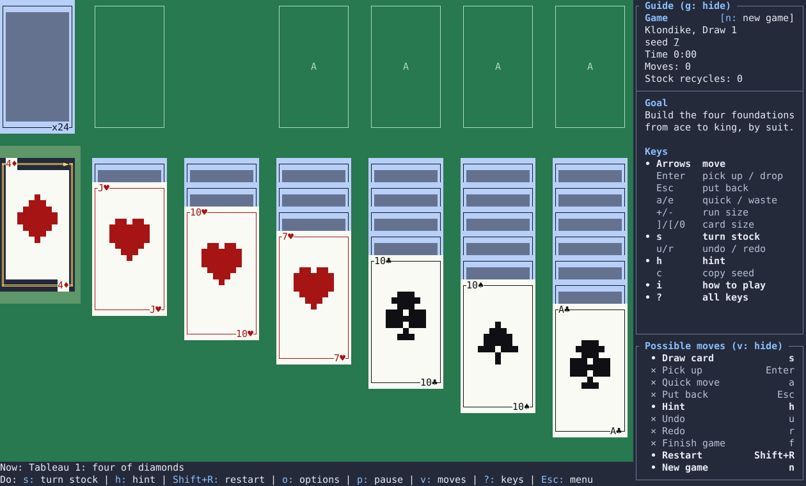
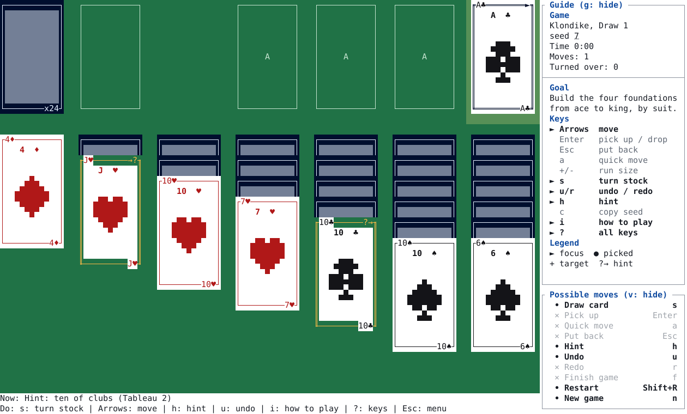

<h1 align="center">oXySol</h1>

<p align="center"><strong>Solitaire for your terminal.</strong><br>
Klondike, Spider, FreeCell and Pyramid in one small program.</p>

<p align="center">
  <a href="https://github.com/beoArcha/oXyFlow.Solitare/actions/workflows/main.yml"></a>
  <a href="LICENSE"></a>
  <a href="https://github.com/beoArcha/oXyFlow.Solitare/releases"></a>
  <a href="https://beoarcha.github.io/oXyFlow.Solitare/"></a>
</p>

<p align="center">
  
</p>

## What it is

oXySol is a terminal solitaire with four games, **Klondike, Spider, FreeCell and Pyramid**, shipped as the single
binary `oxysol`. It is a pre-release: it plays, and it is still in development.

- **Keyboard and mouse.** Every action works with both.
- **Help while you play.** A guide panel, a possible moves panel, hints, undo and redo, and auto-finish when the game
  is certainly won.
- **Seeds and winnable deals.** Every deal has a seed you can copy and replay, a game can start from any seed,
  and a new game can search for a deal that is proven winnable.
- **Statistics and history** of every game you play.
- **Five themes:** Dark, Light, High contrast (for low vision), Monokai and Dracula. Color is never the only signal.
  Color-vision modes are planned, not built yet.
- **Polish and English.** Switch the language in Settings.

## Screenshots

Every image is generated from the real game by `cargo xtask screenshots`.

<table>
  <tr>
    <td></td>
    <td></td>
  </tr>
  <tr>
    <td></td>
    <td></td>
  </tr>
  <tr>
    <td></td>
    <td></td>
  </tr>
</table>

More screens, the animations and all five themes are on the [website](https://beoarcha.github.io/oXyFlow.Solitare/gallery.html).

## Install

You need a terminal. Pick one way.

### Download a build

Get the newest build from the [releases page](https://github.com/beoArcha/oXyFlow.Solitare/releases). Every build so
far is a pre-release, so look at the top of the list and not at "latest". Archives exist for Windows (x86-64), Linux
(x86-64 and ARM64) and macOS (Apple silicon). Unpack one and run `oxysol` (`oxysol.exe` on Windows). The Linux builds
have no sound. `SHA256SUMS` on the release lets you check a download.

### Build from source

You build the `release` branch, the last commit that passed the full check on Linux, Windows and macOS.

**Rust is required.** Install it with [rustup](https://rustup.rs). The toolchain version is pinned in
[`rust-toolchain.toml`](rust-toolchain.toml); rustup picks it up by itself on the first build. The build also compiles
a little C code (SQLite), so you need a C toolchain: on Windows the Visual Studio Build Tools with the "Desktop
development with C++" workload, on macOS the Xcode command line tools (`xcode-select --install`), on Linux `gcc` and,
for sound, the ALSA headers (`sudo apt install build-essential libasound2-dev`; without them add
`--no-default-features` to the build command).

**Windows (PowerShell).** Verified on Windows 10 on 2026-11-19.

```powershell
curl.exe -L -o oxysol-source.zip https://github.com/beoArcha/oXyFlow.Solitare/archive/refs/heads/release.zip
Expand-Archive oxysol-source.zip -DestinationPath oxysol-source
cd oxysol-source\oXyFlow.Solitare-release
cargo build --release
.\target\release\oxysol.exe
```

**Linux and macOS.** Not verified yet: written, not run.

```sh
curl -L -o oxysol-source.tar.gz https://github.com/beoArcha/oXyFlow.Solitare/archive/refs/heads/release.tar.gz
tar -xzf oxysol-source.tar.gz
cd oXyFlow.Solitare-release
cargo build --release
./target/release/oxysol
```

The program ends up in `target/release/` (`oxysol.exe` on Windows). Run it from there or copy it to a folder on your
`PATH`. The first build takes a few minutes.

**With `cargo install`.** One step instead of the download. Verified on Windows 10; not verified on Linux and macOS.

```sh
cargo install --git https://github.com/beoArcha/oXyFlow.Solitare --branch release --locked oxysol
```

This puts `oxysol` in `~/.cargo/bin` (`%USERPROFILE%\.cargo\bin` on Windows), which rustup adds to your `PATH`.

## Usage

Start the game in a terminal that is at least 100 columns by 30 rows (it says so when it is too small):

```sh
oxysol
```

The panels beside the board need 130 columns; on narrower terminals `g` and `v` open them in a window.
The full key list is in the game: press `?`.

| Key | What it does |
|---|---|
| Arrows (or `k` and `j` for up and down) | Move the cursor |
| `Enter` or `Space` | Pick up a card, then drop it on a target |
| `Esc` | Put the card back, or go back |
| `s` | Turn or deal from the stock |
| `a` | Quick move to a foundation |
| `+` and `-` | Pick more or fewer cards of a run |
| `h` | Hint |
| `u` and `r` | Undo and redo |
| `g` | Guide panel |
| `v` | Possible moves panel |
| `i` | How to play |
| `?` | Help: every key |
| `q` | Quit |

Command-line options (`oxysol --help` lists them):

| Option | What it does |
|---|---|
| `--seed <number>` | Choose a game for this seed at once |
| `--ascii` | Draw cards with ASCII characters only |
| `--colors <16\|256\|truecolor>` | Set the color depth of the terminal |
| `-n`, `--new-window` | Open the game in a new console window and return to the prompt |
| `--version`, `--help` | Print the version, or the help, and exit |

**Where the files are.** Settings, the saved game and the history are in one SQLite file, `oxysol.db`, next to the log
`oxysol.log`. The folder is:

- Windows: `%APPDATA%\oXyFlow\oXySol\data`
- Linux: `~/.local/share/oxysol` (or under `$XDG_DATA_HOME`). Not verified.
- macOS: `~/Library/Application Support/oXyFlow.oXySol`. Not verified.

The environment variable `OXYSOL_HOME` points the game at another folder, and `OXYSOL_LOG` sets the log level
(`error`, `warn`, `info`, `debug` or `trace`).

**Portable copy.** Unpack a `-portable` archive anywhere: the game keeps its files in a `data` folder next to the
program and writes nothing to system folders. Delete the `oxysol.portable` file next to the program to use the system
folder again.

## Accessibility

Accessibility is a requirement here, not polish.

- Every action works by keyboard and by mouse.
- The focus is visible without color: a `►` marks the focused item (`>` in ASCII mode), and the line under the
  board says in words where the cursor is and what it can do.
- Color is never the only signal: suits are drawn as signs (♠ ♥ ♦ ♣) next to the rank, and picked cards and drop
  targets have their own marks.
- The **High contrast** theme is for low vision: white text on black and a frame around the playing field. Text contrast
  is tested against a ratio of 4.5:1 in every theme and 7:1 in High contrast.
- `--ascii` and `--colors 16` serve limited terminals.
- Color-vision modes for color-blind players are planned. They are not in the game yet.

## Development

The project is a Rust workspace:

| Part | What it is |
|---|---|
| `crates/core` | `oxysol-core`: the engine and the four games. No terminal, no files, no clock |
| `crates/tui` | `oxysol-tui`: rendering, input, themes and localization. Changes the game only through the engine's session |
| `src/` | `oxysol`: the binary that wires it together: storage, audio, logging, arguments |
| `xtask/` | `cargo xtask`: quality gates, lint, release tooling and the screenshot generator |

The toolchain is pinned in `rust-toolchain.toml`. From the repository root:

```sh
cargo run                    # play from source
cargo xtask check --quick    # fmt, Clippy, lint and the fast tests: run before a pull request
cargo xtask check            # everything, as CI does on main
cargo xtask screenshots      # regenerate the SVG screenshots and animations of the website
```

Read [`AGENTS.md`](AGENTS.md) for the rules of the code, then [`docs/tech/`](docs/tech): the
[architecture](docs/tech/architecture.md), the [workflow](docs/tech/workflow.md) (branches, checks, releases) and the
[decisions](docs/tech/decisions.md). The rules of the four games are in [`docs/wiki/rules/`](docs/wiki/rules).
The website is built from [`docs/site`](docs/site) with mdBook.

## Links

- Website: <https://beoarcha.github.io/oXyFlow.Solitare/>
- Po polsku: pasjans w terminalu z czterema grami. Polska wersja strony:
  <https://beoarcha.github.io/oXyFlow.Solitare/pl/index.html>

## License

MIT. See [LICENSE](LICENSE). Copyright (c) 2026 Marcin "beoArcha" Stefan, under the oXyFlow brand.
