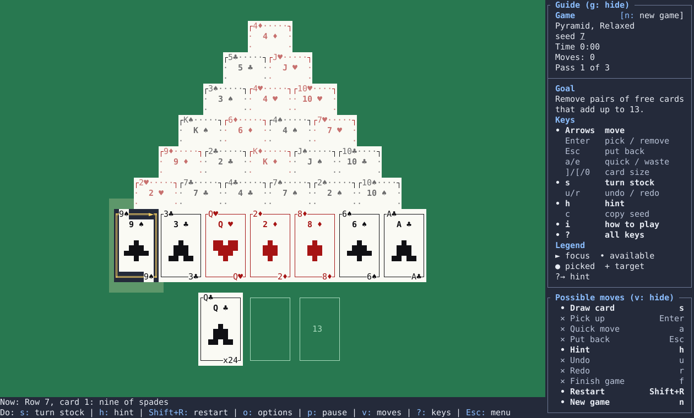
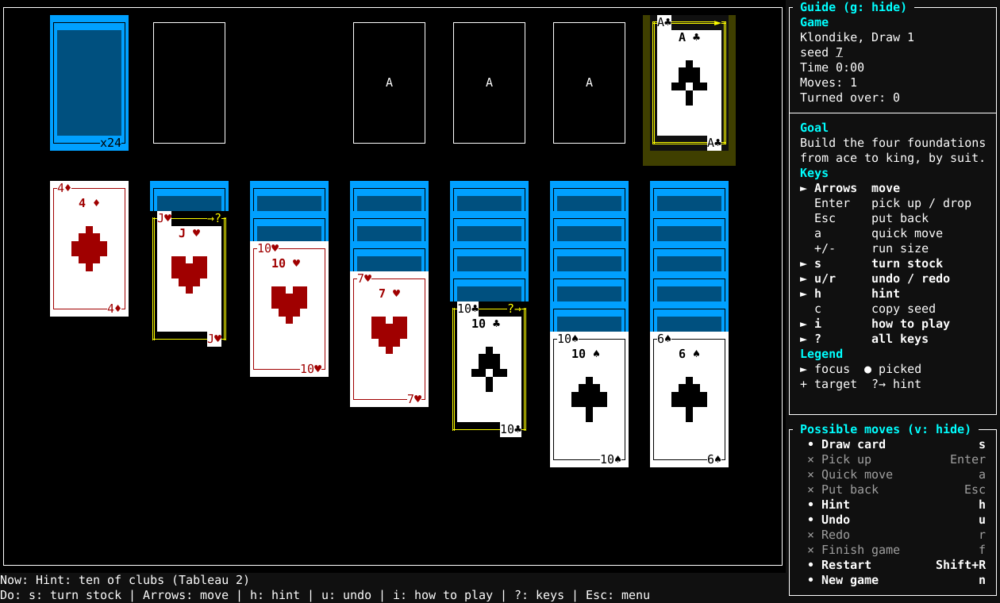

<h1 align="center">oXySol</h1>

<p align="center"><strong>Fourteen solitaire games in your terminal, playable by keyboard or mouse.</strong><br>
Klondike, Spider, FreeCell, Pyramid, the Yukon family and Golf, in one small program.</p>

<p align="center">
  <a href="https://github.com/beoArcha/oXyFlow.Solitaire/actions/workflows/main.yml"></a>
  <a href="LICENSE"></a>
  <a href="https://github.com/beoArcha/oXyFlow.Solitaire/releases"></a>
  <a href="https://www.rust-lang.org/"></a>
  <a href="https://ratatui.rs/"></a>
  <a href="https://beoarcha.github.io/oXyFlow.Solitaire/"></a>
</p>

<p align="center">
  
</p>

oXySol is a solitaire collection for the terminal, shipped as a single program, `oxysol`, for Windows, Linux and
macOS. It is a pre-release (0.5): every game plays from start to finish, and new games, card styles and polish are
still arriving.

## Highlights

- **Fourteen games in six families.** Klondike (draw 1 and draw 3), Spider (1, 2 and 4 suits), FreeCell, Pyramid
  (Relaxed and Classic), the Yukon family (Yukon, Russian Solitaire, Alaska, Moosehide and Australian Patience) and
  Golf. The game menu groups them by family, stars the popular ones, keeps your favourites and finds a game as you
  type its name.
- **Deals you can trust.** Every deal has a seed you can copy and replay. A new game can wait for a deal that a solver
  has proven winnable, and "New game from seed" offers three curated deals for each of five difficulty levels in every
  game.
- **Help when you want it.** Hints that never peek at face-down cards, a guide panel, a list of possible moves,
  undo and redo, quick moves (`a` for the card under the cursor, `e` for the waste card) and auto-finish once the
  win is certain.
- **Built for every pair of eyes.** A low-vision mode with 7:1 contrast and larger, bolder cards; five themes,
  including High contrast; colour-vision modes for protanopia, deuteranopia, tritanopia and monochrome; a four-colour
  deck; and focus that is always marked by a symbol, never by colour alone.
- **Cards your way.** Six front styles (International, French, German, Italian, Spanish and Swiss), two back styles,
  table colours and textures, card face tints and four card sizes that follow the window.
- **Statistics and history.** Wins, streaks, personal bests and every game you played, in your local time, with a mark
  for each deal that was checked as winnable.
- **Nine languages.** English, Polski, Deutsch, Español, Français, Italiano, Nederlands, Português (Brasil) and
  Українська. On first start the game follows your system language.

## Screenshots

<table>
  <tr>
    <td></td>
    <td></td>
  </tr>
  <tr>
    <td></td>
    <td></td>
  </tr>
  <tr>
    <td></td>
    <td></td>
  </tr>
</table>

Every image is rendered from the real game by `cargo xtask-art screenshots`. More screens, animations and all five
themes are in the [gallery](https://beoarcha.github.io/oXyFlow.Solitaire/gallery.html).

## Install

### Download a build

Take the newest build from the [releases page](https://github.com/beoArcha/oXyFlow.Solitaire/releases). Every build so
far is a pre-release, so look at the top of the list rather than at "latest". Archives exist for Windows (x86-64),
Linux (x86-64 and ARM64) and macOS (Apple silicon), each also as a `-portable` variant. Unpack one and run `oxysol`
(`oxysol.exe` on Windows).

- The Linux builds have no sound.
- `SHA256SUMS` on the release checks a download, and every archive carries a build provenance attestation
  (`gh attestation verify <archive> -R beoArcha/oXyFlow.Solitaire`).
- Windows may warn about an unknown publisher the first time you run a downloaded `oxysol.exe`; the builds are not
  code-signed yet.

### Build from source

The install scripts check every dependency first, tell you what is missing and, if you agree, install it and build
the `release` branch into `~/.cargo/bin` (`%USERPROFILE%\.cargo\bin` on Windows):

```sh
# Linux and macOS
curl -fsSL https://raw.githubusercontent.com/beoArcha/oXyFlow.Solitaire/main/build/install.sh | sh -s -- --list
```

```powershell
# Windows (PowerShell)
& ([scriptblock]::Create((irm https://raw.githubusercontent.com/beoArcha/oXyFlow.Solitaire/main/build/install.ps1))) --list
```

`--list` only reports; run the script from a file with `--install` to install and build, or with `--no-audio` to build
without sound. The modes are described in [`build/README.md`](build/README.md).

If you already have the tools (Rust through [rustup](https://rustup.rs) and a C toolchain; on Linux also `pkg-config`
and the ALSA headers for sound), one command is enough:

```sh
cargo install --git https://github.com/beoArcha/oXyFlow.Solitaire --branch release --locked oxysol
```

The [install page](https://beoarcha.github.io/oXyFlow.Solitaire/install.html) has the manual steps for every system.

## Play

Run `oxysol` in a terminal of at least 100 × 30 characters; at 130 columns or more the guide and the possible moves
sit beside the board. Press `?` in the game for every key. The ones you will use most:

| Key | Action |
|---|---|
| Arrows | Move the cursor |
| `Enter` or `Space` | Pick up cards, then drop them |
| `Esc` | Put the cards back |
| `s` | Turn or deal from the stock |
| `a` / `e` | Quick move the card under the cursor / the waste card |
| `u` / `r` | Undo / redo |
| `h` | Hint |
| `g` / `v` / `o` | Guide / possible moves / quick options |
| `]` / `[` / `0` | Bigger / smaller / automatic card size |
| `n` / `p` / `m` | New game / pause / main menu |
| `c` | Copy the seed of this deal |
| `i` / `?` | How to play / help |
| `q` | Quit |

Everything also works by mouse: click to pick up and drop, double-click for a quick move, drag, and right-click to put
cards back.

### Command line

| Option | What it does |
|---|---|
| `--seed <number>` | Choose a game for this seed at once |
| `-n`, `--new-window` | Open the game in its own console window and return to the prompt |
| `-fs`, `--fullscreen` / `--no-fullscreen` | Start in full screen or in a window, whatever the setting says |
| `--ascii` | Draw cards with ASCII characters only |
| `--colors <16\|256\|truecolor>` | Set the colour depth of the terminal |
| `--priority <level>` | Process priority for this run: `highest`, `high`, `normal`, `low` or `lowest` |
| `-h`, `--help` / `--version` | Print the help or the version, and exit |

On Windows, a game started by a double-click (or with `-n`) owns its console window: it opens full screen by default,
and in a window you can choose its size in Settings (130 × 40, 195 × 60 or 260 × 80).

### Your files

Settings, the saved game and the history live in one file, `oxysol.db`, next to the log, `oxysol.log`, in
`%APPDATA%\oXyFlow\oXySol\data` on Windows and in your system's application data folder on Linux and macOS.
`OXYSOL_HOME` points the game at another folder. A `-portable` build keeps everything in a `data` folder next to the
program and writes nothing anywhere else.

## Accessibility

Accessibility is a requirement in oXySol, not a finishing touch.

- Every action works by keyboard and by mouse.
- Focus is marked by a symbol (`►`, or `>` in ASCII), and the line under the board says in words where the cursor is
  and what you can do there.
- Colour never carries meaning alone: suits are signs (♠ ♥ ♦ ♣) beside the rank, picked cards and targets have their
  own marks, and events are announced with ✓ or ✗.
- **Low vision**, offered on first start and in Settings, sets 7:1 contrast in any theme, the largest cards that fit,
  a thick aura, bold rank and suit and, in the classic Windows console, a larger font. Turning it off restores your
  previous settings.
- **Colour vision** remaps colours for protanopia, deuteranopia, tritanopia or monochrome, and the four-colour deck
  gives every suit its own colour.
- `--ascii` and `--colors 16` serve limited terminals.

## Development

oXySol is a Rust workspace:

| Part | What it is |
|---|---|
| `crates/core` | `oxysol-core`: the engine, the games and the solver. No terminal, no files, no clock |
| `crates/tui` | `oxysol-tui`: rendering, input, themes and localization |
| `src/` | `oxysol`: the program that wires it together: storage, audio, logging, arguments |
| `xtask/` | `cargo xtask`: quality gates, release tooling, the screenshot and curated-seed generators |

```sh
cargo run                      # play from source
cargo xtask check --quick      # format, Clippy, lint and the fast tests: run before a pull request
cargo xtask check              # everything, as CI does on main
cargo xtask-art screenshots    # regenerate the screenshots and animations of the website
```

Start with [`AGENTS.md`](AGENTS.md) for the rules of the code, then [`docs/tech/`](docs/tech): the
[architecture](docs/tech/architecture.md), the [workflow](docs/tech/workflow.md) and the
[decisions](docs/tech/decisions.md). The rules of every game are in [`docs/wiki/rules/`](docs/wiki/rules), and the
website is built from [`docs/site`](docs/site) with mdBook.

## Links

- Website, in nine languages: <https://beoarcha.github.io/oXyFlow.Solitaire/>
- Releases: <https://github.com/beoArcha/oXyFlow.Solitaire/releases>
- Issues and ideas: <https://github.com/beoArcha/oXyFlow.Solitaire/issues>
- Po polsku: [polska wersja strony](https://beoarcha.github.io/oXyFlow.Solitaire/pl/index.html)

## License

MIT, see [LICENSE](LICENSE). Copyright (c) 2026 Marcin "beoArcha" Stefan, under the oXyFlow brand.
