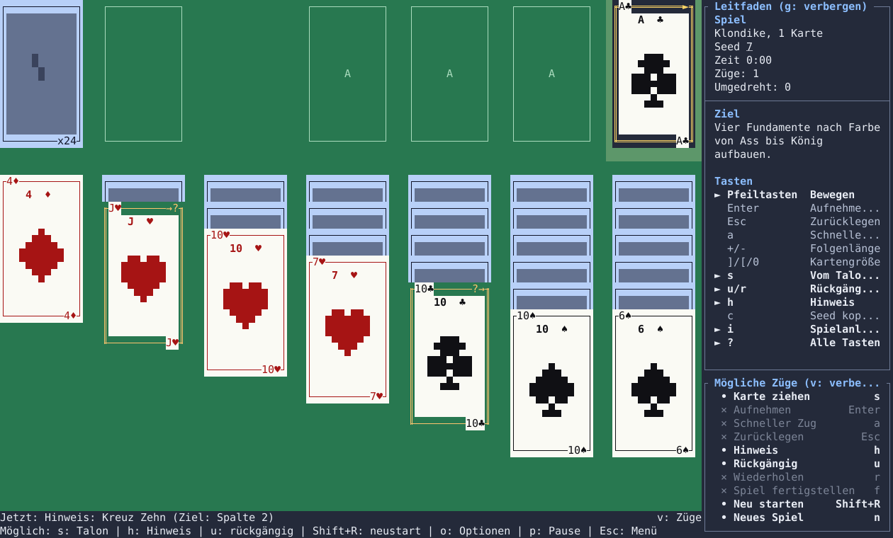
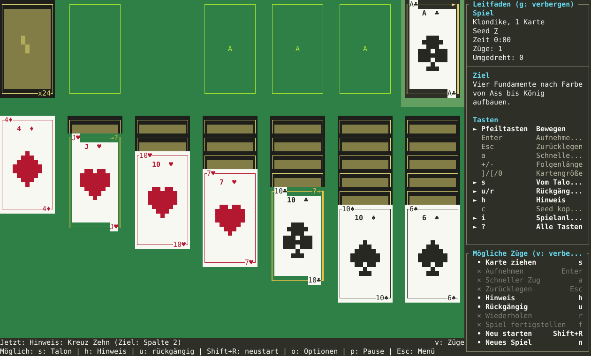
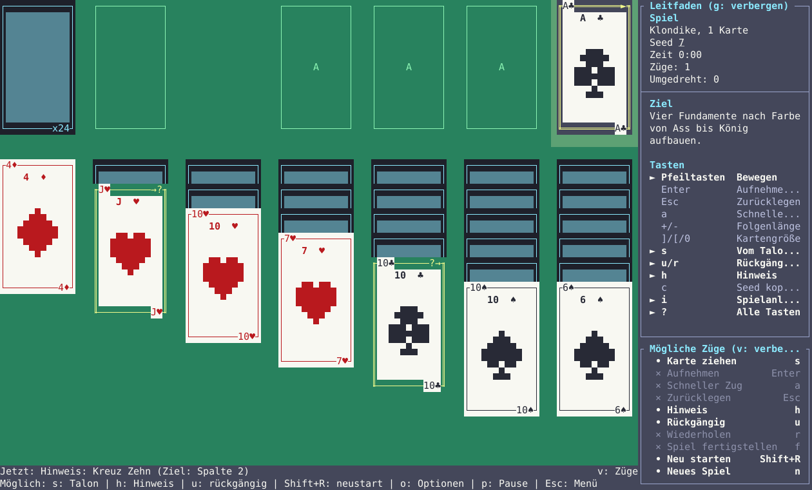

[English](../features.md) · [Polski](../pl/features.md) · **Deutsch** · [Español](../es/features.md) · [Français](../fr/features.md) · [Italiano](../it/features.md) · [Nederlands](../nl/features.md) · [Português (Brasil)](../pt-br/features.md) · [Українська](../uk/features.md)

# Funktionen

## Vier Spiele

- **Klondike**: eine oder drei Karten ziehen.
- **Spider**: mit 1, 2 oder 4 Farben.
- **FreeCell**.
- **Pyramide**: locker oder klassisch.

Ein Programm, ein Menü, eine Tastenbelegung.

## Tastatur und Maus

Alles funktioniert mit der Tastatur und mit der Maus. Klicke eine Karte an, um sie aufzunehmen, und klicke ein Ziel
an, um sie abzulegen. Ein Doppelklick schickt eine Karte auf einen Ablagestapel, eine Karte lässt sich auf ihr Ziel
ziehen, und ein Rechtsklick legt sie zurück. Die vollständige Tastenliste steht im Hilfefenster (`?`).

## Kartengröße

Mit `]` werden die Karten größer, mit `[` kleiner; `0` kehrt zur automatischen Größe zurück, die sich dem Fenster
anpasst. Strg+Mausrad und die Einstellung Kartengröße  tun dasselbe. Eine Größe, die nicht ins Fenster
passt, wird von selbst verkleinert. In der klassischen Windows-Konsole ändern Strg+Plus, Strg+Minus und Strg+0 die
Schriftgröße der Konsole.

## Hilfe beim Spielen

- **Hilfe-Panel** (`g`): das Ziel des Spiels, die Tasten und was die ausgewählte Karte tun kann. Es steht neben dem
  Spielfeld, wenn das Terminal mindestens 130 Spalten breit ist, und öffnet sich bei schmaleren in einem Fenster.
- **Panel der möglichen Züge** (`v`): jeder Zug, der jetzt möglich ist, jeweils mit seiner Taste.
- **Tipps** (`h`): das Spiel markiert einen Zug auf dem Spielfeld und benennt ihn.
- **Automatisches Beenden**: Steht der Sieg sicher fest, werden die restlichen Züge für dich gespielt. Das lässt sich
  in den Einstellungen  abschalten.
- **Rückgängig und Wiederholen** (`u`, `r`), auf Wunsch auch ein Spiel ganz ohne Rückgängig.

## Seeds, lösbare Spiele, Statistiken

Jedes Spiel hat einen **Seed** (Startwert). Kopiere ihn (`c`), um ein Spiel zu wiederholen oder weiterzugeben, oder
starte mit „Neues Spiel aus Seed“  ein Spiel aus einem beliebigen Seed. Eine Option lässt ein
neues Spiel nach einer Verteilung suchen, die nachweislich lösbar ist. Der Bildschirm **Statistiken** zeigt die
Ergebnisse je Spiel und einen Verlauf aller Spiele, das neueste zuerst, und lässt dich einen Seed erneut spielen.

## Farbschemata für Komfort und Barrierefreiheit

Fünf Farbschemata, wählbar in den Einstellungen. Jedes ist hier mit derselben Spielsituation zu sehen.

**Dark** (dunkel) und **Light** (hell) für jeden Tag.

**High contrast** (hoher Kontrast) ist für Menschen mit Sehschwäche gemacht: weißer Text auf reinem Schwarz mit
leuchtend gelben und türkisfarbenen Akzenten, ein Rahmen um das Spielfeld und ein Textkontrast von mindestens 7:1 (die
anderen Farbschemata halten mindestens 4,5:1 ein; Tests prüfen beides).

Außerdem gibt es **Monokai** und **Dracula**.

**Farbe ist nie der einzige Träger einer Information.** Die Farben der Karten stehen als Zeichen (♠ ♥ ♦ ♣) neben dem
Wert, das ausgewählte Element ist mit einem Symbol markiert, aufgenommene Karten und Ablageziele haben eigene
Markierungen, und eine Zeile unter dem Spielfeld sagt in Worten, wo der Cursor steht und was er tun kann. So bleibt das
Spiel auch bei Farbenblindheit gut spielbar. Eigene Modi für Farbsehschwächen sind geplant, aber noch nicht im Spiel.

## Sprachen

Die Oberfläche des Spiels gibt es in neun Sprachen: Englisch, Polnisch, Deutsch, Spanisch, Französisch, Italienisch, Niederländisch, brasilianisches Portugiesisch und Ukrainisch. Die Sprache wählst du mit dem
Flaggen-Umschalter in der linken oberen Ecke des Hauptmenüs oder in den Einstellungen; sie gilt sofort.

Diese Website gibt es in neun Sprachen: Die Links oben auf jeder Seite wechseln zwischen ihnen.

## Was es noch nicht ist

oXySol ist eine Vorabversion. Rechne mit Ecken und Kanten und melde sie uns im
[Issue-Tracker](https://github.com/beoArcha/oXyFlow.Solitare/issues).
