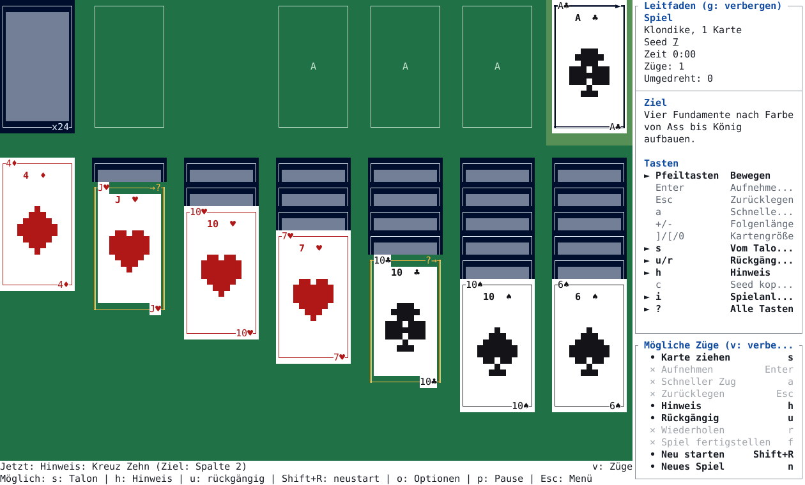
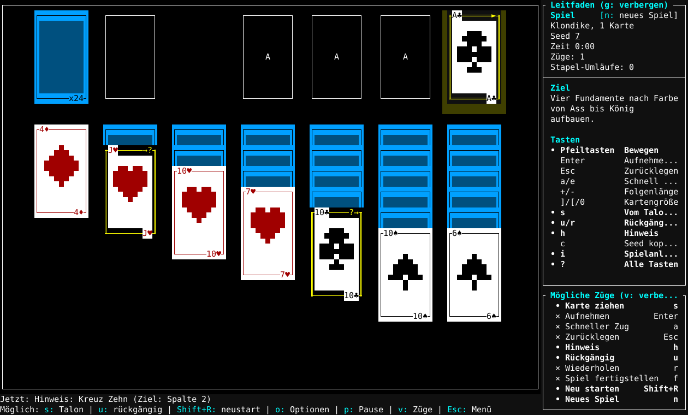

[English](../features.md) · [Polski](../pl/features.md) · **Deutsch** · [Español](../es/features.md) · [Français](../fr/features.md) · [Italiano](../it/features.md) · [Nederlands](../nl/features.md) · [Português (Brasil)](../pt-br/features.md) · [Українська](../uk/features.md)

# Funktionen

## Spiele

Vierzehn Spiele in sechs Familien, ein Programm, ein Satz Tasten:

- **Klondike**: 1 oder 3 Karten ziehen.
- **Spider**: 1, 2 oder 4 Farben.
- **FreeCell**.
- **Pyramide**: Entspannt oder Klassisch.
- **Yukon-Familie**: Yukon, Russisches Solitaire, Alaska, Moosehide und Australisch.
- **Golf**: Sieben Spalten nacheinander auf den Ablagestapel abräumen, jeweils einen Rang höher oder tiefer.

Das Spielmenü ordnet die Spiele unter Familienüberschriften, markiert die beliebten mit einem Stern, hält deine Favoriten in einer eigenen Liste und findet ein Spiel, sobald du seinen Namen eintippst. Die Regeln jedes Spiels stehen im Hilfefenster (`i`, „Spielanleitung“).

## Austeilungen: Seeds, lösbare Austeilungen und Schwierigkeit

Jede Austeilung hat einen **Seed**. Kopiere ihn mit `c`, um die Austeilung noch einmal zu spielen oder zu teilen.

- **Nur lösbare Austeilungen.** Ein neues Spiel kann auf eine Austeilung warten, die der eingebaute Löser als lösbar nachgewiesen hat. Der Löser kennt jede Karte, „lösbar“ heißt also: Die Austeilung lässt sich gewinnen, nicht: sie ist leicht.
- **Neues Spiel aus Seed.** Wähle zuerst das Spiel, dann die Herkunft des Seeds: einen Seed eintippen, eine der Austeilungen wählen, die du schon gespielt hast (die neueste zuerst, mit Ergebnis und Zeit), das Spiel eine davon zufällig wählen lassen oder eine der **ausgewählten Austeilungen** nehmen.
- **Fünf Schwierigkeitsstufen.** Jedes Spiel bietet für jede Stufe drei ausgewählte Austeilungen an, von sehr einfach bis sehr schwer. Alle sind nachweislich lösbar. Die Stufen beruhen auf Messungen: wie viel Arbeit der Löser brauchte, wie lang die Gewinnlinie ist und ob allein das Befolgen der Hinweise die Austeilung gewinnt.

## Hilfe während des Spiels

- **Leitfaden-Leiste** (`g`): die Spielangaben, das Ziel des Spiels, die Tasten (mit Markierung der jetzt nutzbaren) und die Mausaktionen. Ab 130 Spalten steht sie neben dem Spielfeld, mit einem Knopf **Neues Spiel** oben; auf schmaleren Terminals öffnet sie sich in einem Fenster.
- **Züge-Leiste** (`v`): jeder Zug, den du jetzt machen kannst, mit seiner Taste, und der Grund, wenn ein Zug nicht möglich ist.
- **Hinweise** (`h`): Das Spiel markiert einen Zug auf dem Spielfeld und benennt ihn. Hinweise verwenden nur, was du sehen kannst: Sie schauen nie in verdeckte Karten oder in den Talon.
- **Schnelle Züge**: `a` schickt die Karten unter dem Cursor zu ihrem besten Ziel, `e` tut dasselbe für die oberste Karte des Ablagestapels, von überall auf dem Spielfeld, und ein Doppelklick wirkt wie `a`. Schnelle Züge lassen sich in den Einstellungen oder in den Schnelloptionen (`o`) abschalten, wenn du jede Karte selbst ablegen willst.
- **Automatisches Beenden**: Sobald der Gewinn sicher ist, werden die restlichen Züge für dich gespielt. Es lässt sich abschalten.
- **Rückgängig und Wiederholen** (`u`, `r`), mit einer Option, ohne Rückgängig zu spielen.

## Tastatur und Maus

Jede Aktion funktioniert mit der Tastatur und mit der Maus. Klicke eine Karte an, um sie aufzunehmen, und dann ein Ziel, um sie abzulegen, mache einen Doppelklick für einen schnellen Zug, ziehe eine Karte auf ihr Ziel oder klicke mit der rechten Taste, um sie zurückzulegen. Fußzeilen und Knöpfe wie Neues Spiel oder Schließen zeigen ihre Taste, und der aktive Reiter eines Fensters sieht nie wie der fokussierte Knopf aus. Das Hilfefenster (`?`) listet jede Taste auf; es kann auch seitlich am Bildschirm angedockt bleiben (`d`).

## Einstellungen

Die Einstellungen haben drei Reiter:

- **Beliebt** öffnet sich zuerst und sammelt die Einstellungen, die am häufigsten geändert werden: Sprache, Sehhilfemodus, Design, Kartengröße, Kartenrücken, Lautstärke, Leuchten und Automatisches Beenden.
- **Audio & Optik** enthält alles über Aussehen und Klang: Farben, Vollbild und Fenstergröße, Design, Farbsehen, Kartenstile und Kartenfarbe, den Tisch, das Leuchten, die Konsolenschrift, Klang und die Prozesspriorität.
- **Spielablauf** enthält die Sprache und die Hilfen: Leuchten, Zielmarkierungen, die Leitfaden- und die Züge-Leiste, Automatisches Beenden und schnelle Züge.

Eine Vorschau neben der Liste zeigt eine Änderung, bevor du sie behältst.

## Karten und Tisch

- **Sechs Vorderseiten-Stile**: International, Französisch, Deutsch, Italienisch, Spanisch und Schweizer, jeweils mit eigenen Farbzeichen oder Bildkarten-Kürzeln.
- **Zwei Rückenstile** (Gitter und Ornament) und Rückenfarben aus dem Design, Monokai oder Dracula.
- **Kartenfarbe**: die des Designs, Weiß, Elfenbein, Hellgrau oder Dunkel.
- **Tisch**: die Farbe des Designs, Grünfilz, Blau, Rot, Grau, Braun oder Schwarz, und die Oberfläche schlicht, Filz oder liniert.
- **Kartengröße**: Mit `]` werden die Karten größer und mit `[` kleiner; `0` stellt die automatische Größe wieder her, die in das Fenster passt. Lange Spalten rücken enger zusammen, damit ihre letzte Karte immer ganz sichtbar bleibt; die Karten werden nur kleiner, wenn das Zusammenrücken nicht reicht.

## Designs und Barrierefreiheit

Fünf Designs: **Dunkel** und **Hell** für den Alltag, **Hoher Kontrast** für Sehschwächen, **Monokai** und **Dracula**. Jedes wird hier an derselben Position gezeigt.

- **Sehhilfemodus.** Ein Schalter, angeboten beim ersten Start und in den Einstellungen: Textkontrast von mindestens 7:1 in jedem Design, die größten Karten, die passen, ein dicker Leuchtrand, Rang und Farbzeichen in Fett, größere Fokus- und Zielmarkierungen und in der klassischen Windows-Konsole eine größere Schrift. Jeder Teil bleibt einstellbar, und wenn du den Modus ausschaltest, kehren deine früheren Einstellungen zurück.
- **Farbsehen.** Die Modi für Protanopie, Deuteranopie, Tritanopie und Monochrom ändern die Farben, damit Dinge, die du unterscheiden musst, unterscheidbar bleiben. Das **Vierfarbige Deck** gibt jeder Farbe eine eigene Farbe: Pik schwarz, Herz rot, Karo blau und Kreuz grün.
- **Farbe ist nie das einzige Signal.** Farbzeichen (♠ ♥ ♦ ♣) stehen neben dem Rang, die markierte Stelle trägt ein Symbol, aufgenommene Karten und Ziele haben eigene Markierungen, Ergebnisse der Lösbarkeitsprüfung tragen ✓ oder ✗, und eine Zeile unter dem Spielfeld sagt in Worten, wo der Cursor steht und was er tun kann.

## Statistik

Der Statistikbildschirm zeigt die Ergebnisse je Spiel (Siege, Serien, Bestzeit und wenigste Züge) und eine Historie jeder Austeilung, die neueste zuerst und in deiner Ortszeit. Aus der Historie kannst du einen Seed erneut spielen, ihn kopieren oder den Löser prüfen lassen, ob eine Austeilung lösbar war.

## Windows-Konsole

Unter Windows besitzt ein Spiel, das per Doppelklick oder mit `oxysol -n` gestartet wird, sein eigenes Konsolenfenster. Es öffnet sich standardmäßig im Vollbild, und im Fenstermodus kannst du seine Größe in den Einstellungen wählen: 130 × 40, 195 × 60 oder 260 × 80. Ein Spiel, das in einer bereits geöffneten Konsole startet, lässt diese Konsole, wie sie ist. In der klassischen Windows-Konsole ändern Strg+Plus, Strg+Minus und Strg+0 die Schriftgröße; andere Terminals zoomen mit eigenen Tasten.

## Sprachen

Das Spiel gibt es in neun Sprachen: Englisch, Polnisch, Deutsch, Spanisch, Französisch, Italienisch, Niederländisch, brasilianisches Portugiesisch und Ukrainisch. Wähle eine mit der Flaggenauswahl oben links im Hauptmenü oder in den Einstellungen; sie gilt sofort. Diese Website gibt es in denselben neun Sprachen.

## Was noch fehlt

oXySol ist eine Vorabversion. Rechne mit Ecken und Kanten und sag uns davon Bescheid in der
[Fehlerliste](https://github.com/beoArcha/oXyFlow.Solitaire/issues).
