[English](../gallery.md) · [Polski](../pl/gallery.md) · **Deutsch** · [Español](../es/gallery.md) · [Français](../fr/gallery.md) · [Italiano](../it/gallery.md) · [Nederlands](../nl/gallery.md) · [Português (Brasil)](../pt-br/gallery.md) · [Українська](../uk/gallery.md)

# Screenshots und Animationen

Jedes Bild auf dieser Seite wird von `cargo xtask-art screenshots` aus dem echten Spiel erzeugt und zeigt also, was das
Programm zeichnet.

## Spiele

### Klondike

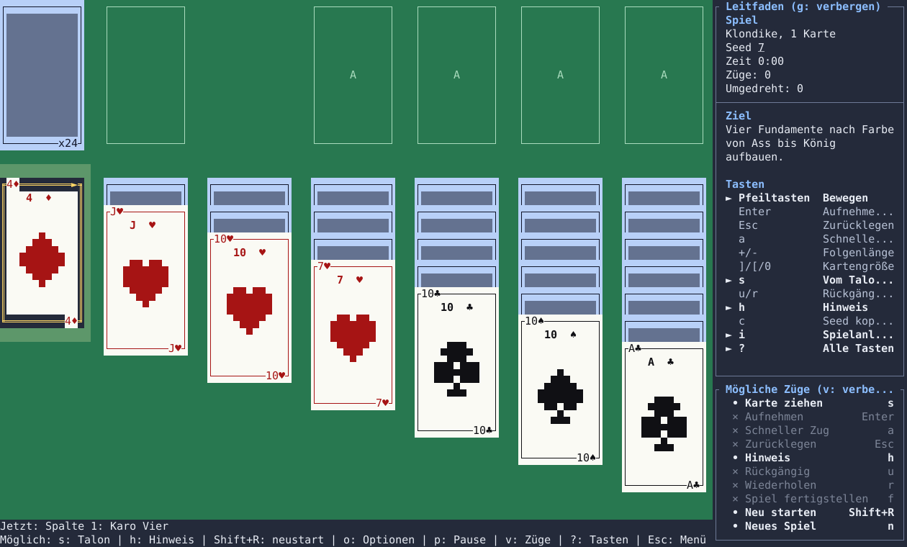

### Spider

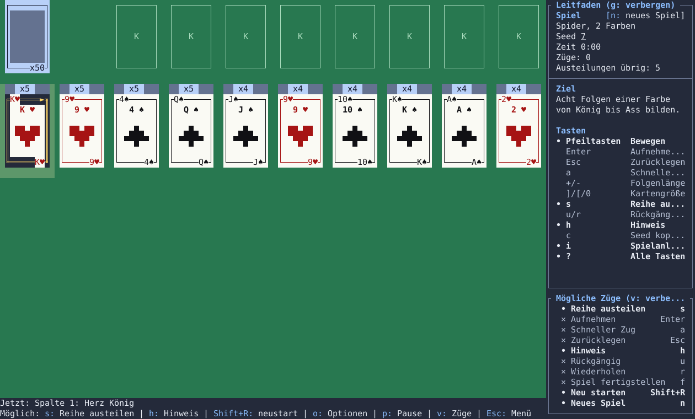

### FreeCell

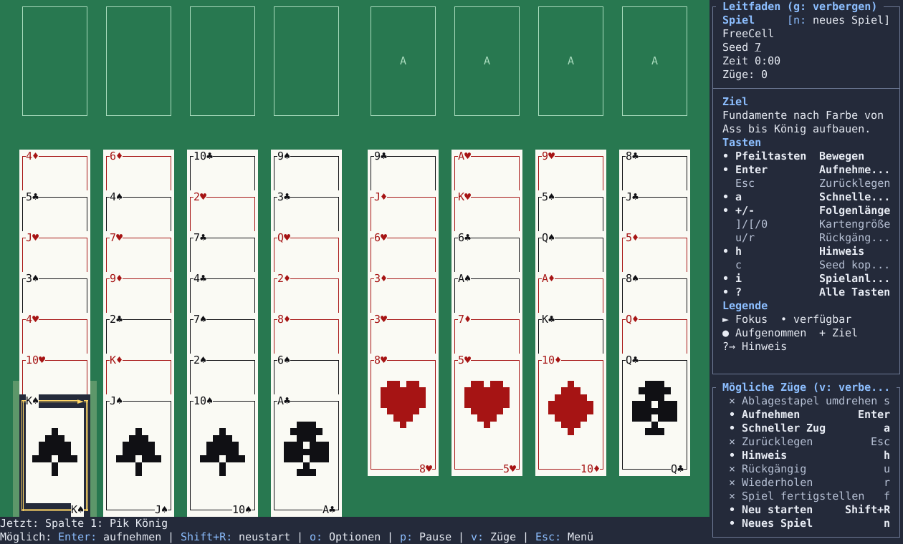

### Pyramide

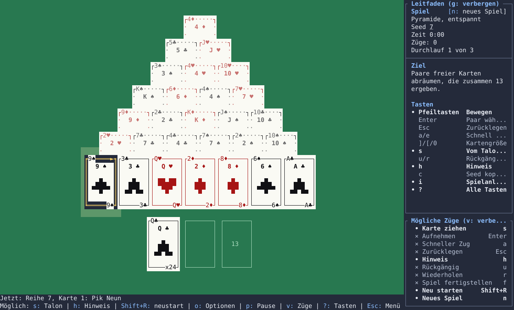

## Bildschirme

### Hauptmenü

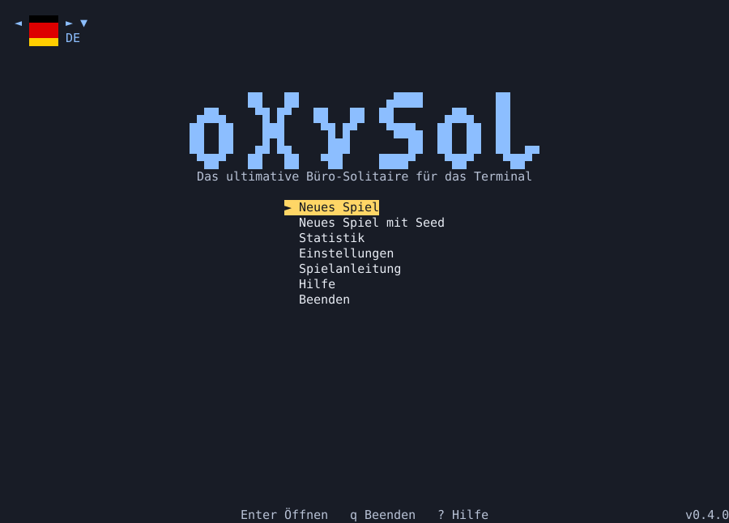

### Einstellungen

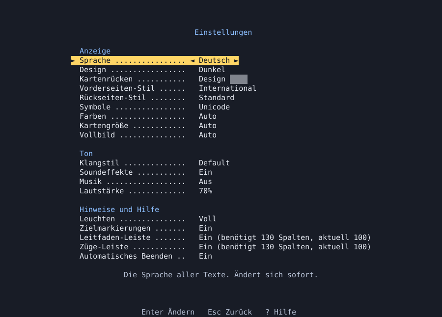

### Hilfe

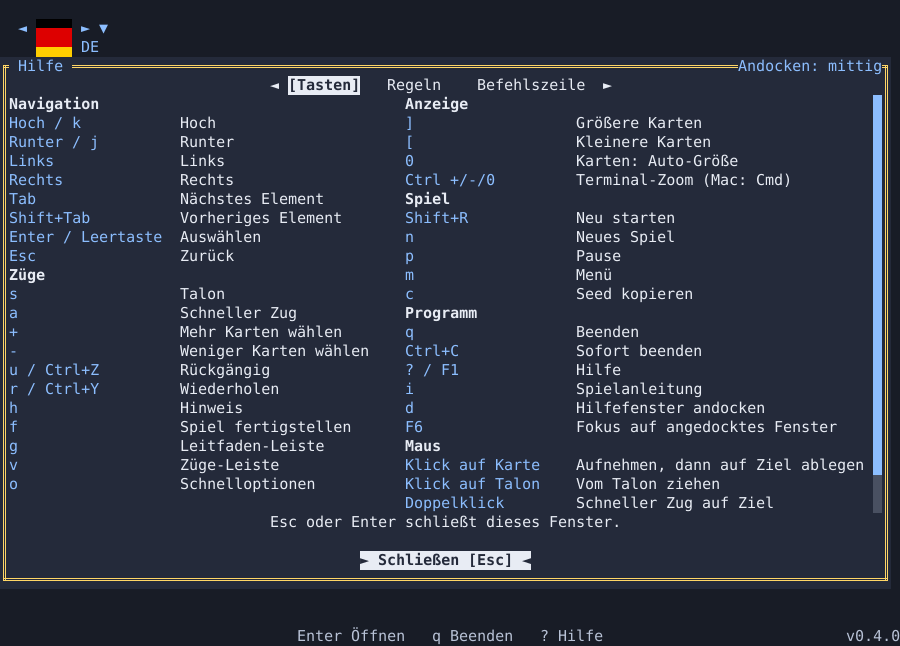

### Tipps und das Hilfe-Panel

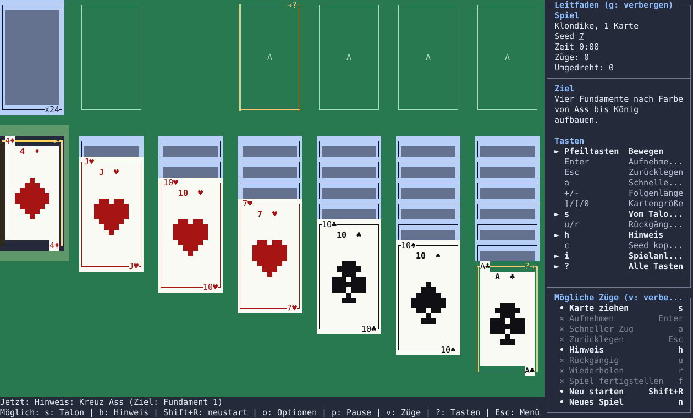

## Animationen

### Ein Zug


### Automatisches Beenden


### Ein Sieg

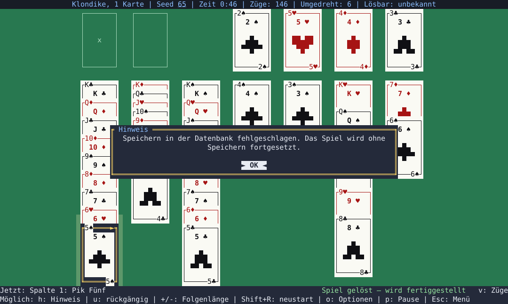

Wenn dein System reduzierte Bewegung wünscht, zeigen die Animationen ihr letztes Bild, statt sich zu bewegen.

## Farbschemata

Die fünf Farbschemata stehen auf der [Seite Funktionen](features.md#farbschemata-für-komfort-und-barrierefreiheit).
