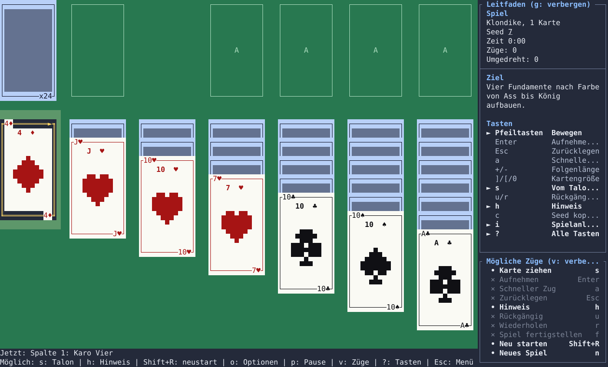

[English](../en/index.md) · [Polski](../pl/index.md) · **Deutsch** · [Español](../es/index.md) · [Français](../fr/index.md) · [Italiano](../it/index.md) · [Nederlands](../nl/index.md) · [Português (Brasil)](../pt-br/index.md) · [Українська](../uk/index.md)

# oXySol

Vierzehn Solitär-Spiele für das Terminal: **Klondike, Spider, FreeCell, Pyramide, die Yukon-Familie und Golf** in einem Programm, `oxysol`.
Es läuft in jedem modernen Terminal und wird mit der Tastatur oder der Maus gespielt.

**Stand:** Vorabversion, in Entwicklung.

## Herunterladen

**Neueste Version:** [{{VERSION}}]({{RELEASE_URL}}). Das ist die neueste Version, Vorabversionen eingeschlossen.
Alle Versionen stehen auf der [Release-Seite](https://github.com/beoArcha/oXyFlow.Solitaire/releases).

- [Eine fertige Version herunterladen oder aus dem Quellcode bauen](install.md), unter Windows, Linux oder macOS.
- [Funktionen](features.md): ausgewählte Spiele nach Schwierigkeit, Hinweise, Sehhilfemodus und Farbsehen, Kartenstile, Statistiken und Sprachen.
- [Screenshots und Animationen](gallery.md) aller Spiele und Bildschirme.

Quellcode und Fehlermeldungen: [beoArcha/oXyFlow.Solitaire](https://github.com/beoArcha/oXyFlow.Solitaire).
Die Regeln der Spiele stehen im
[Wiki](https://github.com/beoArcha/oXyFlow.Solitaire/tree/main/docs/wiki/rules) (auf Englisch).
