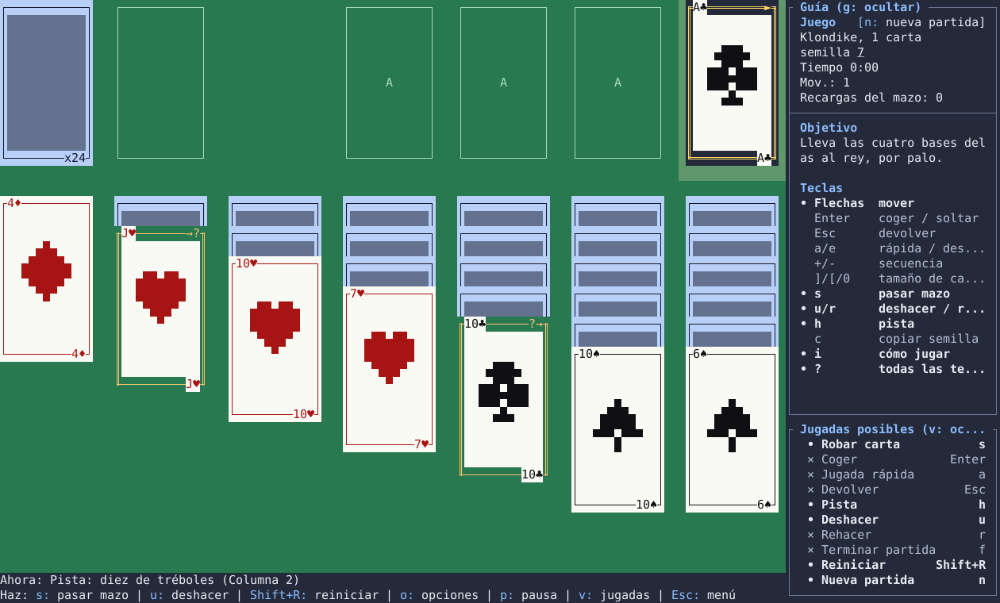
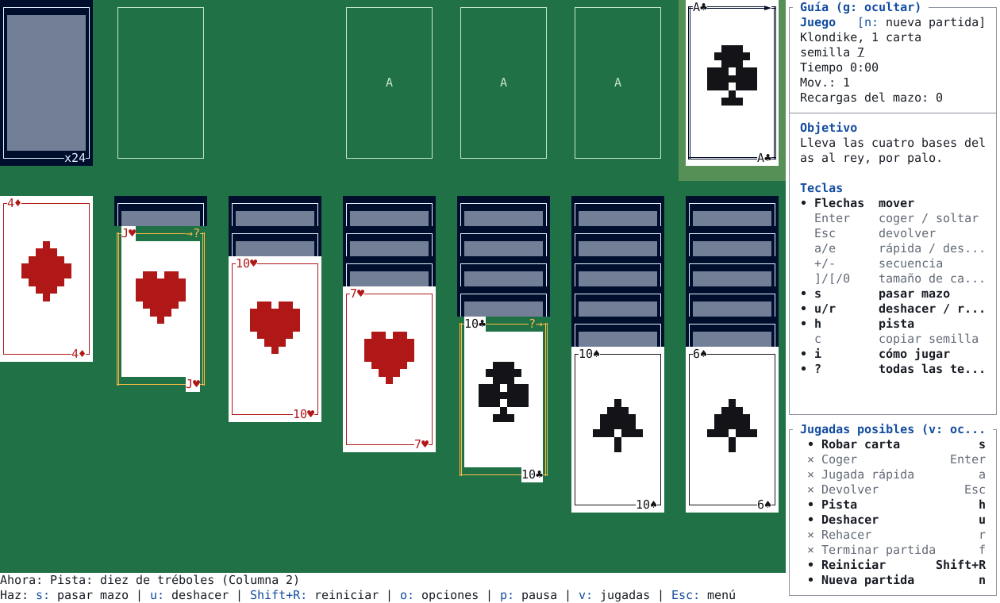
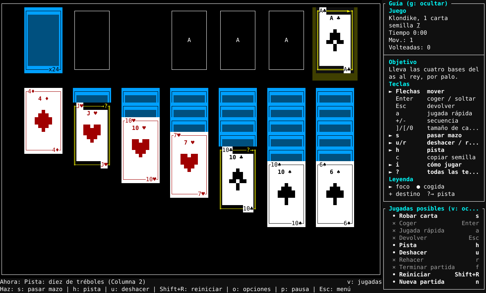
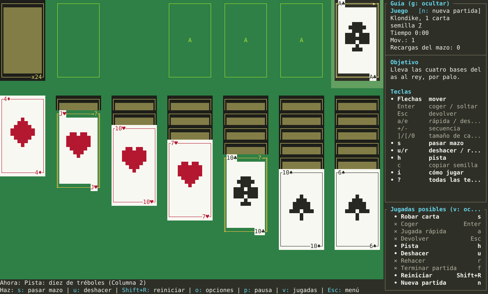
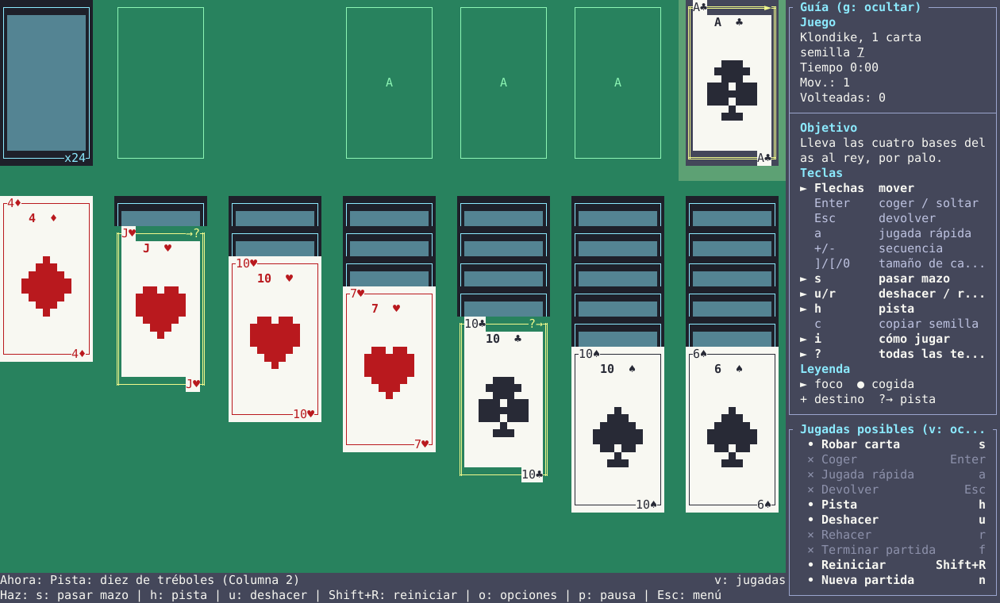

[English](../features.md) · [Polski](../pl/features.md) · [Deutsch](../de/features.md) · **Español** · [Français](../fr/features.md) · [Italiano](../it/features.md) · [Nederlands](../nl/features.md) · [Português (Brasil)](../pt-br/features.md) · [Українська](../uk/features.md)

# Funciones

## Cuatro juegos

- **Klondike**: robando 1 o 3 cartas.
- **Spider**: con 1, 2 o 4 palos.
- **FreeCell**.
- **Pirámide**: relajada o clásica.

Un programa, un menú, las mismas teclas para todo.

## Teclado y ratón

Todas las acciones funcionan con el teclado y con el ratón. Haz clic en una carta para cogerla y haz clic en un
destino para dejarla. Un doble clic envía una carta a una fundación, puedes arrastrar una carta hasta su destino y el
clic derecho la devuelve a su sitio. La lista completa de teclas está en la ventana de ayuda (`?`).

## Tamaño de las cartas

`]` agranda las cartas y `[` las reduce; `0` vuelve al tamaño automático, que se ajusta a la ventana. Ctrl+rueda del
ratón y el ajuste Tamaño de las cartas  hacen lo mismo. Un tamaño que no cabe en la ventana se reduce solo.
En la consola clásica de Windows, Ctrl+Más, Ctrl+Menos y Ctrl+0 cambian el tamaño de la fuente de la consola.

## Ayuda mientras juegas

- **Panel de la guía** (`g`): el objetivo del juego, las teclas y lo que puede hacer la carta seleccionada. Se muestra
  junto al tablero en terminales de al menos 130 columnas y se abre en una ventana en las más estrechas.
- **Panel de jugadas posibles** (`v`): todas las jugadas que puedes hacer ahora, cada una con su tecla.
- **Pistas** (`h`): el juego marca una jugada en el tablero y la describe.
- **Final automático**: cuando la partida está ganada con seguridad, el juego hace solo las jugadas restantes. Se
  puede desactivar en los Ajustes.
- **Deshacer y rehacer** (`u`, `r`), con una opción para jugar sin deshacer.

## Semillas, partidas ganables, estadísticas

Cada partida tiene una **semilla** (seed). Cópiala (`c`) para repetir o compartir una partida, o empieza una partida
desde cualquier semilla con «Nueva partida desde semilla». Una opción hace que una partida nueva
busque un reparto del que está demostrado que se puede ganar. La pantalla de **estadísticas** muestra los resultados de
cada juego y el historial de todas las partidas, de la más reciente a la más antigua, y permite volver a jugar una
semilla.

## Temas para la comodidad y la accesibilidad

Cinco temas, a elegir en los Ajustes. Cada uno se muestra aquí con la misma posición.

**Dark** (oscuro) y **Light** (claro) para el día a día.

**High contrast** (alto contraste) está pensado para personas con baja visión: texto blanco sobre negro puro con toques
de amarillo intenso y cian, un marco alrededor de la zona de juego y un contraste del texto de al menos 7:1 (los demás
temas mantienen al menos 4,5:1; las pruebas comprueban ambos valores).

**Monokai** y **Dracula** también están disponibles.

**El color nunca es el único portador de información.** Los palos se dibujan como signos (♠ ♥ ♦ ♣) junto al valor, el
elemento seleccionado se marca con un símbolo, las cartas cogidas y los destinos tienen sus propias marcas, y una línea
bajo el tablero dice con palabras dónde está el cursor y qué puede hacer. El juego sigue siendo jugable para personas
daltónicas. Hay modos específicos para el daltonismo previstos, pero todavía no están en el juego.

## Idiomas

La interfaz del juego está disponible en nueve idiomas: inglés, polaco, alemán, español, francés, italiano, neerlandés, portugués de Brasil y ucraniano. Elige el idioma con el selector de
banderas de la esquina superior izquierda del menú principal, o en los Ajustes; el cambio se aplica al momento.

Este sitio está disponible en nueve idiomas: los enlaces de la parte superior de cada página permiten pasar de uno a
otro.

## Lo que todavía no es

oXySol es una versión preliminar. Cuenta con algunas asperezas y avísanos en el
[gestor de incidencias](https://github.com/beoArcha/oXyFlow.Solitare/issues).
