[English](../gallery.md) · [Polski](../pl/gallery.md) · [Deutsch](../de/gallery.md) · **Español** · [Français](../fr/gallery.md) · [Italiano](../it/gallery.md) · [Nederlands](../nl/gallery.md) · [Português (Brasil)](../pt-br/gallery.md) · [Українська](../uk/gallery.md)

# Capturas de pantalla y animaciones

Todas las imágenes de esta página se generan a partir del juego real con `cargo xtask-art screenshots`, así que muestran lo
que dibuja el programa.

## Juegos

### Klondike

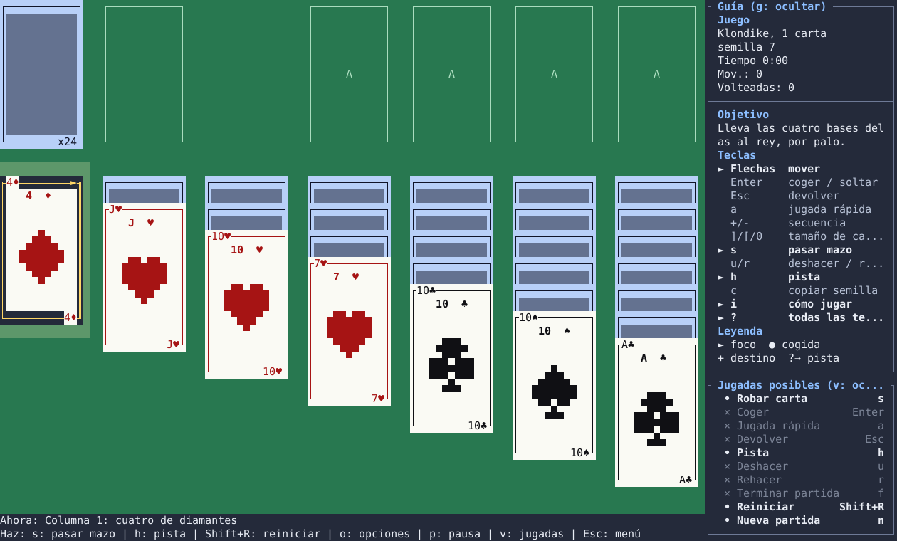

### Spider

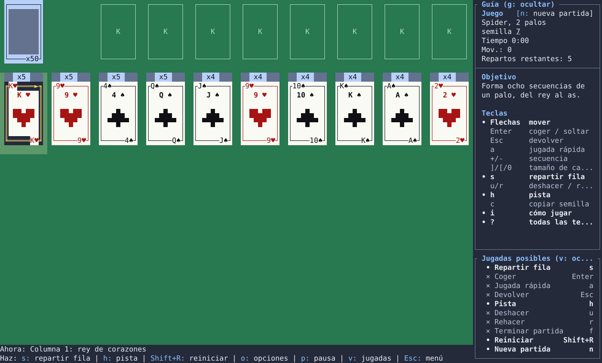

### FreeCell

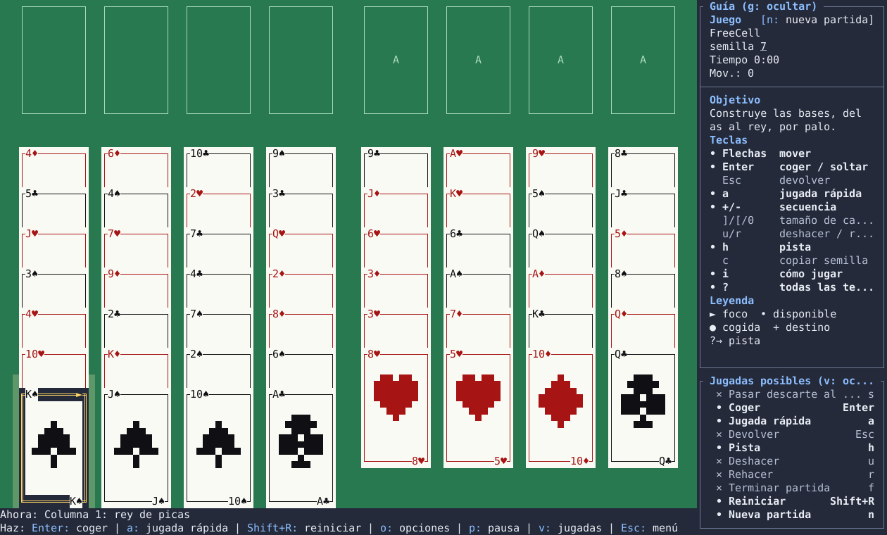

### Pirámide

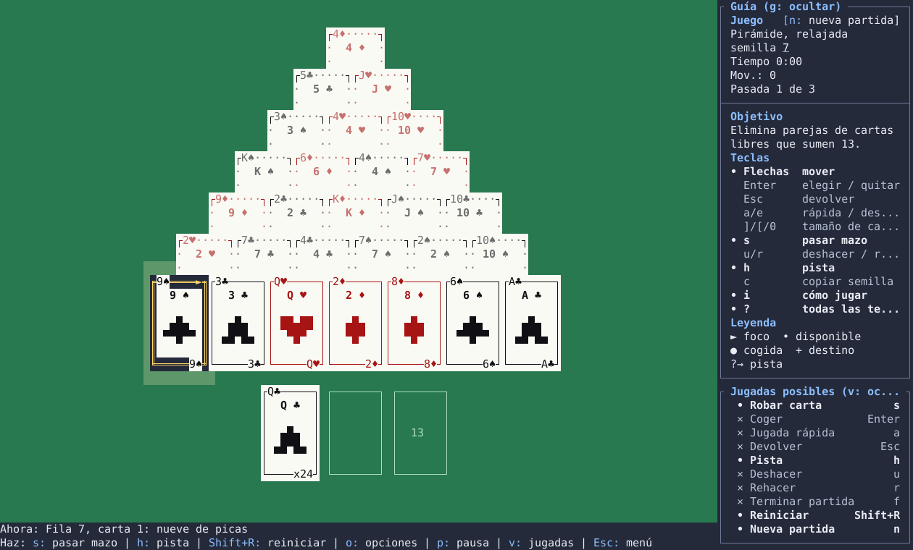

## Pantallas

### Menú principal

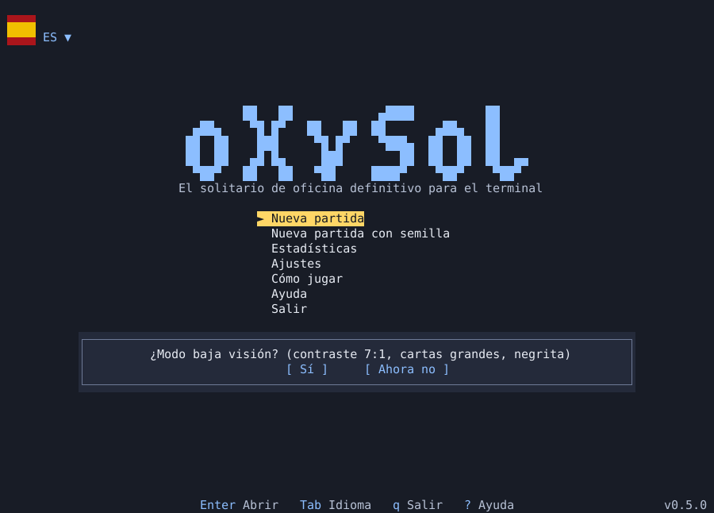

### Ajustes

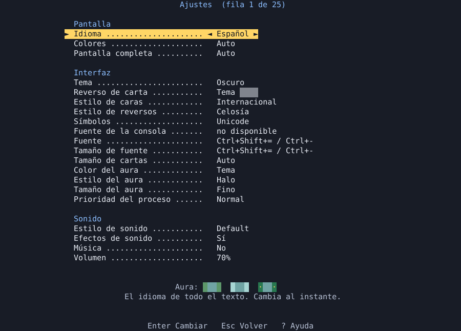

### Ayuda

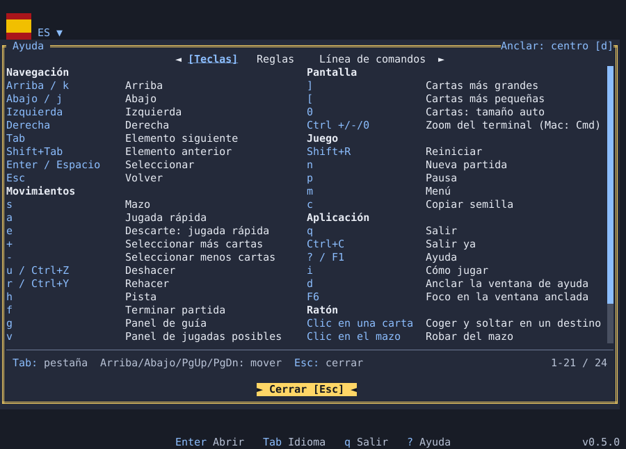

### Pistas y el panel de la guía

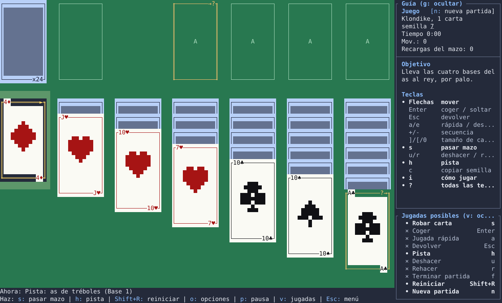

## Animaciones

### Una jugada


### Final automático


### Una victoria


Si tu sistema pide reducir el movimiento, las animaciones muestran su último fotograma en lugar de moverse.

## Temas

Los cinco temas están en la [página de funciones](features.md#temas-para-la-comodidad-y-la-accesibilidad).
