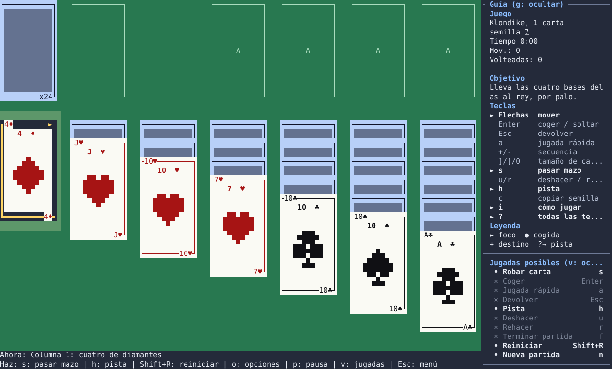

[English](../en/index.md) · [Polski](../pl/index.md) · [Deutsch](../de/index.md) · **Español** · [Français](../fr/index.md) · [Italiano](../it/index.md) · [Nederlands](../nl/index.md) · [Português (Brasil)](../pt-br/index.md) · [Українська](../uk/index.md)

# oXySol

Catorce juegos de solitario para la terminal: **Klondike, Spider, FreeCell, Pirámide, la familia Yukon y Golf** en un solo programa, `oxysol`.
Funciona en cualquier terminal moderna y se juega con el teclado o el ratón.

**Estado:** versión preliminar, en desarrollo.

## Descárgalo

**Última versión:** [{{VERSION}}]({{RELEASE_URL}}). Es la versión más reciente, incluidas las preliminares.
Todas las versiones están en la [página de versiones](https://github.com/beoArcha/oXyFlow.Solitaire/releases).

- [Descarga una versión lista para usar o compílala desde el código fuente](install.md) en Windows, Linux o macOS.
- [Funciones](features.md): partidas seleccionadas por dificultad, pistas, baja visión y visión del color, estilos de cartas, estadísticas e idiomas.
- [Capturas de pantalla y animaciones](gallery.md) de todos los juegos y pantallas.

Código fuente e incidencias: [beoArcha/oXyFlow.Solitaire](https://github.com/beoArcha/oXyFlow.Solitaire).
Las reglas de los juegos están en la
[wiki](https://github.com/beoArcha/oXyFlow.Solitaire/tree/main/docs/wiki/rules) (en inglés).
