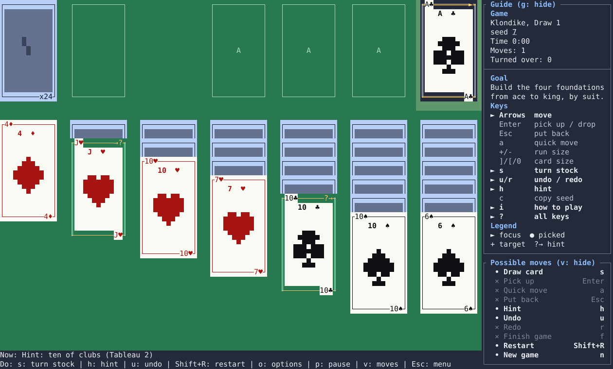
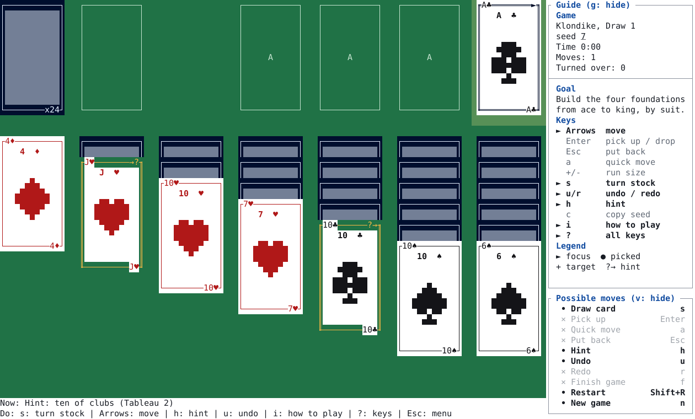
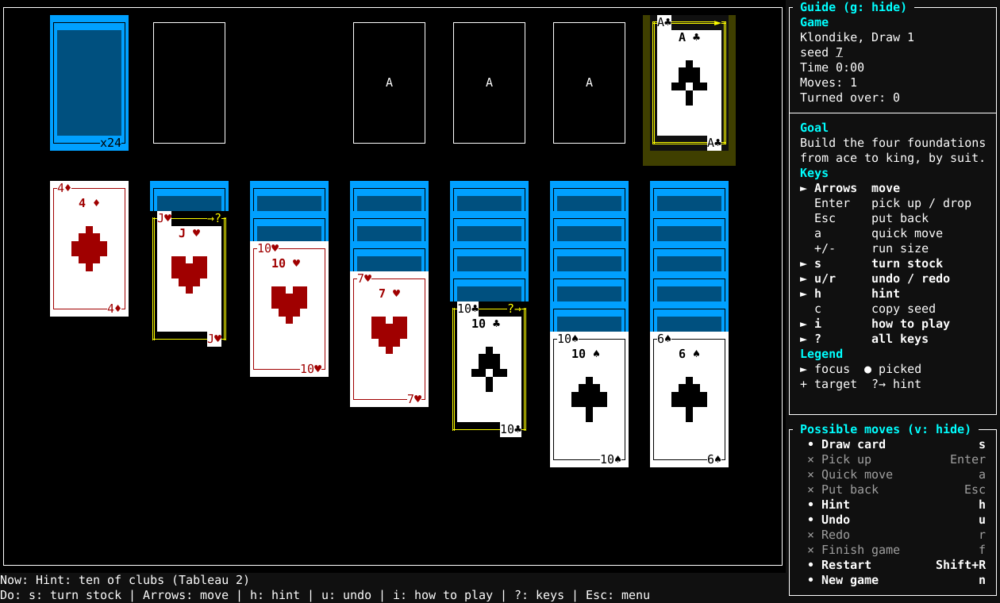
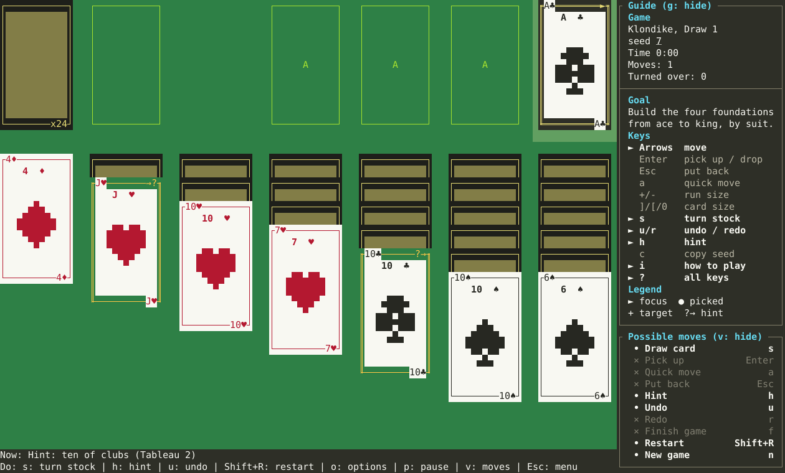
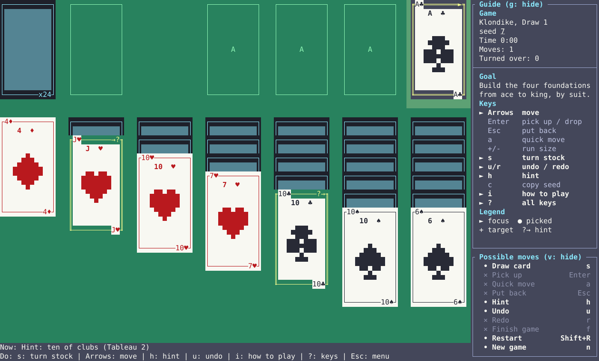

**English** · [Polski](pl/features.md) · [Deutsch](de/features.md) · [Español](es/features.md) · [Français](fr/features.md) · [Italiano](it/features.md) · [Nederlands](nl/features.md) · [Português (Brasil)](pt-br/features.md) · [Українська](uk/features.md)

# Features

## Games

Fourteen games in six families, one program, one set of keys:

- **Klondike**: draw 1 or draw 3.
- **Spider**: 1, 2 or 4 suits.
- **FreeCell**.
- **Pyramid**: Relaxed or Classic.
- **Yukon family**: Yukon, Russian Solitaire, Alaska, Moosehide and Australian Patience.
- **Golf**: clear seven columns onto the waste, one rank up or down at a time.

The game menu lists the games under family headings, stars the popular ones, keeps your favourites in their own list
and finds a game as you type its name. The rules of every game are in the help window (`i`, "How to play").

## Deals: seeds, winnable deals and difficulty

Every deal has a **seed**. Copy it with `c` to replay or share the deal.

- **Winnable deals only.** A new game can wait for a deal that the built-in solver has proven winnable. The solver
  knows every card, so "winnable" means the deal can be won, not that it is easy.
- **New game from seed.** Choose the game first, then where the seed comes from: type one, pick one of the deals you
  have already played (newest first, with the result and the time), let the game choose a random one of them, or take
  one of the **curated deals**.
- **Five difficulty levels.** Every game offers three curated deals for each level, from very easy to very hard. All of
  them are proven winnable. The levels come from measurements: how much work the solver needed, how long the winning
  line is, and whether following the hints alone wins the deal.

## Help while you play

- **Guide panel** (`g`): the goal of the game, the keys that work now and what the focused card can do. At 130 columns
  or more it sits beside the board, with a **New game** button at the top; on narrower terminals it opens in a window.
- **Possible moves panel** (`v`): every move you can make now, each with its key, and the reason when a move is not
  possible.
- **Hints** (`h`): the game marks a move on the board and names it. Hints only use what you can see: they never peek at
  face-down cards or into the stock.
- **Quick moves**: `a` sends the cards under the cursor to their best target, `e` does the same for the top card of the
  waste from anywhere on the board, and a double-click works like `a`. Quick moves can be switched off in Settings or in
  the quick options (`o`) if you prefer to place every card yourself.
- **Auto-finish**: once the win is certain, the remaining moves are played for you. It can be switched off.
- **Undo and redo** (`u`, `r`), with an option to play without undo.

## Keyboard and mouse

Every action works with the keyboard and with the mouse. Click a card to pick it up and click a target to drop it,
double-click for a quick move, drag a card onto its target, right-click to put it back. Buttons in windows and panels
show their key, and the active tab of a window never looks like the focused button. The help window (`?`) lists every
key; it can also stay docked at the side of the screen (`d`).

## Settings

Settings has three tabs:

- **Popular** opens first and gathers the settings changed most often: language, low vision, theme, card size, card
  back, volume, aura and auto-finish.
- **Audio & Visual** holds everything about the look and sound: colors, full screen and window size, theme, color
  vision, card styles and tints, the table, the aura, the console font, sound and the process priority.
- **Gameplay** holds the aids: target marks, the guide and moves panels, auto-finish and quick moves.

A preview beside the list shows a change before you keep it.

## Cards and table

- **Six front styles**: International, French, German, Italian, Spanish and Swiss, each with its own suit signs.
- **Two back styles** (Lattice and Ornament) and back colors from the theme, Monokai or Dracula.
- **Card face tint**: the theme's own, white, ivory, light grey or dark.
- **Table**: the theme's color, green felt, blue, red, grey, brown or black, plain, felt or lined.
- **Card size**: make the cards bigger with `]` and smaller with `[`; `0` goes back to the automatic size that fits
  the window. Long columns close up so their last card always stays fully visible, and the cards only get smaller when
  closing up is not enough.

## Themes and accessibility

Five themes: **Dark** and **Light** for everyday play, **High contrast** for low vision, **Monokai** and **Dracula**.
Each one is shown here on the same position.

- **Low vision.** One switch, offered on the first start and in Settings: text contrast of at least 7:1 in any theme,
  the largest cards that fit, a thick aura, bold rank and suit, larger focus and target marks, and in the classic
  Windows console a larger font. Every part stays adjustable, and turning the mode off restores your earlier settings.
- **Color vision.** Modes for protanopia, deuteranopia, tritanopia and monochrome change the colors so that the things
  you must tell apart stay apart. The **four-color deck** gives every suit its own color: black spades, red hearts,
  blue diamonds and green clubs.
- **Color is never the only signal.** Suits are signs (♠ ♥ ♦ ♣) beside the rank, the focused item is marked with a
  symbol, picked cards and targets have their own marks, results carry ✓ or ✗, and a line under the board says in
  words where the cursor is and what it can do.

## Statistics

The statistics screen shows results for each game (wins, streaks, best time and fewest moves) and a history of every
deal, newest first and in your local time. From the history you can play a seed again, copy it, or let the solver
check whether a deal was winnable.

## Windows console

On Windows, a game started by a double-click, or with `oxysol -n`, owns its console window. It opens full screen by
default, and in a window you can choose its size in Settings: 130 × 40, 195 × 60 or 260 × 80. A game started in a
console that is already open leaves that console as it is. In the classic Windows console, Ctrl+Plus, Ctrl+Minus and
Ctrl+0 change the console font size; other terminals zoom with their own keys.

## Languages

The game is available in nine languages: English, Polish, German, Spanish, French, Italian, Dutch, Brazilian Portuguese
and Ukrainian. Pick one with the flag selector in the top-left corner of the main menu, or in Settings; it applies at
once. This website is available in the same nine languages.

## What it is not yet

oXySol is a pre-release. Expect rough edges, and tell us about them in the
[issue tracker](https://github.com/beoArcha/oXyFlow.Solitaire/issues).
