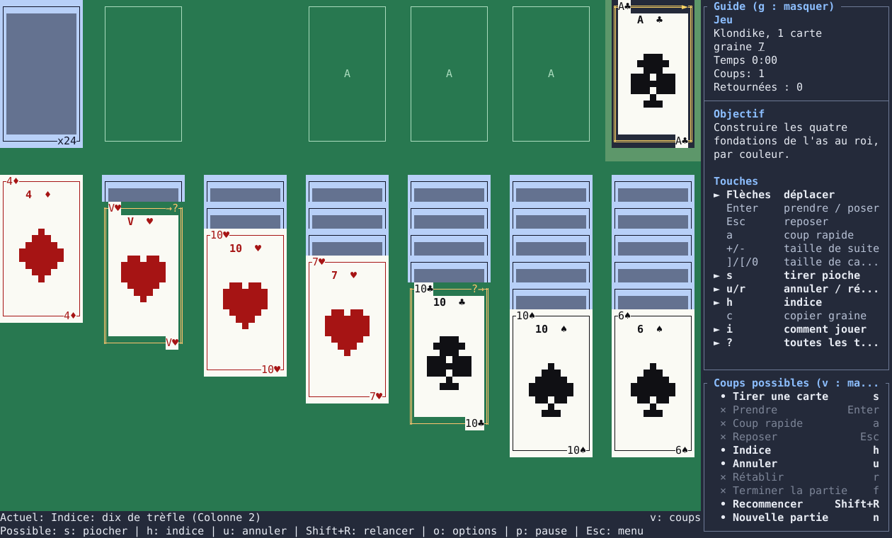

[English](../features.md) · [Polski](../pl/features.md) · [Deutsch](../de/features.md) · [Español](../es/features.md) · **Français** · [Italiano](../it/features.md) · [Nederlands](../nl/features.md) · [Português (Brasil)](../pt-br/features.md) · [Українська](../uk/features.md)

# Fonctionnalités

## Jeux

Quatorze jeux en six familles, un seul programme, un seul jeu de touches :

- **Klondike** : tirer 1 ou tirer 3.
- **Spider** : 1, 2 ou 4 couleurs.
- **FreeCell**.
- **Pyramide** : détente ou classique.
- **Famille Yukon** : Yukon, Solitaire russe, Alaska, Moosehide et Australienne.
- **Golf** : vider sept colonnes vers la défausse, un rang plus haut ou plus bas à la fois.

Le menu des jeux range les jeux sous des titres de famille, met une étoile aux jeux populaires, garde vos favoris dans leur propre liste et trouve un jeu dès que vous tapez son nom. Les règles de chaque jeu sont dans la fenêtre d’aide (`i`, « Comment jouer »).

## Donnes : graines, donnes gagnables et difficulté

Chaque donne a une **graine** (seed). Copiez-la avec `c` pour rejouer la donne ou la partager.

- **Donnes gagnables uniquement.** Une nouvelle partie peut attendre une donne que le solveur intégré a prouvée gagnable. Le solveur connaît chaque carte : « gagnable » signifie donc que la donne peut être gagnée, pas qu’elle est facile.
- **Nouvelle partie avec graine.** Choisissez d’abord le jeu, puis l’origine de la graine : saisir une graine, choisir une des donnes déjà jouées (la plus récente d’abord, avec le résultat et le temps), laisser le jeu en prendre une au hasard, ou choisir une des **donnes sélectionnées**.
- **Cinq niveaux de difficulté.** Chaque jeu propose trois donnes sélectionnées par niveau, de très facile à très difficile. Toutes sont prouvées gagnables. Les niveaux viennent de mesures : le travail que le solveur a dû fournir, la longueur de la ligne gagnante et le fait que suivre seulement les indices suffise à gagner la donne.

## Aide pendant la partie

- **Panneau du guide** (`g`) : les informations de la partie, le but du jeu, les touches (en indiquant celles qui fonctionnent maintenant) et les actions à la souris. À 130 colonnes ou plus, il se place à côté du plateau, avec un bouton **Nouvelle partie** en haut ; sur les terminaux plus étroits, il s’ouvre dans une fenêtre.
- **Panneau des coups possibles** (`v`) : chaque coup que vous pouvez jouer maintenant, avec sa touche, et la raison lorsqu’un coup n’est pas possible.
- **Indices** (`h`) : le jeu marque un coup sur le plateau et le nomme. Les indices n’utilisent que ce que vous voyez : ils ne regardent jamais les cartes face cachée ni dans la pioche.
- **Coups rapides** : `a` envoie les cartes sous le curseur vers leur meilleure cible, `e` fait de même pour la carte du dessus de la défausse, depuis n’importe où sur le plateau, et un double-clic agit comme `a`. Les coups rapides peuvent être désactivés dans les paramètres ou dans les options rapides (`o`) si vous préférez placer chaque carte vous-même.
- **Fin automatique** : dès que la victoire est certaine, les coups restants sont joués pour vous. Elle peut être désactivée.
- **Annuler et rétablir** (`u`, `r`), avec une option pour jouer sans annulation.

## Clavier et souris

Chaque action fonctionne au clavier et à la souris. Cliquez une carte pour la prendre puis une cible pour la poser, faites un double-clic pour un coup rapide, glissez une carte sur sa cible et faites un clic droit pour la reposer. Les pieds d’écran et les boutons comme Nouvelle partie ou Fermer affichent leur touche, et l’onglet actif d’une fenêtre ne ressemble jamais au bouton en focus. La fenêtre d’aide (`?`) liste chaque touche ; elle peut aussi rester ancrée sur le côté de l’écran (`d`).

## Paramètres

Les paramètres comportent trois onglets :

- **Populaires** s’ouvre en premier et rassemble les réglages les plus souvent modifiés : langue, basse vision, thème, taille des cartes, dos de carte, volume, aura et fin automatique.
- **Audio & visuel** regroupe tout ce qui touche à l’aspect et au son : couleurs, plein écran et taille de fenêtre, thème, vision des couleurs, styles et teintes des cartes, la table, l’aura, la police de la console, le son et la priorité du processus.
- **Jouabilité** regroupe la langue et les aides : aura, marques de cible, panneaux du guide et des coups possibles, fin automatique et coups rapides.

Un aperçu à côté de la liste montre une modification avant que vous la gardiez.

## Cartes et table

- **Six styles de faces** : International, Français, Allemand, Italien, Espagnol et Suisse, chacun avec ses propres symboles de couleur ou lettres des figures.
- **Deux styles de dos** (Treillis et Ornement) et des couleurs de dos du thème, Monokai ou Dracula.
- **Teinte du fond des cartes** : celle du thème, blanc, ivoire, gris clair ou sombre.
- **Table** : la couleur du thème, feutre vert, bleu, rouge, gris, brun ou noir, en surface unie, feutre ou lignée.
- **Taille des cartes** : agrandissez les cartes avec `]` et réduisez-les avec `[` ; `0` revient à la taille automatique qui tient dans la fenêtre. Les colonnes longues se resserrent pour que leur dernière carte reste toujours entièrement visible, et les cartes ne deviennent plus petites que lorsque le resserrement ne suffit pas.

## Thèmes et accessibilité

Cinq thèmes : **Sombre** et **Clair** pour le jeu de tous les jours, **Contraste élevé** pour la basse vision, **Monokai** et **Dracula**. Chacun est montré ici sur la même position.

- **Basse vision.** Un seul interrupteur, proposé au premier démarrage et dans les paramètres : contraste du texte d’au moins 7:1 dans tous les thèmes, les plus grandes cartes qui tiennent, une aura épaisse, rang et couleur en gras, des marques de focus et de cible plus grandes et, dans la console Windows classique, une police plus grande. Chaque élément reste réglable, et désactiver le mode rétablit vos réglages précédents.
- **Vision des couleurs.** Des modes pour la protanopie, la deutéranopie, la tritanopie et le monochrome modifient les couleurs pour que ce que vous devez distinguer reste distinct. Le **jeu à quatre couleurs** donne une couleur à chaque couleur de carte : piques noirs, cœurs rouges, carreaux bleus et trèfles verts.
- **La couleur n’est jamais le seul signal.** Les couleurs sont des symboles (♠ ♥ ♦ ♣) à côté du rang, l’élément en focus porte une marque, les cartes prises et les cibles ont leurs propres marques, les résultats de gagnabilité portent ✓ ou ✗, et une ligne sous le plateau indique en toutes lettres où se trouve le curseur et ce qu’il peut faire.

## Statistiques

L’écran des statistiques montre les résultats de chaque jeu (victoires, séries, meilleur temps et moins de coups) et un historique de chaque donne, la plus récente d’abord et à votre heure locale. Depuis l’historique, vous pouvez rejouer une graine, la copier, ou demander au solveur de vérifier si une donne était gagnable.

## Console Windows

Sous Windows, un jeu lancé par un double-clic, ou avec `oxysol -n`, possède sa propre fenêtre de console. Elle s’ouvre en plein écran par défaut, et en mode fenêtré vous pouvez choisir sa taille dans les paramètres : 130 × 40, 195 × 60 ou 260 × 80. Un jeu lancé dans une console déjà ouverte laisse cette console telle quelle. Dans la console Windows classique, Ctrl+Plus, Ctrl+Moins et Ctrl+0 changent la taille de la police de la console ; les autres terminaux zooment avec leurs propres touches.

## Langues

Le jeu est disponible en neuf langues : anglais, polonais, allemand, espagnol, français, italien, néerlandais, portugais du Brésil et ukrainien. Choisissez-en une avec le sélecteur de drapeaux, en haut à gauche du menu principal, ou dans les paramètres ; elle s’applique tout de suite. Ce site est disponible dans les mêmes neuf langues.

## Ce qui n’est pas encore là

oXySol est une préversion. Attendez-vous à des aspérités, et signalez-les-nous dans le
[suivi des tickets](https://github.com/beoArcha/oXyFlow.Solitaire/issues).
