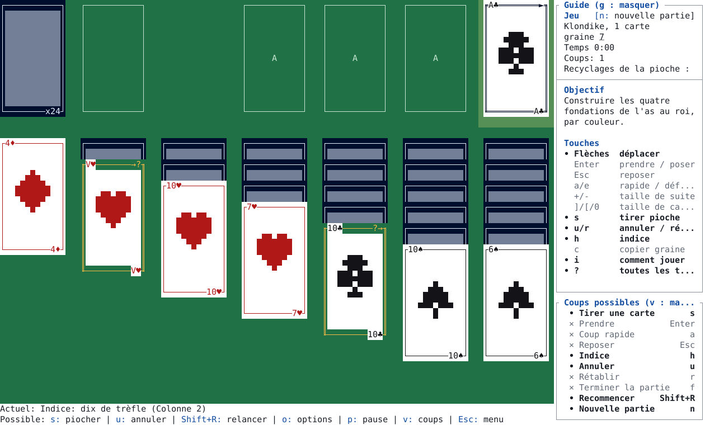
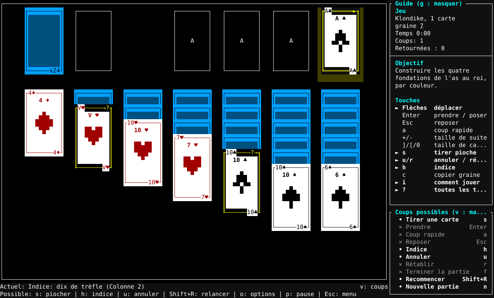
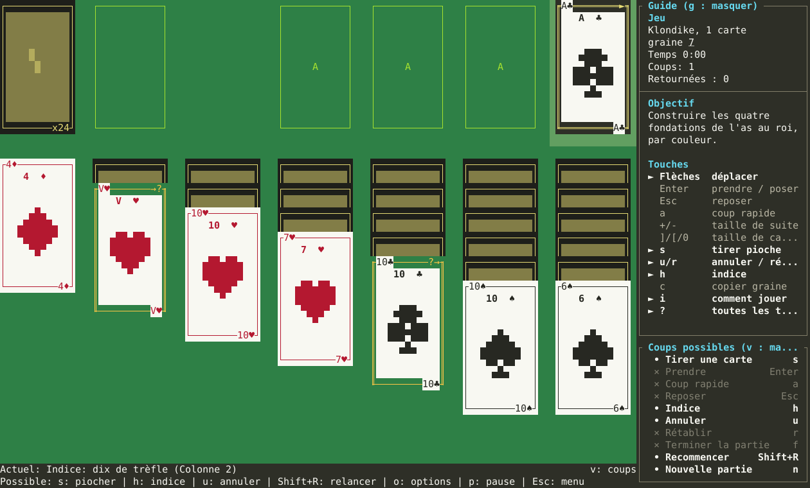
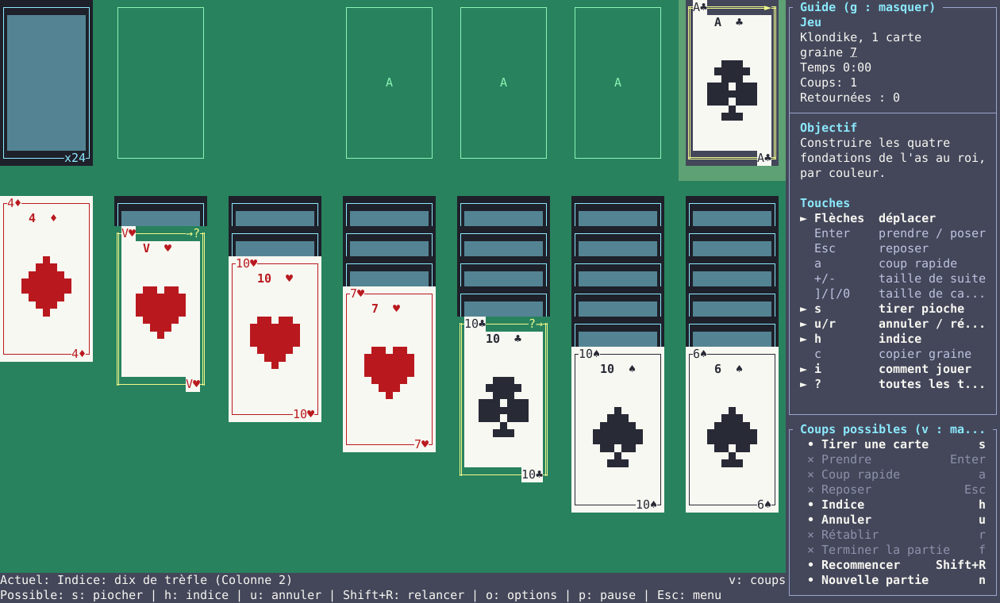

[English](../features.md) · [Polski](../pl/features.md) · [Deutsch](../de/features.md) · [Español](../es/features.md) · **Français** · [Italiano](../it/features.md) · [Nederlands](../nl/features.md) · [Português (Brasil)](../pt-br/features.md) · [Українська](../uk/features.md)

# Fonctionnalités

## Jeux

- **Klondike** : en tirant 1 ou 3 cartes.
- **Spider** : à 1, 2 ou 4 couleurs.
- **FreeCell**.
- **Pyramide** : souple ou classique.
- **Famille Yukon** : Yukon, Solitaire russe, Alaska, Moosehide et Australienne (avec une pioche, un seul passage).

Un seul programme, un seul menu, les mêmes touches partout.

Le menu des jeux regroupe les jeux par famille, marque les populaires d’une étoile, garde vos favoris dans une liste à part et offre une recherche.

## Styles de cartes

Les Réglages proposent un style de faces (International, Français, Allemand, Italien ou Suisse) et un style de dos (Treillis ou Ornement). Les cartes sont dessinées avec des glyphes vectoriels, et la couleur de la carte est toujours aussi indiquée par un signe à côté de la valeur.

## Clavier et souris

Chaque action se fait au clavier comme à la souris. Cliquez sur une carte pour la prendre, puis sur une destination
pour la poser. Un double-clic envoie une carte sur une fondation, une carte peut être glissée sur sa destination, et
un clic droit la remet à sa place. La liste complète des touches se trouve dans la fenêtre d’aide (`?`).

## Taille des cartes

`]` agrandit les cartes et `[` les réduit; `0` revient à la taille automatique, ajustée à la fenêtre. Ctrl+molette et
le réglage Taille des cartes  font de même. Une taille qui ne tient pas dans la fenêtre est réduite
d’elle-même. Dans la console Windows classique, Ctrl+Plus, Ctrl+Moins et Ctrl+0 changent la taille de la police de la
console.

## De l’aide pendant la partie

- **Panneau du guide** (`g`) : le but du jeu, les touches et ce que peut faire la carte sélectionnée. Il s’affiche à
  côté du plateau sur les terminaux d’au moins 130 colonnes et s’ouvre dans une fenêtre sur les plus étroits.
- **Panneau des coups possibles** (`v`) : tous les coups jouables maintenant, chacun avec sa touche.
- **Indices** (`h`) : le jeu signale un coup sur le plateau et le décrit.
- **Fin automatique** : quand la partie est gagnée à coup sûr, les derniers coups se jouent tout seuls. On peut la
  désactiver dans les Réglages.
- **Annuler et rétablir** (`u`, `r`), avec une option pour jouer sans annulation.

## Graines, donnes gagnables, statistiques

Chaque donne a une **graine** (seed). Copiez-la (`c`) pour rejouer ou partager une donne, ou lancez une partie à partir
de n’importe quelle graine avec « Nouvelle partie depuis une graine ». Une option permet à une
nouvelle partie de chercher une donne dont on a prouvé qu’elle est gagnable. L’écran des **statistiques** affiche les
résultats de chaque jeu et l’historique de toutes les donnes, de la plus récente à la plus ancienne, et permet de
rejouer une graine.

## Des thèmes pour le confort et l’accessibilité

Cinq thèmes, à choisir dans les Réglages. Chacun est montré ici sur la même position.

**Dark** (sombre) et **Light** (clair) pour jouer au quotidien.

**High contrast** (contraste élevé) est conçu pour les personnes malvoyantes : du texte blanc sur un noir pur avec des
touches de jaune vif et de cyan, un cadre autour de la zone de jeu et un contraste du texte d’au moins 7:1 (les autres
thèmes respectent au moins 4,5:1; des tests vérifient les deux).

**Monokai** et **Dracula** sont également disponibles.

**La couleur n’est jamais le seul porteur d’information.** Les enseignes sont dessinées sous forme de signes
(♠ ♥ ♦ ♣) à côté de la valeur, l’élément sélectionné est marqué d’un symbole, les cartes prises et les destinations
possibles ont leurs propres marques, et une ligne sous le plateau dit en toutes lettres où se trouve le curseur et ce
qu’il peut faire. Le jeu reste utilisable par les personnes daltoniennes. Des modes dédiés aux troubles de la vision
des couleurs sont prévus; ils ne sont pas encore dans le jeu.

## Langues

L’interface du jeu est disponible en neuf langues : anglais, polonais, allemand, espagnol, français, italien, néerlandais, portugais du Brésil et ukrainien. Choisissez la langue avec le
sélecteur à drapeaux, en haut à gauche du menu principal, ou dans les Réglages; le changement est immédiat.

Ce site est disponible en neuf langues : les liens en haut de chaque page permettent de passer de l’une à l’autre.

## Ce qu’il n’est pas encore

oXySol est une préversion. Attendez-vous à quelques imperfections, et signalez-les-nous dans le
[suivi des tickets](https://github.com/beoArcha/oXyFlow.Solitare/issues).
