[English](../gallery.md) · [Polski](../pl/gallery.md) · [Deutsch](../de/gallery.md) · [Español](../es/gallery.md) · **Français** · [Italiano](../it/gallery.md) · [Nederlands](../nl/gallery.md) · [Português (Brasil)](../pt-br/gallery.md) · [Українська](../uk/gallery.md)

# Captures d’écran et animations

Chaque image de cette page est générée à partir du vrai jeu par `cargo xtask screenshots` : elle montre donc ce que
le programme affiche.

## Jeux

### Klondike

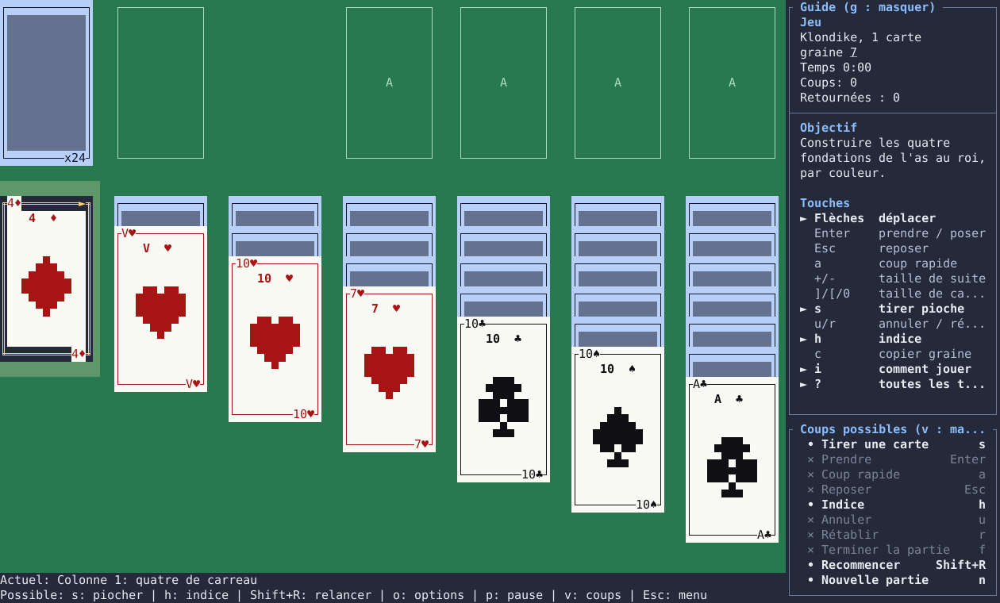

### Spider

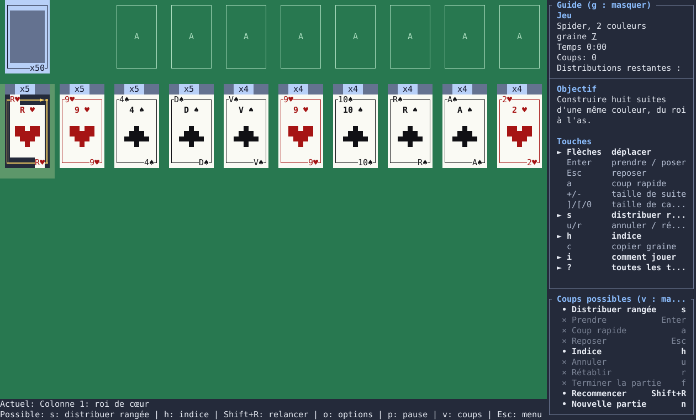

### FreeCell

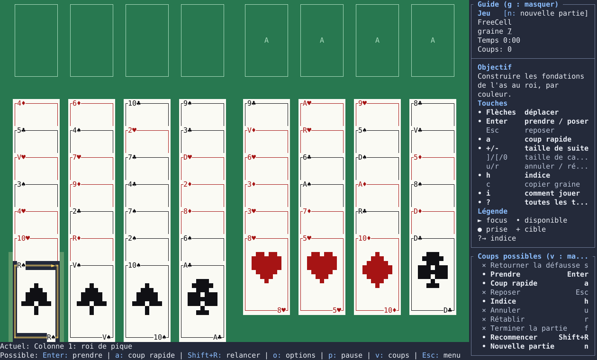

### Pyramide

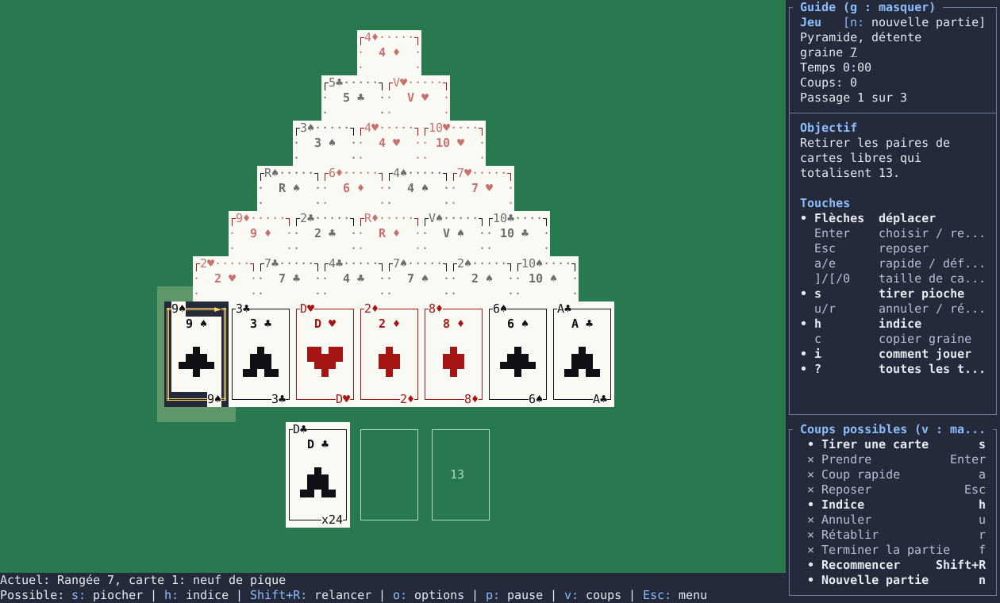

## Écrans

### Menu principal

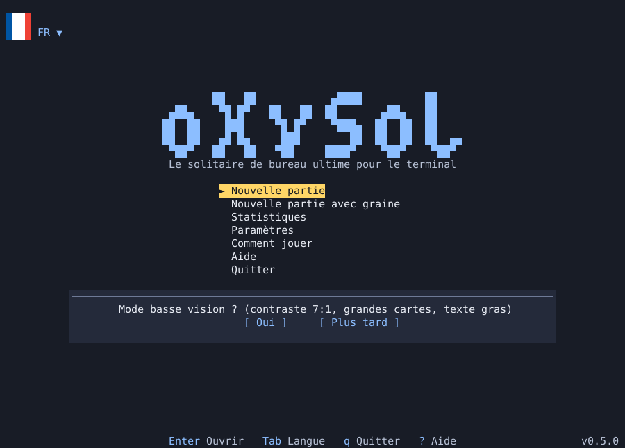

### Réglages

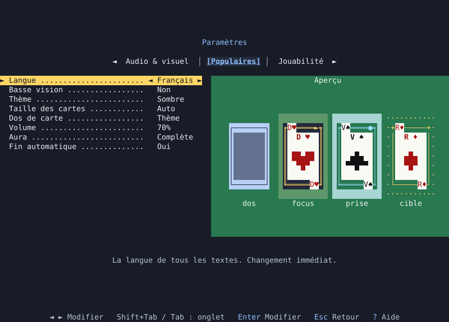

### Aide

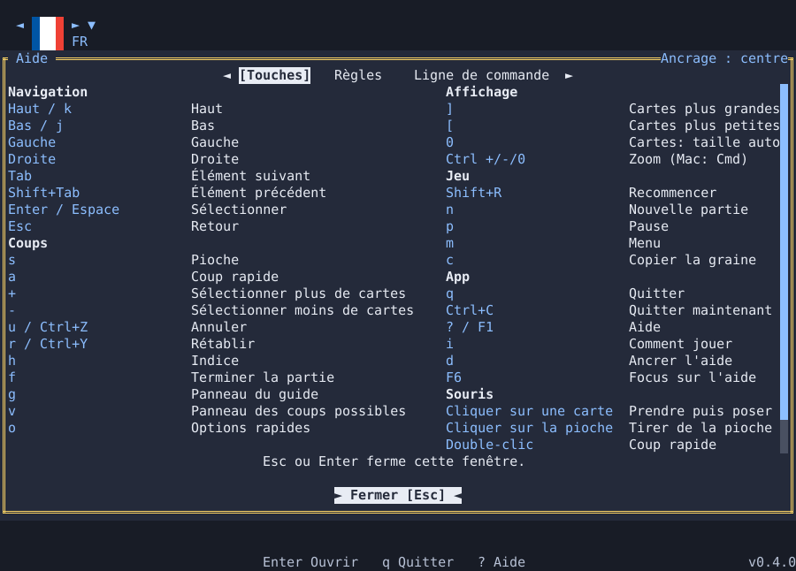

### Indices et panneau du guide

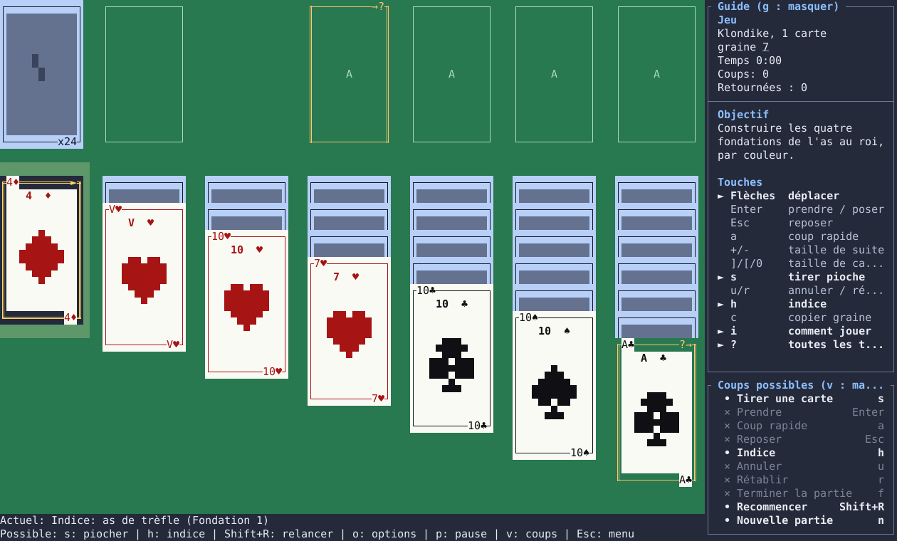

## Animations

### Un coup


### Fin automatique


### Une victoire


Si votre système demande de réduire les animations, elles affichent leur dernière image au lieu de bouger.

## Thèmes

Les cinq thèmes sont sur la [page des fonctionnalités](features.md#des-thèmes-pour-le-confort-et-laccessibilité).
