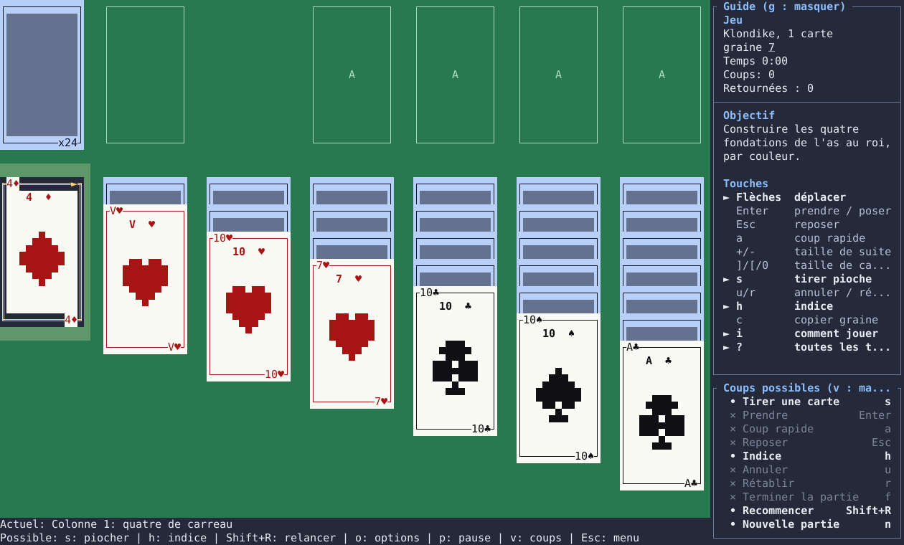

[English](../en/index.md) · [Polski](../pl/index.md) · [Deutsch](../de/index.md) · [Español](../es/index.md) · **Français** · [Italiano](../it/index.md) · [Nederlands](../nl/index.md) · [Português (Brasil)](../pt-br/index.md) · [Українська](../uk/index.md)

# oXySol

Le solitaire dans votre terminal : **Klondike, Spider, FreeCell et Pyramide** réunis dans un seul programme, le
fichier unique `oxysol`. Il fonctionne dans tout terminal moderne et se joue au clavier ou à la souris.

**État :** préversion, en cours de développement.

## Télécharger

**Dernière version :** [{{VERSION}}]({{RELEASE_URL}}). C’est la version la plus récente, préversions comprises.
Toutes les versions sont sur la [page des publications](https://github.com/beoArcha/oXyFlow.Solitare/releases).

- [Télécharger une version prête à l’emploi ou compiler depuis les sources](install.md), sous Windows, Linux ou macOS.
- [Fonctionnalités](features.md) : guide, indices, fin automatique, statistiques, thèmes, langues.
- [Captures d’écran et animations](gallery.md) de tous les jeux et de tous les écrans.

Code source et signalements : [beoArcha/oXyFlow.Solitare](https://github.com/beoArcha/oXyFlow.Solitare).
Les règles des quatre jeux se trouvent dans le
[wiki](https://github.com/beoArcha/oXyFlow.Solitare/tree/main/docs/wiki/rules) (en anglais).
