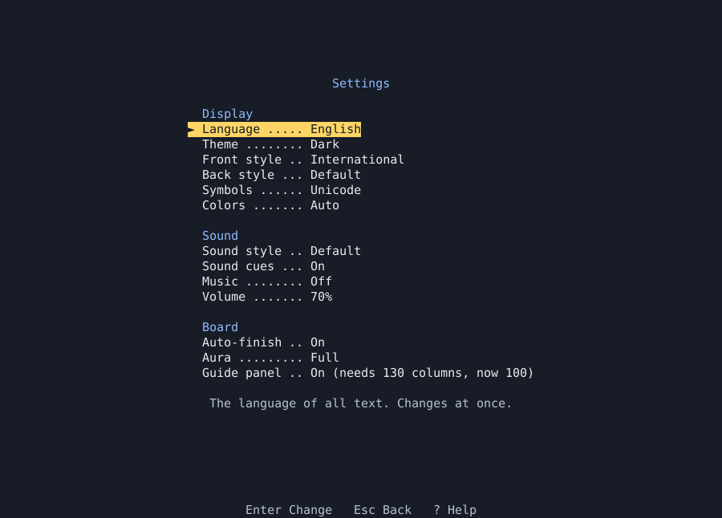

**English** · [Polski](pl/gallery.md) · [Deutsch](de/gallery.md) · [Español](es/gallery.md) · [Français](fr/gallery.md) · [Italiano](it/gallery.md) · [Nederlands](nl/gallery.md) · [Português (Brasil)](pt-br/gallery.md) · [Українська](uk/gallery.md)

# Screenshots and animations

Every image on this page is generated from the real game by `cargo xtask screenshots`, so it shows what the
program draws.

## Games

### Klondike

### Spider

### FreeCell

### Pyramid

## Screens

### Main menu

### Settings

### Help

### Hints and the guide panel

## Animations

### A move

### Auto-finish

### A win

If your system asks for reduced motion, the animations show their last frame instead of moving.

## Themes

The five themes are on the [features page](features.md#themes-for-comfort-and-accessibility).
