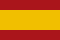

# oXySol

<ul class="lp-flags">
<li><a href="en/index.html" hreflang="en" lang="en" data-code="en">SolitaireEnglish</a></li>
<li><a href="pl/index.html" hreflang="pl" lang="pl" data-code="pl">PasjansPolski</a></li>
<li><a href="de/index.html" hreflang="de" lang="de" data-code="de">SolitärDeutsch</a></li>
<li><a href="es/index.html" hreflang="es" lang="es" data-code="es">SolitarioEspañol</a></li>
</ul>

A terminal solitaire: Klondike, Spider, FreeCell and Pyramid in one program, the single binary oxysol. It runs in any modern terminal and is played with the keyboard or the mouse.

<ul class="lp-links">
<li><a href="en/index.html">Introduction</a></li>
<li><a href="features.html">Features</a></li>
<li><a href="gallery.html">Screenshots and animations</a></li>
<li><a href="install.html">Install</a></li>
</ul>

<ul class="lp-flags">
<li><a href="fr/index.html" hreflang="fr" lang="fr" data-code="fr">SolitaireFrançais</a></li>
<li><a href="it/index.html" hreflang="it" lang="it" data-code="it">SolitarioItaliano</a></li>
<li><a href="nl/index.html" hreflang="nl" lang="nl" data-code="nl">PatienceNederlands</a></li>
<li><a href="pt-br/index.html" hreflang="pt-BR" lang="pt-BR" data-code="pt-br">PaciênciaPortuguês (Brasil)</a></li>
<li><a href="uk/index.html" hreflang="uk" lang="uk" data-code="uk">ПасьянсУкраїнська</a></li>
</ul>

