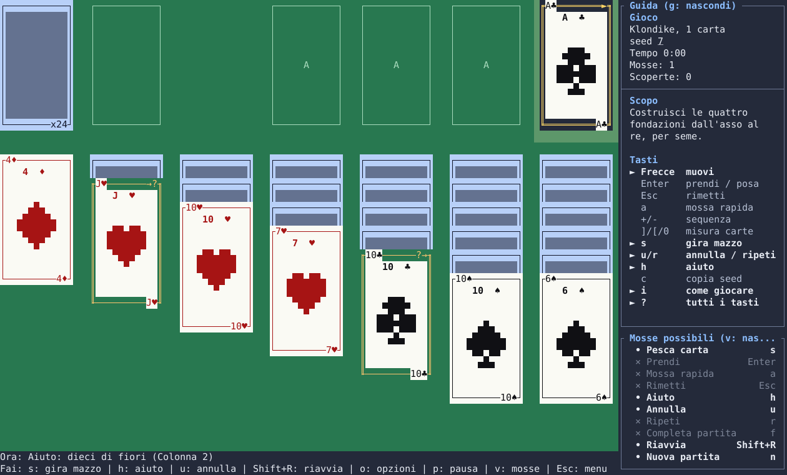

[English](../features.md) · [Polski](../pl/features.md) · [Deutsch](../de/features.md) · [Español](../es/features.md) · [Français](../fr/features.md) · **Italiano** · [Nederlands](../nl/features.md) · [Português (Brasil)](../pt-br/features.md) · [Українська](../uk/features.md)

# Funzionalità

## Quattro giochi

- **Klondike**: pescando 1 o 3 carte.
- **Spider**: con 1, 2 o 4 semi.
- **FreeCell**.
- **Piramide**: rilassata o classica.

Un solo programma, un solo menu, gli stessi tasti per tutti.

## Tastiera e mouse

Ogni azione funziona con la tastiera e con il mouse. Fai clic su una carta per prenderla e su una destinazione per
posarla. Un doppio clic manda una carta su una pila di base, una carta si può trascinare sulla sua destinazione e il
clic destro la rimette al suo posto. L’elenco completo dei tasti è nella finestra di aiuto (`?`).

## Dimensione delle carte

`]` ingrandisce le carte e `[` le rimpicciolisce; `0` torna alla dimensione automatica, adattata alla finestra.
Ctrl+rotellina e l’impostazione Dimensione carte  fanno lo stesso. Una dimensione che non entra nella
finestra si riduce da sola. Nella console classica di Windows, Ctrl+Più, Ctrl+Meno e Ctrl+0 cambiano la dimensione del
carattere della console.

## Aiuto durante la partita

- **Pannello della guida** (`g`): lo scopo del gioco, i tasti e cosa può fare la carta selezionata. Sta accanto al
  tavolo nei terminali larghi almeno 130 colonne e si apre in una finestra in quelli più stretti.
- **Pannello delle mosse possibili** (`v`): tutte le mosse che puoi fare adesso, ognuna con il suo tasto.
- **Suggerimenti** (`h`): il gioco evidenzia una mossa sul tavolo e la descrive.
- **Completamento automatico**: quando la vittoria è certa, le mosse rimanenti vengono giocate per te. Si può
  disattivare nelle Impostazioni.
- **Annulla e ripeti** (`u`, `r`), con un’opzione per giocare senza annullare.

## Seed, smazzate vincibili, statistiche

Ogni smazzata ha un **seed** (seme di generazione). Copialo (`c`) per rigiocare o condividere una smazzata, oppure
inizia una partita da qualsiasi seed con «Nuova partita da seed». Un’opzione fa sì che una nuova
partita cerchi una smazzata di cui è dimostrato che si può vincere. La schermata delle **statistiche** mostra i
risultati di ogni gioco e la cronologia di tutte le smazzate, dalla più recente, e permette di rigiocare un seed.

## Temi per comfort e accessibilità

Cinque temi, da scegliere nelle Impostazioni. Ognuno è mostrato qui sulla stessa posizione.

**Dark** (scuro) e **Light** (chiaro) per tutti i giorni.

**High contrast** (contrasto elevato) è pensato per chi ha una vista ridotta: testo bianco su nero puro con accenti
giallo acceso e ciano, una cornice intorno all’area di gioco e un contrasto del testo di almeno 7:1 (gli altri temi
mantengono almeno 4,5:1; i test verificano entrambi i valori).

Sono disponibili anche **Monokai** e **Dracula**.

**Il colore non è mai l’unico portatore di informazioni.** I semi sono disegnati come simboli (♠ ♥ ♦ ♣) accanto al
valore, l’elemento selezionato è segnato da un simbolo, le carte prese e le destinazioni hanno segni propri e una riga
sotto il tavolo dice a parole dove si trova il cursore e cosa può fare. Il gioco resta utilizzabile anche da chi è
daltonico. Sono previste modalità dedicate alla visione dei colori, ma non sono ancora nel gioco.

## Lingue

L’interfaccia del gioco è disponibile in nove lingue: inglese, polacco, tedesco, spagnolo, francese, italiano, olandese, portoghese brasiliano e ucraino. Scegli la lingua con il selettore a bandierine
nell’angolo in alto a sinistra del menu principale, oppure nelle Impostazioni; il cambio è immediato.

Questo sito è disponibile in nove lingue: i link in cima a ogni pagina permettono di passare dall’una all’altra.

## Cosa non è ancora

oXySol è una versione preliminare. Aspettati qualche imperfezione e segnalacela nel
[sistema di segnalazione](https://github.com/beoArcha/oXyFlow.Solitare/issues).
