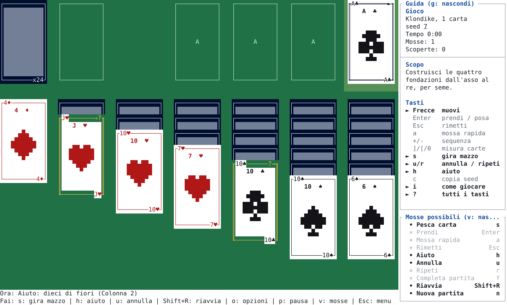
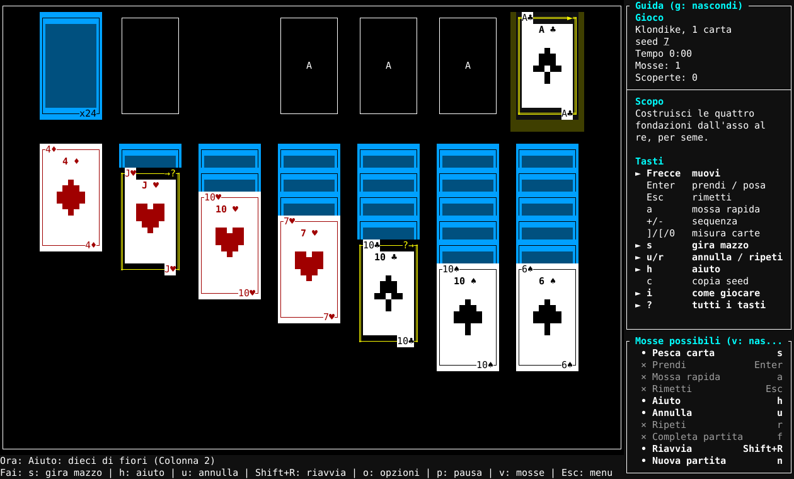
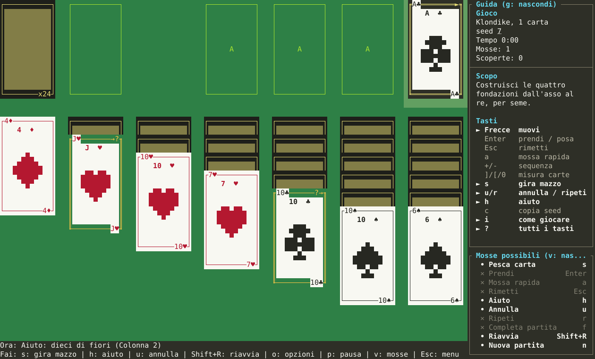
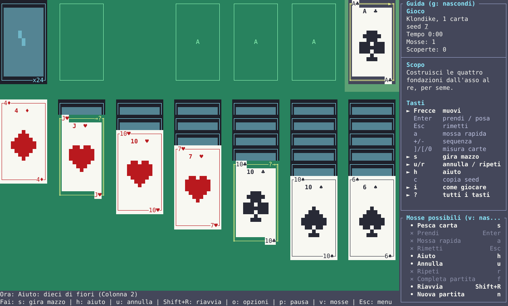

[English](../features.md) · [Polski](../pl/features.md) · [Deutsch](../de/features.md) · [Español](../es/features.md) · [Français](../fr/features.md) · **Italiano** · [Nederlands](../nl/features.md) · [Português (Brasil)](../pt-br/features.md) · [Українська](../uk/features.md)

# Funzionalità

## Giochi

Quattordici giochi in sei famiglie, un solo programma, un solo insieme di tasti:

- **Klondike**: pescare 1 o pescare 3.
- **Spider**: 1, 2 o 4 semi.
- **FreeCell**.
- **Piramide**: rilassata o classica.
- **Famiglia Yukon**: Yukon, Solitario russo, Alaska, Moosehide e Australiano.
- **Golf**: svuotare sette colonne sugli scarti, un grado più alto o più basso alla volta.

Il menu dei giochi raggruppa i giochi sotto intestazioni di famiglia, mette una stella ai più popolari, tiene i preferiti in un elenco a parte e trova un gioco mentre digiti il suo nome. Le regole di ogni gioco sono nella finestra di aiuto (`i`, "Come giocare").

## Distribuzioni: seed, distribuzioni risolvibili e difficoltà

Ogni distribuzione ha un **seed**. Copialo con `c` per rigiocare la distribuzione o condividerla.

- **Solo distribuzioni risolvibili.** Una nuova partita può attendere una distribuzione che il risolutore integrato ha dimostrato risolvibile. Il risolutore conosce ogni carta, quindi "risolvibile" significa che la distribuzione si può vincere, non che sia facile.
- **Nuova partita da seed.** Scegli prima il gioco, poi da dove viene il seed: digitarne uno, scegliere una delle distribuzioni già giocate (la più recente prima, con esito e tempo), lasciare che il gioco ne scelga una a caso oppure prenderne una delle **distribuzioni selezionate**.
- **Cinque livelli di difficoltà.** Ogni gioco offre tre distribuzioni selezionate per livello, da molto facile a molto difficile. Tutte sono dimostrate risolvibili. I livelli derivano da misurazioni: quanto lavoro ha richiesto il risolutore, quanto è lunga la linea vincente e se seguire soltanto i suggerimenti basta a vincere la distribuzione.

## Aiuto durante il gioco

- **Pannello guida** (`g`): i dati della partita, lo scopo del gioco, i tasti (con l'indicazione di quelli attivi ora) e le azioni del mouse. A 130 colonne o più sta accanto al tavolo, con un pulsante **Nuova partita** in alto; sui terminali più stretti si apre in una finestra.
- **Pannello mosse possibili** (`v`): ogni mossa che puoi fare ora, con il suo tasto, e il motivo quando una mossa non è possibile.
- **Suggerimenti** (`h`): il gioco evidenzia una mossa sul tavolo e la nomina. I suggerimenti usano solo ciò che puoi vedere: non guardano mai le carte coperte né il mazzo.
- **Mosse rapide**: `a` invia le carte sotto il cursore alla loro meta migliore, `e` fa lo stesso per la carta in cima agli scarti da qualsiasi punto del tavolo, e il doppio clic funziona come `a`. Le mosse rapide si possono disattivare nelle impostazioni o nelle opzioni rapide (`o`) se preferisci posare ogni carta da solo.
- **Completamento automatico**: quando la vittoria è certa, le mosse rimanenti vengono giocate per te. Si può disattivare.
- **Annulla e ripeti** (`u`, `r`), con un'opzione per giocare senza annullamento.

## Tastiera e mouse

Ogni azione funziona con la tastiera e con il mouse. Clicca una carta per prenderla e una meta per posarla, fai doppio clic per una mossa rapida, trascina una carta sulla sua meta e fai clic destro per rimetterla a posto. Le righe in basso e i pulsanti come Nuova partita o Chiudi mostrano il loro tasto, e la scheda attiva di una finestra non sembra mai il pulsante a fuoco. La finestra di aiuto (`?`) elenca ogni tasto; può anche restare ancorata al lato dello schermo (`d`).

## Impostazioni

Le impostazioni hanno tre schede:

- **Popolari** si apre per prima e raccoglie le impostazioni cambiate più spesso: lingua, ipovisione, tema, dimensione delle carte, dorso delle carte, volume, aura e completamento automatico.
- **Audio e video** contiene tutto ciò che riguarda aspetto e suono: colori, schermo intero e dimensione della finestra, tema, visione dei colori, stili e tinte delle carte, il tavolo, l'aura, il carattere della console, il suono e la priorità del processo.
- **Gioco** contiene la lingua e gli aiuti: aura, indicatori destinazione, pannelli guida e mosse, completamento automatico e mosse rapide.

Un'anteprima accanto all'elenco mostra una modifica prima che tu la confermi.

## Carte e tavolo

- **Sei stili di facce**: Internazionale, Francese, Tedesco, Italiano, Spagnolo e Svizzero, ognuno con i propri segni di seme o lettere delle figure.
- **Due stili di dorso** (Reticolo e Ornamento) e colori di dorso dal tema, Monokai o Dracula.
- **Tinta del fondo delle carte**: quella del tema, bianco, avorio, grigio chiaro o scuro.
- **Tavolo**: il colore del tema, feltro verde, blu, rosso, grigio, marrone o nero, e la superficie liscia, di feltro o rigata.
- **Dimensione delle carte**: ingrandisci le carte con `]` e rimpicciolisci con `[`; `0` torna alla dimensione automatica che sta nella finestra. Le colonne lunghe si stringono perché la loro ultima carta resti sempre completamente visibile, e le carte si riducono solo quando stringere non basta.

## Temi e accessibilità

Cinque temi: **Scuro** e **Chiaro** per il gioco quotidiano, **Contrasto elevato** per l'ipovisione, **Monokai** e **Dracula**. Ognuno è mostrato qui nella stessa posizione.

- **Ipovisione.** Un unico interruttore, offerto al primo avvio e nelle impostazioni: contrasto del testo di almeno 7:1 in ogni tema, le carte più grandi che entrano, un alone spesso, grado e seme in grassetto, indicatori di focus e di destinazione più grandi e, nella console classica di Windows, un carattere più grande. Ogni parte resta regolabile, e disattivare la modalità ripristina le impostazioni precedenti.
- **Visione dei colori.** Modalità per protanopia, deuteranopia, tritanopia e monocromatico cambiano i colori perché ciò che devi distinguere resti distinguibile. Il **mazzo a quattro colori** dà a ogni seme il suo colore: picche nere, cuori rossi, quadri blu e fiori verdi.
- **Il colore non è mai l'unico segnale.** I semi sono segni (♠ ♥ ♦ ♣) accanto al grado, l'elemento a fuoco è segnato da un simbolo, le carte prese e le destinazioni hanno segni propri, i risultati di risolvibilità portano ✓ o ✗, e una riga sotto il tavolo dice a parole dove si trova il cursore e che cosa può fare.

## Statistiche

La schermata delle statistiche mostra i risultati di ogni gioco (vittorie, serie, tempo migliore e mosse minime) e una cronologia di ogni distribuzione, la più recente prima e nell'ora locale. Dalla cronologia puoi rigiocare un seed, copiarlo o far verificare dal risolutore se una distribuzione era risolvibile.

## Console di Windows

Su Windows, un gioco avviato con un doppio clic, o con `oxysol -n`, possiede la propria finestra di console. Si apre a schermo intero per impostazione predefinita, e in modalità finestra puoi scegliere la sua dimensione nelle impostazioni: 130 × 40, 195 × 60 o 260 × 80. Un gioco avviato in una console già aperta lascia quella console com'è. Nella console classica di Windows, Ctrl+Più, Ctrl+Meno e Ctrl+0 cambiano la dimensione del carattere della console; gli altri terminali usano i propri tasti di zoom.

## Lingue

Il gioco è disponibile in nove lingue: inglese, polacco, tedesco, spagnolo, francese, italiano, olandese, portoghese brasiliano e ucraino. Scegline una con il selettore di bandiere nell'angolo in alto a sinistra del menu principale, oppure nelle impostazioni; si applica subito. Questo sito è disponibile nelle stesse nove lingue.

## Cosa non è ancora

oXySol è una versione di pre-rilascio. Aspettati qualche spigolo vivo, e segnalacelo nel
[tracciatore dei problemi](https://github.com/beoArcha/oXyFlow.Solitaire/issues).
