[English](../gallery.md) · [Polski](../pl/gallery.md) · [Deutsch](../de/gallery.md) · [Español](../es/gallery.md) · [Français](../fr/gallery.md) · **Italiano** · [Nederlands](../nl/gallery.md) · [Português (Brasil)](../pt-br/gallery.md) · [Українська](../uk/gallery.md)

# Screenshot e animazioni

Ogni immagine di questa pagina è generata dal gioco vero e proprio con `cargo xtask-art screenshots`, quindi mostra
quello che il programma disegna.

## Giochi

### Klondike

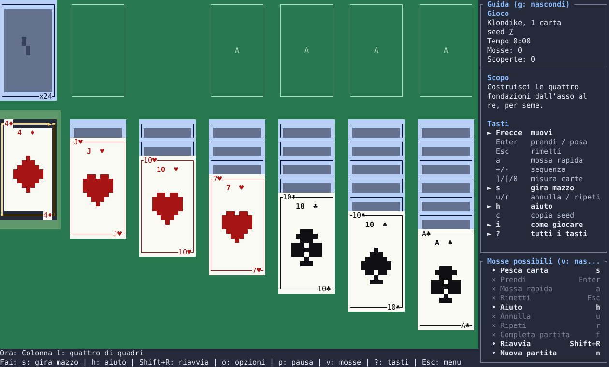

### Spider

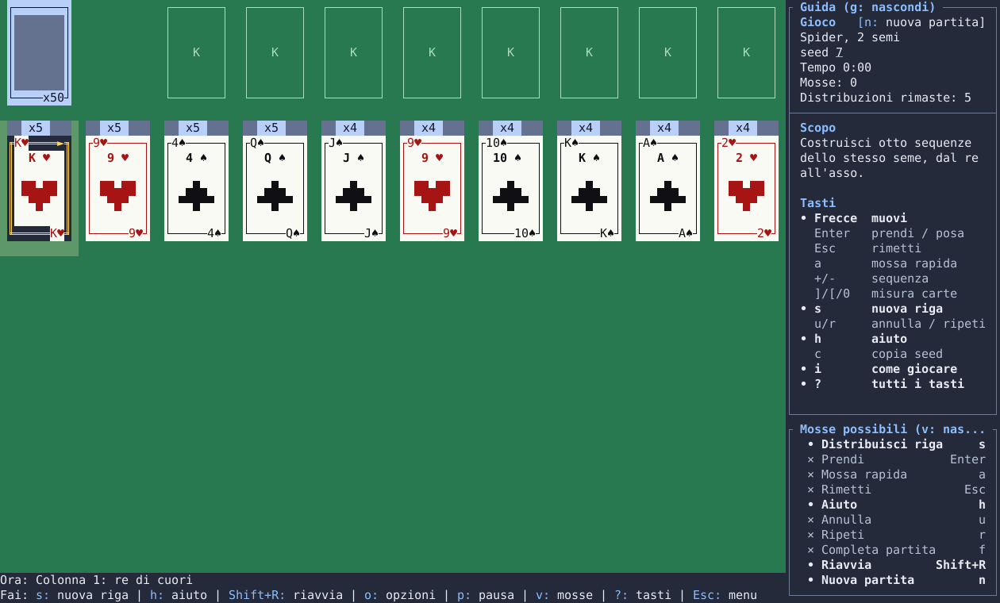

### FreeCell

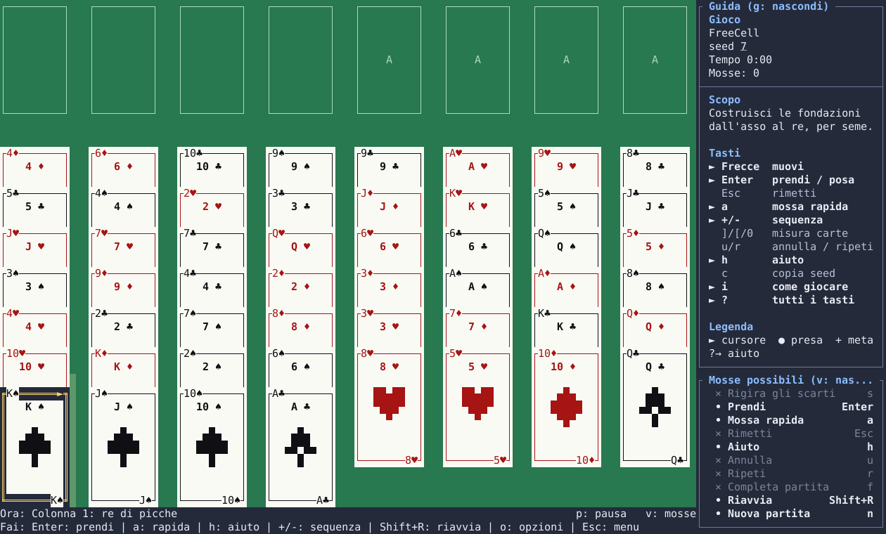

### Piramide

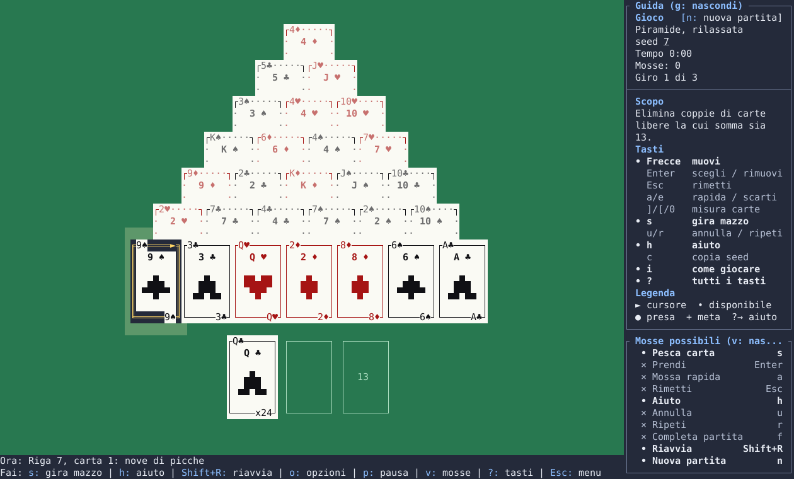

## Schermate

### Menu principale

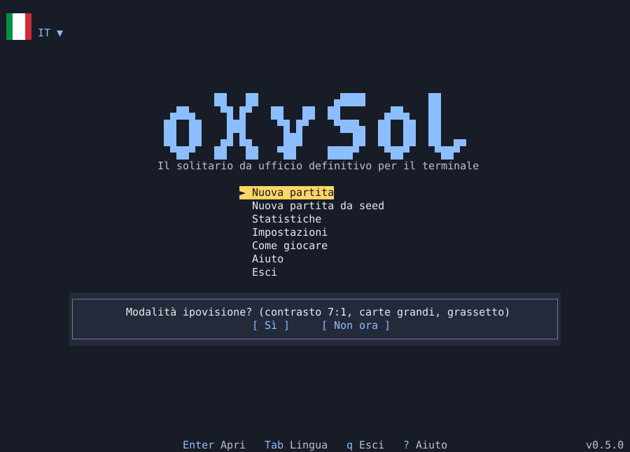

### Impostazioni

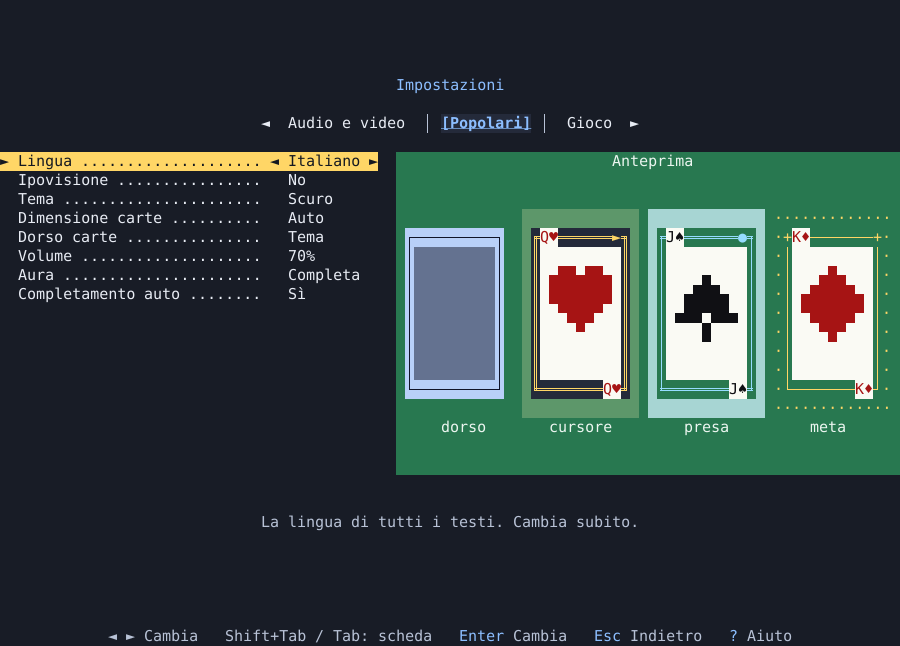

### Aiuto

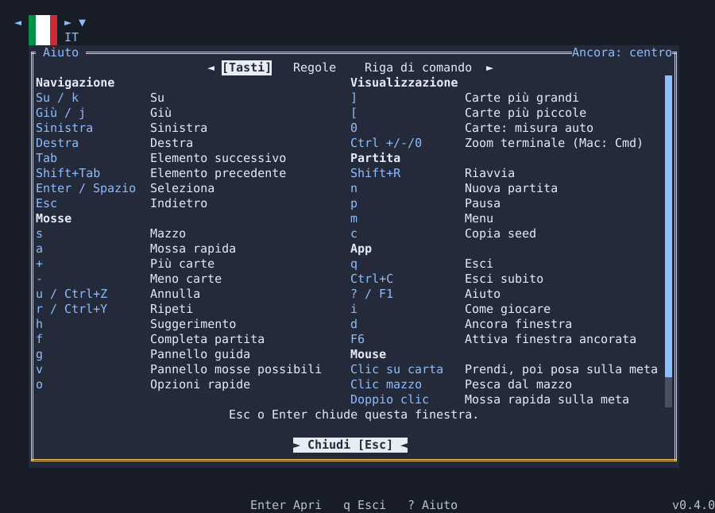

### Suggerimenti e pannello della guida

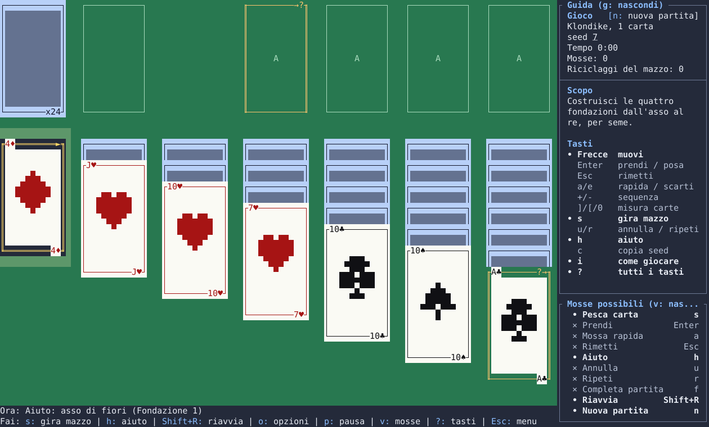

## Animazioni

### Una mossa


### Completamento automatico


### Una vittoria

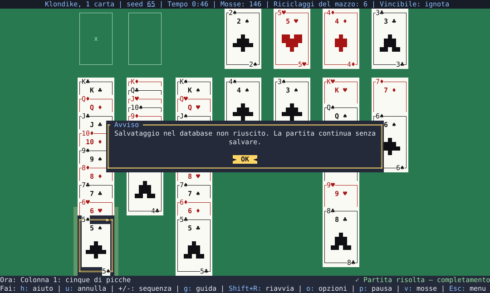

Se il tuo sistema chiede di ridurre il movimento, le animazioni mostrano l’ultimo fotogramma invece di muoversi.

## Temi

I cinque temi sono nella [pagina delle funzionalità](features.md#temi-per-comfort-e-accessibilità).
