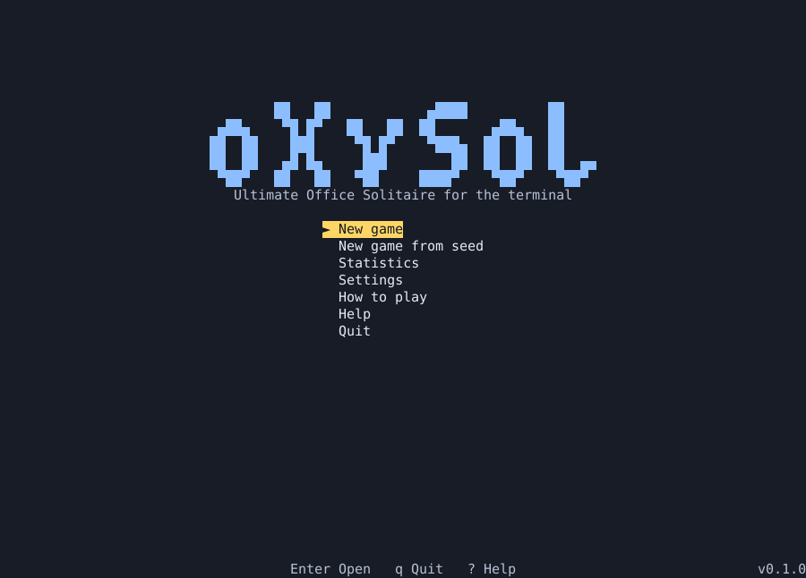

[English](../gallery.md) · [Polski](../pl/gallery.md) · [Deutsch](../de/gallery.md) · [Español](../es/gallery.md) · [Français](../fr/gallery.md) · **Italiano** · [Nederlands](../nl/gallery.md) · [Português (Brasil)](../pt-br/gallery.md) · [Українська](../uk/gallery.md)

# Screenshot e animazioni

> **Nota:** l’interfaccia del gioco oggi è disponibile in inglese e in polacco; tedesco, francese, italiano,
> portoghese brasiliano, ucraino, olandese e spagnolo sono in lavorazione. Gli screenshot mostrano la versione
> inglese.

Ogni immagine di questa pagina è generata dal gioco vero e proprio con `cargo xtask screenshots`, quindi mostra
quello che il programma disegna.

## Giochi

### Klondike

### Spider

### FreeCell

### Piramide

## Schermate

### Menu principale

### Impostazioni

### Aiuto

### Suggerimenti e pannello della guida

## Animazioni

### Una mossa

### Completamento automatico

### Una vittoria

Se il tuo sistema chiede di ridurre il movimento, le animazioni mostrano l’ultimo fotogramma invece di muoversi.

## Temi

I cinque temi sono nella [pagina delle funzionalità](features.md#temi-per-comfort-e-accessibilità).
