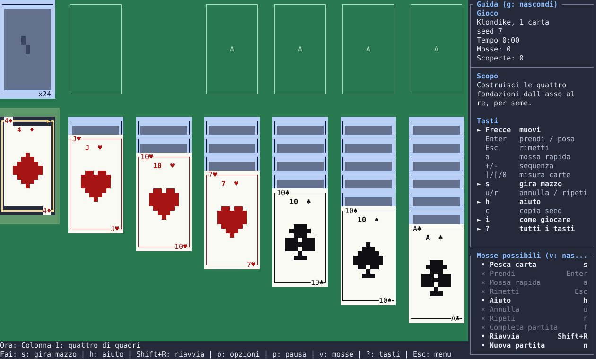

[English](../en/index.md) · [Polski](../pl/index.md) · [Deutsch](../de/index.md) · [Español](../es/index.md) · [Français](../fr/index.md) · **Italiano** · [Nederlands](../nl/index.md) · [Português (Brasil)](../pt-br/index.md) · [Українська](../uk/index.md)

# oXySol

Il solitario nel terminale: **Klondike, Spider, FreeCell, Piramide e la famiglia Yukon** in un unico programma, un solo file: `oxysol`.
Funziona in qualsiasi terminale moderno e si gioca con la tastiera o con il mouse.

**Stato:** versione preliminare, in sviluppo.

## Scaricalo

**Ultima versione:** [{{VERSION}}]({{RELEASE_URL}}). È la versione più recente, versioni preliminari comprese.
Tutte le versioni sono nella [pagina delle release](https://github.com/beoArcha/oXyFlow.Solitaire/releases).

- [Scarica una versione pronta o compila dai sorgenti](install.md) su Windows, Linux o macOS.
- [Funzionalità](features.md): guida, suggerimenti, completamento automatico, statistiche, temi, lingue.
- [Screenshot e animazioni](gallery.md) di tutti i giochi e di tutte le schermate.

Codice sorgente e segnalazioni: [beoArcha/oXyFlow.Solitaire](https://github.com/beoArcha/oXyFlow.Solitaire).
Le regole dei giochi sono nella
[wiki](https://github.com/beoArcha/oXyFlow.Solitaire/tree/main/docs/wiki/rules) (in inglese).
