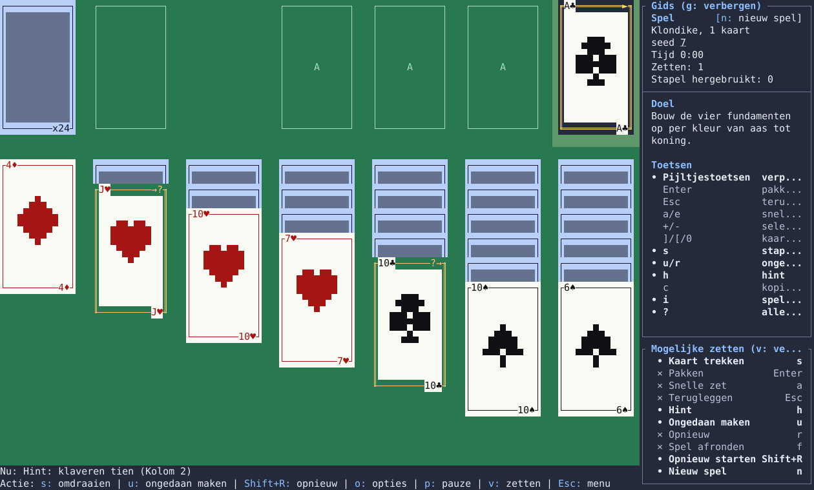

[English](../features.md) · [Polski](../pl/features.md) · [Deutsch](../de/features.md) · [Español](../es/features.md) · [Français](../fr/features.md) · [Italiano](../it/features.md) · **Nederlands** · [Português (Brasil)](../pt-br/features.md) · [Українська](../uk/features.md)

# Functies

## Spellen

Veertien spellen in zes families, één programma, één set toetsen:

- **Klondike**: 1 kaart trekken of 3 kaarten trekken.
- **Spider**: 1, 2 of 4 kleuren.
- **FreeCell**.
- **Piramide**: ontspannen of klassiek.
- **Yukon-familie**: Yukon, Russisch solitair, Alaska, Moosehide en Australisch.
- **Golf**: zeven kolommen leegmaken op de aflegstapel, steeds één rang omhoog of omlaag.

Het spelmenu zet de spellen onder familiekoppen, geeft de populaire spellen een ster, houdt je favorieten in een eigen lijst en vindt een spel terwijl je de naam typt. De regels van elk spel staan in het helpvenster (`i`, "Spelregels").

## Verdelingen: seeds, winbare spellen en moeilijkheid

Elke verdeling heeft een **seed**. Kopieer die met `c` om de verdeling opnieuw te spelen of te delen.

- **Alleen winbare verdelingen.** Een nieuw spel kan wachten op een verdeling die de ingebouwde oplosser bewezen winbaar heeft gevonden. De oplosser kent elke kaart, dus "winbaar" betekent dat de verdeling gewonnen kan worden, niet dat ze makkelijk is.
- **Nieuw spel uit een seed.** Kies eerst het spel en dan waar de seed vandaan komt: een seed typen, een van de verdelingen kiezen die je al hebt gespeeld (de nieuwste eerst, met resultaat en tijd), het spel er willekeurig een laten kiezen, of een van de **geselecteerde verdelingen** nemen.
- **Vijf moeilijkheidsniveaus.** Elk spel biedt voor elk niveau drie geselecteerde verdelingen, van heel makkelijk tot heel moeilijk. Alle zijn bewezen winbaar. De niveaus komen uit metingen: hoeveel werk de oplosser nodig had, hoe lang de winnende lijn is en of het alleen volgen van de hints genoeg is om de verdeling te winnen.

## Hulp tijdens het spelen

- **Gidspaneel** (`g`): de spelgegevens, het doel van het spel, de toetsen (met een teken bij wat nu werkt) en de muisacties. Vanaf 130 kolommen staat het naast het bord, met bovenaan een knop **Nieuw spel**; op smallere terminals opent het in een venster.
- **Zettenpaneel** (`v`): elke zet die je nu kunt doen, met zijn toets, en de reden wanneer een zet niet mogelijk is.
- **Hints** (`h`): het spel markeert een zet op het bord en noemt die. Hints gebruiken alleen wat je kunt zien: ze kijken nooit in verborgen kaarten of in de stapel.
- **Snelle zetten**: `a` stuurt de kaarten onder de cursor naar hun beste doel, `e` doet hetzelfde voor de bovenste kaart van de aflegstapel, vanaf elke plek op het bord, en een dubbelklik werkt als `a`. Snelle zetten kun je uitzetten in de instellingen of in de snelle opties (`o`) als je elke kaart zelf wilt neerleggen.
- **Automatisch voltooien**: zodra de overwinning zeker is, worden de resterende zetten voor je gespeeld. Dit kan uitgezet worden.
- **Ongedaan maken en opnieuw** (`u`, `r`), met een optie om zonder ongedaan maken te spelen.

## Toetsenbord en muis

Elke actie werkt met het toetsenbord en met de muis. Klik op een kaart om hem op te pakken en op een doel om hem neer te leggen, dubbelklik voor een snelle zet, sleep een kaart naar zijn doel en klik met de rechtermuisknop om hem terug te leggen. Voetteksten en knoppen zoals Nieuw spel of Sluiten tonen hun toets, en het actieve tabblad van een venster ziet er nooit uit als de knop in focus. Het helpvenster (`?`) toont elke toets; het kan ook aan de zijkant van het scherm vastgezet blijven (`d`).

## Instellingen

De instellingen hebben drie tabbladen:

- **Populair** opent als eerste en verzamelt de instellingen die het vaakst veranderd worden: taal, slechtziendheid, thema, kaartgrootte, kaartrug, volume, gloed en automatisch voltooien.
- **Audio & Beeld** bevat alles over het uiterlijk en het geluid: kleuren, volledig scherm en venstergrootte, thema, kleurenzicht, kaartstijlen en -tinten, de tafel, de gloed, het consolelettertype, het geluid en de procesprioriteit.
- **Spel** bevat de taal en de hulpmiddelen: gloed, doelmarkeringen, het gidspaneel en het zettenpaneel, automatisch voltooien en snelle zetten.

Een voorbeeld naast de lijst toont een wijziging voordat je die behoudt.

## Kaarten en tafel

- **Zes voorkantstijlen**: Internationaal, Frans, Duits, Italiaans, Spaans en Zwitsers, elk met zijn eigen kleurtekens of letters voor hofkaarten.
- **Twee achterkantstijlen** (Rooster en Ornament) en kaartrugkleuren uit het thema, Monokai of Dracula.
- **Kleurtint van de kaartvoorkant**: die van het thema, wit, ivoor, lichtgrijs of donker.
- **Tafel**: de kleur van het thema, groen laken, blauw, rood, grijs, bruin of zwart, en het oppervlak effen, vilt of gelijnd.
- **Kaartgrootte**: maak de kaarten groter met `]` en kleiner met `[`; `0` herstelt de automatische grootte die in het venster past. Lange kolommen sluiten dichter op elkaar zodat hun laatste kaart altijd volledig zichtbaar blijft, en de kaarten worden alleen kleiner als dichter op elkaar sluiten niet genoeg is.

## Thema's en toegankelijkheid

Vijf thema's: **Donker** en **Licht** voor het dagelijks spelen, **Hoog contrast** voor slechtziendheid, **Monokai** en **Dracula**. Elk wordt hier in dezelfde positie getoond.

- **Slechtziendheid.** Eén schakelaar, aangeboden bij de eerste start en in de instellingen: tekstcontrast van minstens 7:1 in elk thema, de grootst mogelijke kaarten die passen, een dikke gloed, vet gedrukte rang en kleurteken, grotere focus- en doelmarkeringen en, in de klassieke Windows-console, een groter lettertype. Elk onderdeel blijft aan te passen, en als je de modus uitzet, komen je eerdere instellingen terug.
- **Kleurenzicht.** Modi voor protanopie, deuteranopie, tritanopie en monochroom veranderen de kleuren zodat de dingen die je uit elkaar moet kunnen houden, uit elkaar blijven. Het **vierkleurendek** geeft elke kleur een eigen kleur: schoppen zwart, harten rood, ruiten blauw en klaveren groen.
- **Kleur is nooit het enige signaal.** Kleuren zijn tekens (♠ ♥ ♦ ♣) naast de rang, het item in focus is met een teken gemarkeerd, opgepakte kaarten en doelen hebben hun eigen markeringen, winbaarheidsresultaten dragen ✓ of ✗, en een regel onder het bord zegt in woorden waar de cursor staat en wat hij kan doen.

## Statistieken

Het statistiekenscherm toont de resultaten per spel (overwinningen, reeksen, beste tijd en minste zetten) en een geschiedenis van elke verdeling, de nieuwste eerst en in je lokale tijd. Vanuit de geschiedenis kun je een seed opnieuw spelen, hem kopiëren, of de oplosser laten controleren of een verdeling winbaar was.

## Windows-console

Op Windows bezit een spel dat met een dubbelklik of met `oxysol -n` gestart wordt, zijn eigen consolevenster. Het opent standaard op volledig scherm, en in een venster kun je de grootte in de instellingen kiezen: 130 × 40, 195 × 60 of 260 × 80. Een spel dat in een al geopende console start, laat die console zoals ze is. In de klassieke Windows-console veranderen Ctrl+Plus, Ctrl+Min en Ctrl+0 de lettergrootte van de console; andere terminals zoomen met hun eigen toetsen.

## Talen

Het spel is beschikbaar in negen talen: Engels, Pools, Duits, Spaans, Frans, Italiaans, Nederlands, Braziliaans Portugees en Oekraïens. Kies er een met de vlaggenkiezer linksboven in het hoofdmenu, of in de instellingen; hij geldt meteen. Deze website is beschikbaar in dezelfde negen talen.

## Wat het nog niet is

oXySol is een pre-release. Reken op ruwe randjes, en laat ons die weten via de
[issuetracker](https://github.com/beoArcha/oXyFlow.Solitaire/issues).
