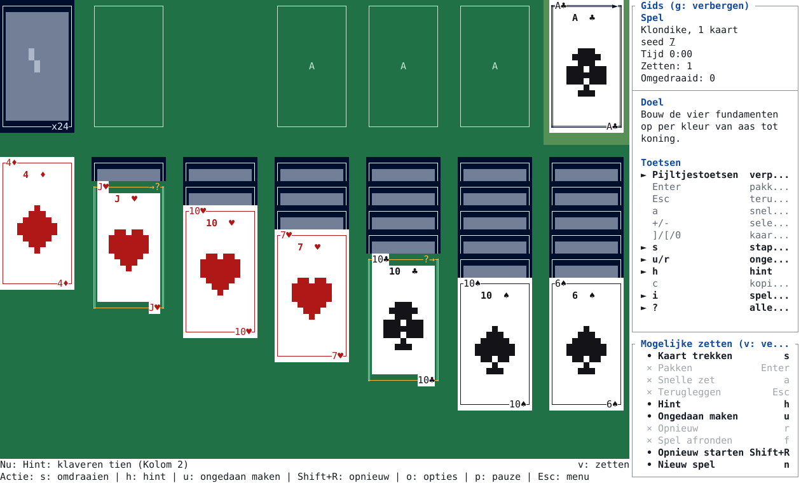
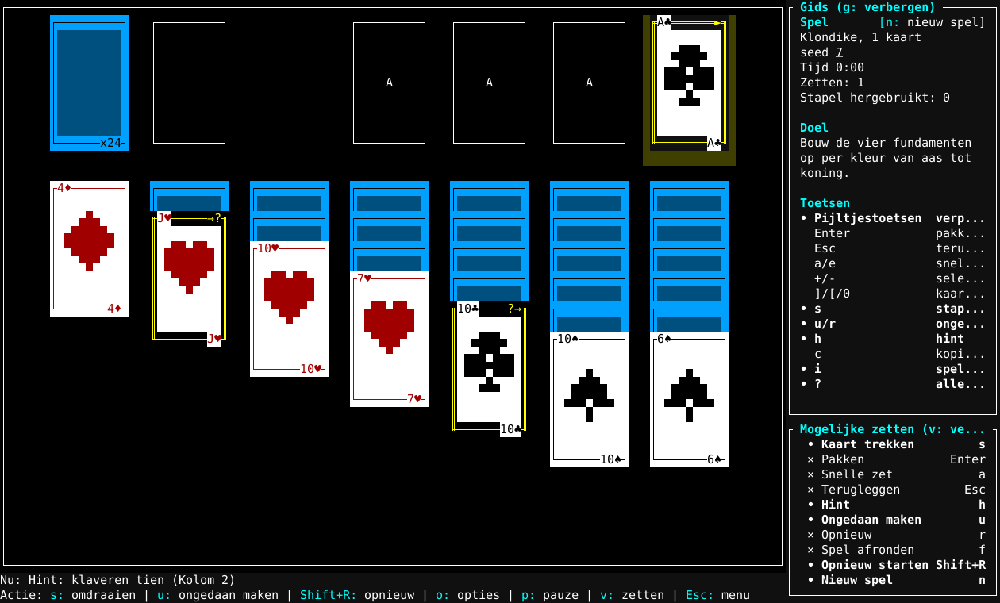
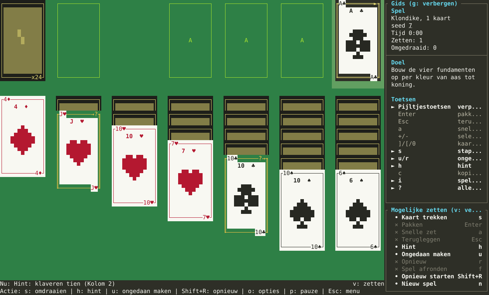
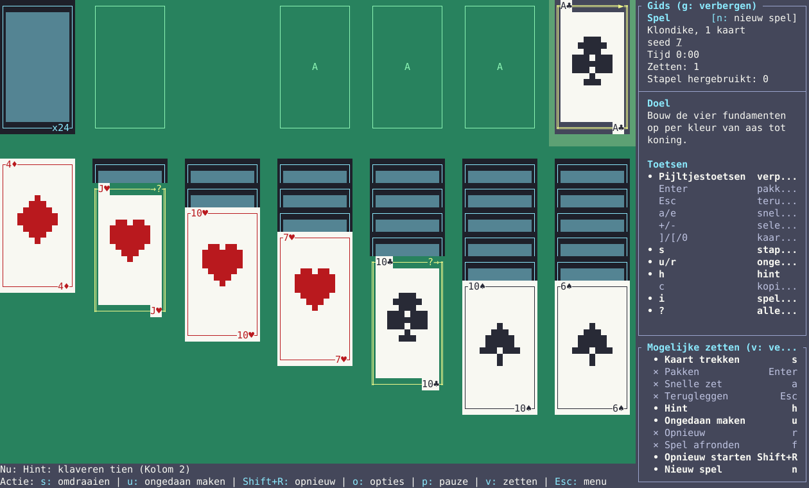

[English](../features.md) · [Polski](../pl/features.md) · [Deutsch](../de/features.md) · [Español](../es/features.md) · [Français](../fr/features.md) · [Italiano](../it/features.md) · **Nederlands** · [Português (Brasil)](../pt-br/features.md) · [Українська](../uk/features.md)

# Functies

## Vier spellen

- **Klondike**: 1 of 3 kaarten trekken.
- **Spider**: met 1, 2 of 4 kleuren.
- **FreeCell**.
- **Piramide**: ontspannen of klassiek.

Eén programma, één menu, dezelfde toetsen overal.

## Toetsenbord en muis

Elke actie werkt met het toetsenbord en met de muis. Klik op een kaart om hem op te pakken en klik op een doel om hem
neer te leggen. Dubbelklikken stuurt een kaart naar een aflegstapel, je kunt een kaart naar zijn doel slepen, en met
de rechtermuisknop leg je hem terug. De volledige lijst met toetsen staat in het helpvenster (`?`).

## Kaartgrootte

`]` maakt de kaarten groter en `[` kleiner; `0` gaat terug naar de automatische grootte, die zich aan het venster
aanpast. Ctrl+scrollwiel en de instelling Kaartgrootte  doen hetzelfde. Een grootte die niet in het venster
past, wordt vanzelf kleiner. In de klassieke Windows-console veranderen Ctrl+Plus, Ctrl+Min en Ctrl+0 de
lettergrootte van de console.

## Hulp tijdens het spelen

- **Gidspaneel** (`g`): het doel van het spel, de toetsen en wat de geselecteerde kaart kan. Het staat naast het
  speelveld op terminals van minstens 130 kolommen breed en opent op smallere terminals in een venster.
- **Paneel met mogelijke zetten** (`v`): elke zet die je nu kunt doen, elk met zijn toets.
- **Hints** (`h`): het spel markeert een zet op het speelveld en benoemt hem.
- **Automatisch afmaken**: als het spel zeker gewonnen is, worden de resterende zetten voor je gespeeld. Dit kun je
  uitzetten in de Instellingen.
- **Ongedaan maken en opnieuw** (`u`, `r`), met een optie om zonder ongedaan maken te spelen.

## Seeds, winbare spellen, statistieken

Elk spel heeft een **seed** (startwaarde). Kopieer hem (`c`) om een spel opnieuw te spelen of te delen, of start een
spel vanuit elke gewenste seed met ‘Nieuw spel vanuit seed’. Met een optie zoekt een nieuw spel
naar een verdeling waarvan bewezen is dat hij te winnen is. Het scherm **Statistieken** toont de resultaten per spel en
een geschiedenis van alle spellen, de nieuwste eerst, en laat je een seed opnieuw spelen.

## Thema’s voor comfort en toegankelijkheid

Vijf thema’s, te kiezen in de Instellingen. Elk thema staat hier op dezelfde stelling.

**Dark** (donker) en **Light** (licht) voor elke dag.

**High contrast** (hoog contrast) is gemaakt voor slechtzienden: witte tekst op puur zwart met felgele en cyaan
accenten, een kader rond het speelveld en een tekstcontrast van minstens 7:1 (de andere thema’s halen minstens 4,5:1;
tests controleren beide).

**Monokai** en **Dracula** zijn er ook.

**Kleur is nooit de enige drager van informatie.** De kleuren van de kaarten staan als tekens (♠ ♥ ♦ ♣) naast de
waarde, het geselecteerde element is gemarkeerd met een symbool, opgepakte kaarten en doelen hebben hun eigen
markeringen, en een regel onder het speelveld zegt in woorden waar de cursor staat en wat hij kan doen. Het spel blijft
bruikbaar voor kleurenblinde spelers. Speciale modi voor kleurenblindheid staan gepland, maar zitten nog niet in het
spel.

## Talen

De interface van het spel is beschikbaar in negen talen: Engels, Pools, Duits, Spaans, Frans, Italiaans, Nederlands, Braziliaans Portugees en Oekraïens. Kies de taal met de vlaggenkiezer in de linkerbovenhoek
van het hoofdmenu, of in de Instellingen; de wijziging geldt meteen.

Deze website is beschikbaar in negen talen: met de links boven aan elke pagina wissel je tussen de talen.

## Wat het nog niet is

oXySol is een voorlopige versie. Reken op wat ruwe randjes en meld ze in de
[issuetracker](https://github.com/beoArcha/oXyFlow.Solitare/issues).
