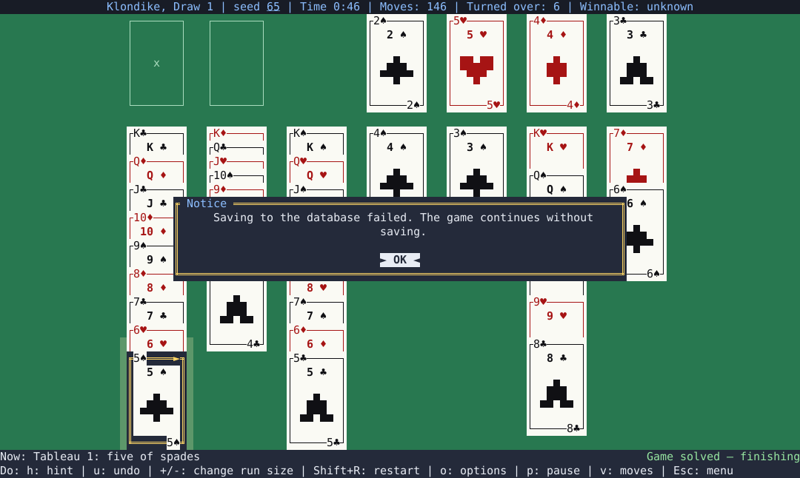

[English](../gallery.md) · [Polski](../pl/gallery.md) · [Deutsch](../de/gallery.md) · [Español](../es/gallery.md) · [Français](../fr/gallery.md) · [Italiano](../it/gallery.md) · **Nederlands** · [Português (Brasil)](../pt-br/gallery.md) · [Українська](../uk/gallery.md)

# Schermafbeeldingen en animaties

> **Let op:** de interface van het spel is nu beschikbaar in het Engels en het Pools; Duits, Frans, Italiaans,
> Braziliaans Portugees, Oekraïens, Nederlands en Spaans zijn in de maak. De schermafbeeldingen tonen de Engelse
> versie.

Elke afbeelding op deze pagina wordt door `cargo xtask screenshots` uit het echte spel gemaakt en laat dus zien wat het
programma tekent.

## Spellen

### Klondike

### Spider

### FreeCell

### Piramide

## Schermen

### Hoofdmenu

### Instellingen

### Help

### Hints en het gidspaneel

## Animaties

### Een zet

### Automatisch afmaken

### Een overwinning

Als je systeem om minder beweging vraagt, tonen de animaties hun laatste beeld in plaats van te bewegen.

## Thema’s

De vijf thema’s staan op de [pagina Functies](features.md#themas-voor-comfort-en-toegankelijkheid).
