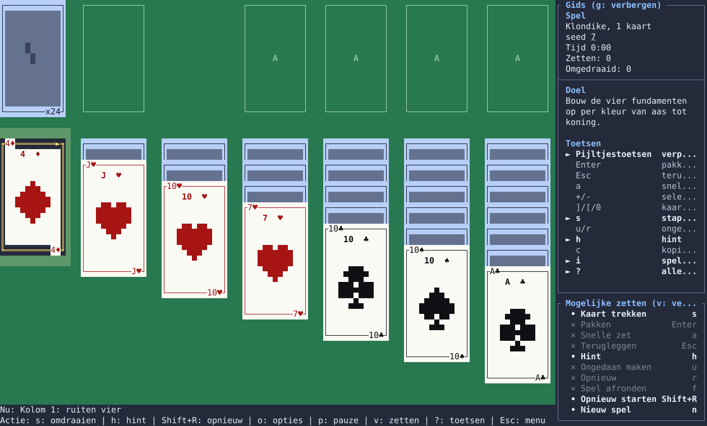

[English](../en/index.md) · [Polski](../pl/index.md) · [Deutsch](../de/index.md) · [Español](../es/index.md) · [Français](../fr/index.md) · [Italiano](../it/index.md) · **Nederlands** · [Português (Brasil)](../pt-br/index.md) · [Українська](../uk/index.md)

# oXySol

Veertien solitairespellen voor je terminal: **Klondike, Spider, FreeCell, Piramide, de Yukon-familie en Golf** in één programma, `oxysol`.
Het werkt in elke moderne terminal en je speelt het met het toetsenbord of de muis.

**Status:** voorlopige versie, in ontwikkeling.

## Downloaden

**Nieuwste versie:** [{{VERSION}}]({{RELEASE_URL}}). Dat is de nieuwste versie, voorlopige versies inbegrepen.
Alle versies staan op de [releasepagina](https://github.com/beoArcha/oXyFlow.Solitaire/releases).

- [Download een kant-en-klare versie of bouw het programma vanuit de broncode](install.md) op Windows, Linux of macOS.
- [Functies](features.md): uitgekozen verdelingen per moeilijkheidsgraad, hints, slechtziendheid en kleurenzicht, kaartstijlen, statistieken en talen.
- [Schermafbeeldingen en animaties](gallery.md) van alle spellen en schermen.

Broncode en meldingen: [beoArcha/oXyFlow.Solitaire](https://github.com/beoArcha/oXyFlow.Solitaire).
De regels van de spellen staan in de
[wiki](https://github.com/beoArcha/oXyFlow.Solitaire/tree/main/docs/wiki/rules) (in het Engels).
