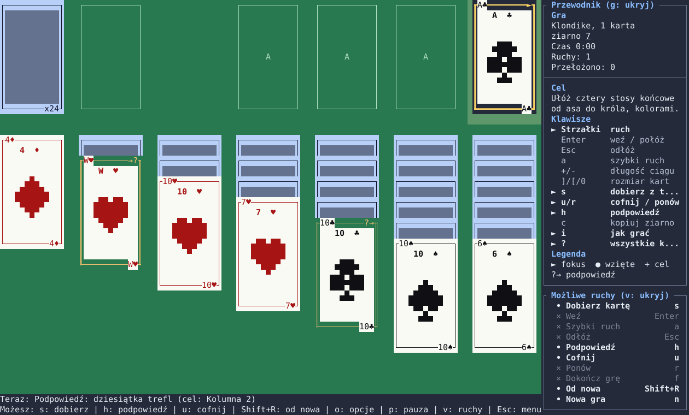
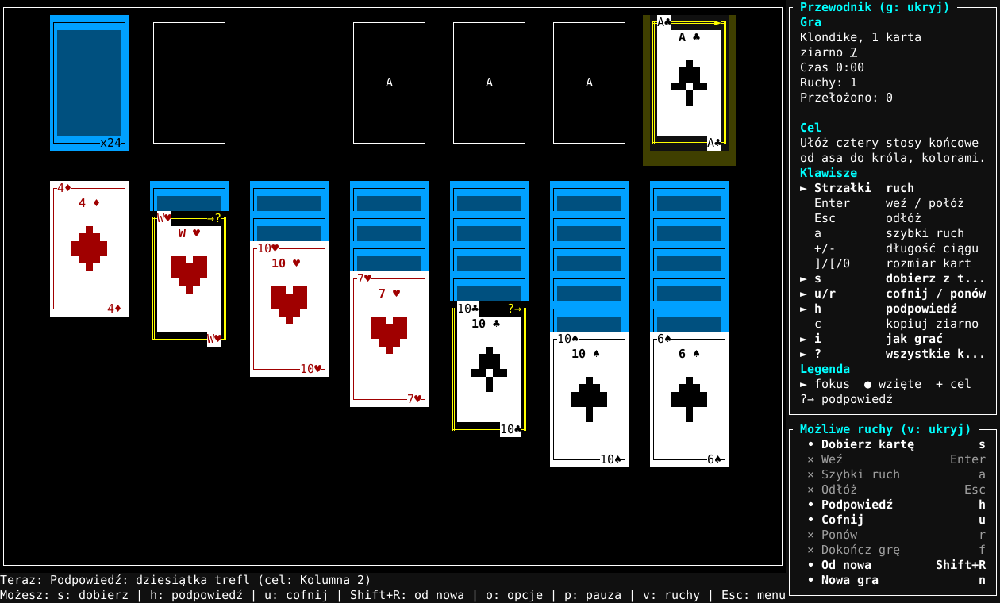
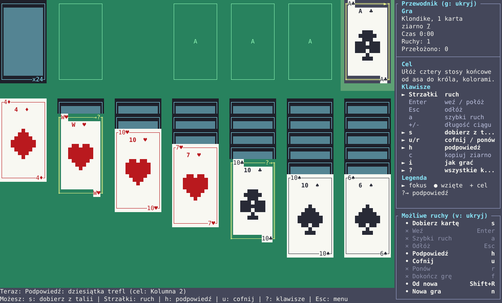

[English](../features.md) · **Polski**

# Funkcje

## Cztery gry

- **Klondike**: 1 karta lub 3 karty.
- **Pająk**: 1, 2 lub 4 kolory.
- **FreeCell**.
- **Piramida**: swobodna lub klasyczna.

Jeden program, jedno menu, jeden zestaw klawiszy.

## Klawiatura i mysz

Każdą czynność wykonasz klawiaturą i myszą. Kliknij kartę, aby ją wziąć, i kliknij cel, aby ją położyć. Dwukrotne
kliknięcie wysyła kartę na stos końcowy, przeciągnięcie przenosi kartę na cel, a prawy przycisk odkłada ją z powrotem.
Pełna lista klawiszy jest w oknie pomocy (`?`).

## Pomoc w trakcie gry

- **Panel przewodnika** (`g`): cel gry, klawisze i to, co może zrobić zaznaczona karta. Przy planszy stoi na terminalach
  szerokich na co najmniej 130 kolumn, a na węższych otwiera się w oknie.
- **Panel możliwych ruchów** (`v`): każdy ruch, który możesz teraz wykonać, razem z jego klawiszem.
- **Podpowiedzi** (`h`): gra zaznacza ruch na planszy i go nazywa.
- **Automatyczne kończenie**: gdy wygrana jest pewna, pozostałe ruchy wykonują się same. Można to wyłączyć
  w Ustawieniach.
- **Cofnij i ponów** (`u`, `r`), z opcją gry bez cofania.

## Ziarna, rozdania do wygrania, statystyki

Każde rozdanie ma **ziarno**. Skopiuj je (`c`), aby zagrać to samo rozdanie jeszcze raz lub podać je dalej, albo
zacznij grę z dowolnego ziarna przez „Nowa gra z ziarna”. Opcja sprawia, że nowa gra szuka rozdania, o którym
udowodniono, że da się je wygrać. Ekran **statystyk** pokazuje wyniki dla każdej gry oraz historię wszystkich
rozdań, od najnowszego, i pozwala zagrać dane ziarno ponownie.

## Motywy dla wygody i dostępności

Pięć motywów, wybieranych w Ustawieniach. Każdy z nich widać tu na tym samym układzie kart.

**Ciemny** i **Jasny** na co dzień.

**Wysoki kontrast** powstał dla osób słabowidzących: biały tekst na czarnym tle z jaskrawymi żółtymi i
turkusowymi akcentami, ramka wokół pola gry oraz kontrast tekstu co najmniej 7:1 (pozostałe motywy trzymają co
najmniej 4,5:1; sprawdzają to testy).

**Monokai** i **Dracula** też są dostępne.

**Barwa nigdy nie jest jedynym nośnikiem informacji.** Znak koloru karty (♠ ♥ ♦ ♣) stoi obok figury, więc barwy nie
trzeba odróżniać; zaznaczony element ma swój symbol, wzięte karty i cele mają własne oznaczenia, a wiersz pod planszą mówi słowami,
gdzie jest kursor i co może zrobić. Gra pozostaje użyteczna dla osób z zaburzeniami widzenia barw. Specjalne tryby
widzenia barw są w planach; w grze jeszcze ich nie ma.

## Języki

oXySol mówi po **angielsku** i **polsku**. Język zmienisz w Ustawieniach; działa od razu. Kolejne języki mogą
się pojawić.

## Czego jeszcze brakuje

oXySol jest w wersji przedpremierowej. Spodziewaj się niedociągnięć i zgłaszaj je w
[systemie zgłoszeń](https://github.com/beoArcha/oXyFlow.Solitare/issues).
