[English](../gallery.md) · **Polski**

# Zrzuty ekranu i animacje

Każdy obraz na tej stronie powstał z prawdziwej gry za pomocą `cargo xtask screenshots`, więc pokazuje to, co
rysuje program.

## Gry

### Klondike

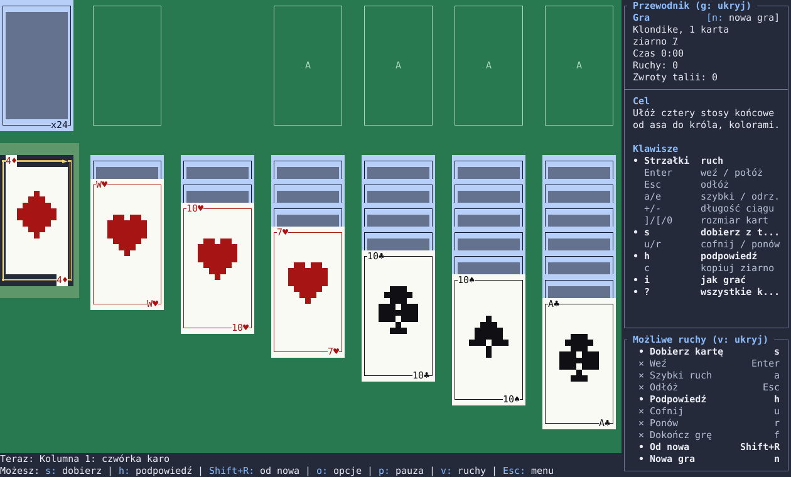

### Pająk

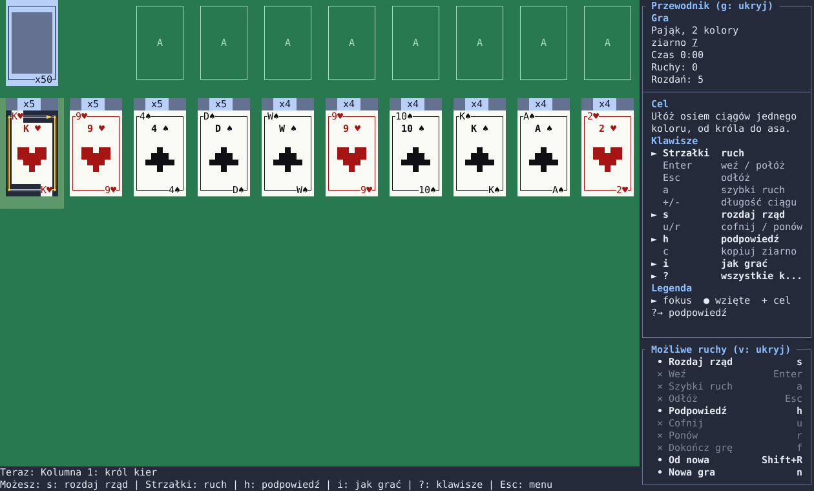

### FreeCell

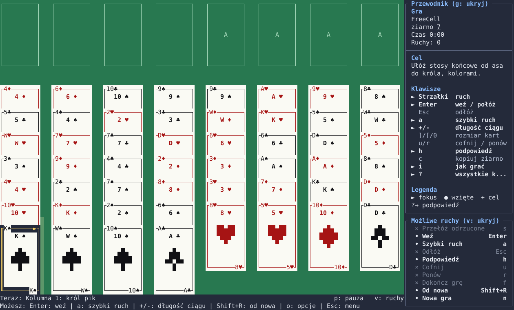

### Piramida

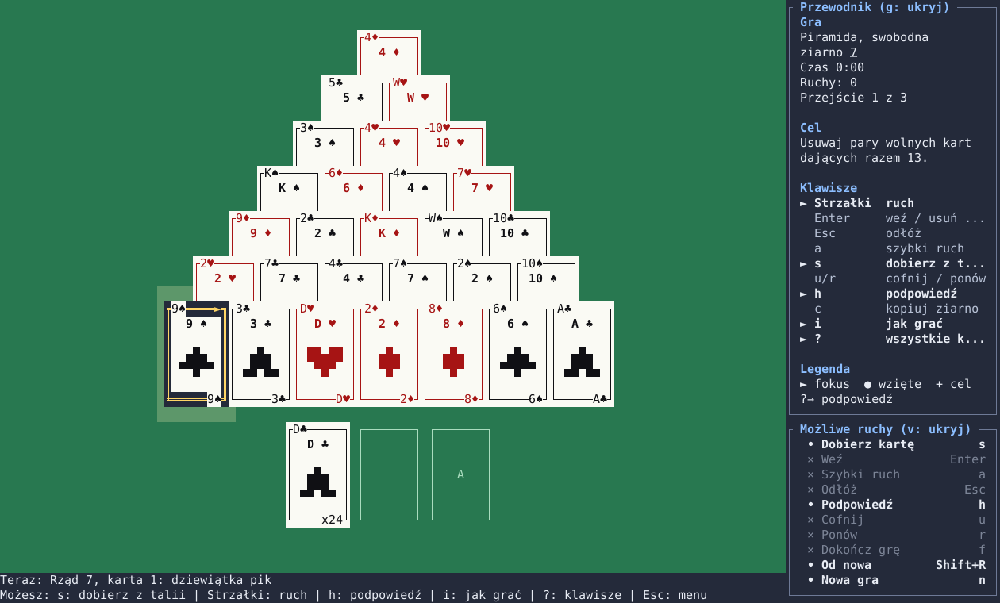

## Ekrany

### Menu główne

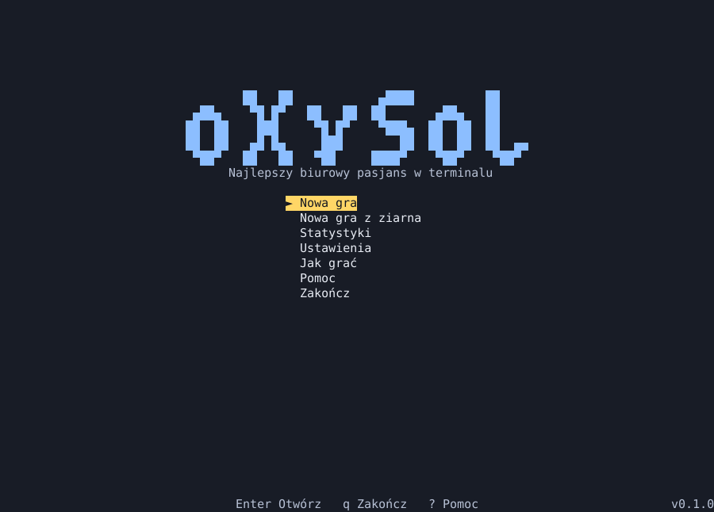

### Ustawienia

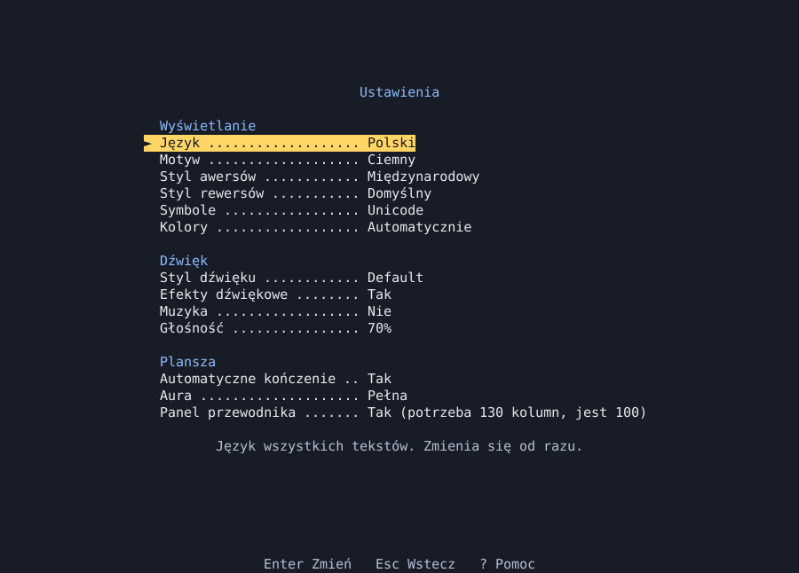

### Pomoc

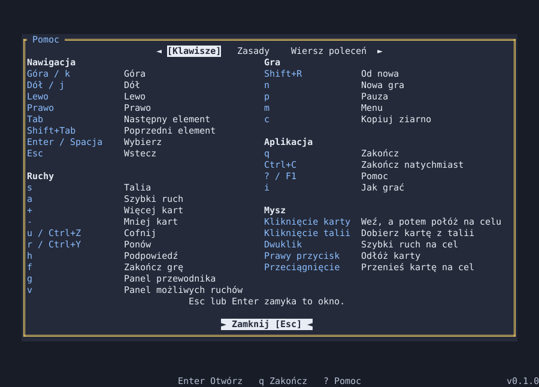

### Podpowiedzi i panel przewodnika

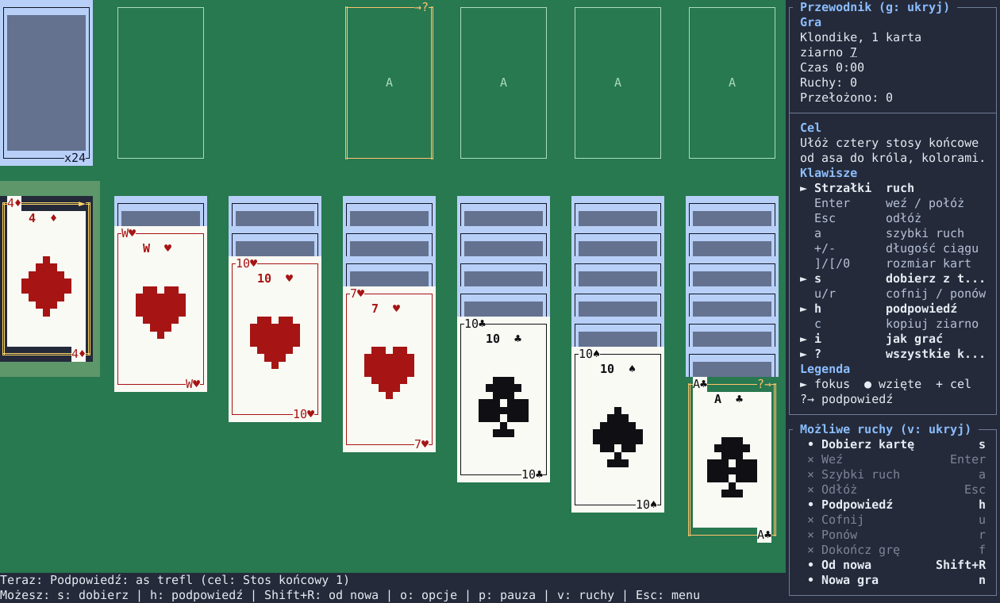

## Animacje

### Ruch


### Automatyczne kończenie


### Wygrana

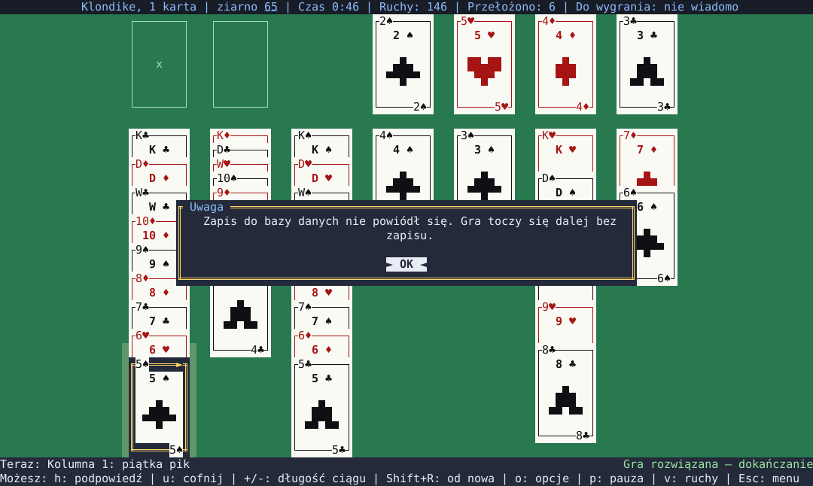

Jeśli system prosi o ograniczenie ruchu, animacje pokazują ostatnią klatkę zamiast się poruszać.

## Motywy

Pięć motywów jest na [stronie funkcji](features.md#motywy-dla-wygody-i-dostępności).
