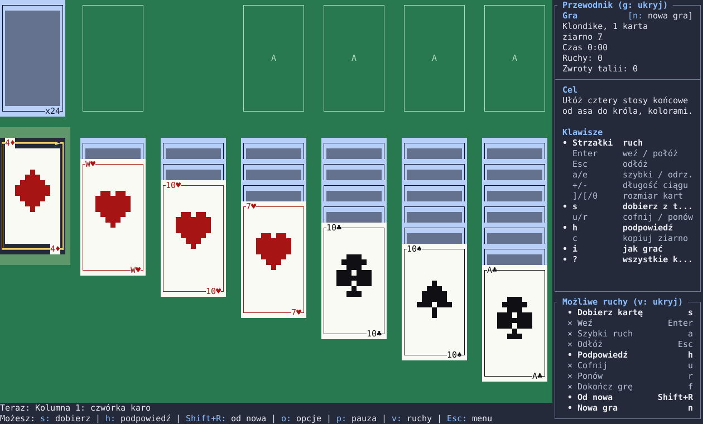

[English](../en/index.md) · **Polski** · [Deutsch](../de/index.md) · [Español](../es/index.md) · [Français](../fr/index.md) · [Italiano](../it/index.md) · [Nederlands](../nl/index.md) · [Português (Brasil)](../pt-br/index.md) · [Українська](../uk/index.md)

# oXySol

Czternaście gier pasjansa w terminalu: **Klondike, Pająk, FreeCell, Piramida, rodzina Yukon i Golf** w jednym programie, `oxysol`.
Działa w każdym nowoczesnym terminalu, a grać można klawiaturą lub myszą.

**Stan:** wersja przedpremierowa, w trakcie tworzenia.

## Pobierz

**Najnowsza wersja:** [{{VERSION}}]({{RELEASE_URL}}). To najnowsza wersja, łącznie z przedpremierowymi.
Wszystkie wersje są na [stronie wydań](https://github.com/beoArcha/oXyFlow.Solitaire/releases).

- [Pobierz gotową wersję albo zbuduj program ze źródeł](install.md) w systemie Windows, Linux lub macOS.
- [Funkcje](features.md): wyselekcjonowane rozdania według trudności, podpowiedzi, tryb słabowidzący i widzenie barw, style kart, statystyki i języki.
- [Zrzuty ekranu i animacje](gallery.md) wszystkich gier i ekranów.

Kod źródłowy i zgłoszenia: [beoArcha/oXyFlow.Solitaire](https://github.com/beoArcha/oXyFlow.Solitaire).
Zasady gier są w
[wiki](https://github.com/beoArcha/oXyFlow.Solitaire/tree/main/docs/wiki/rules) (po angielsku).
