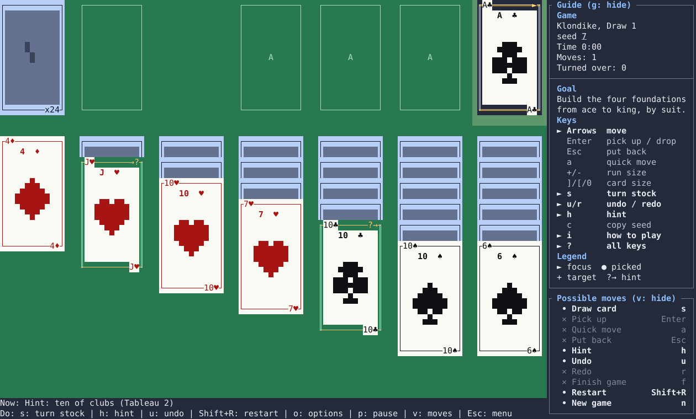
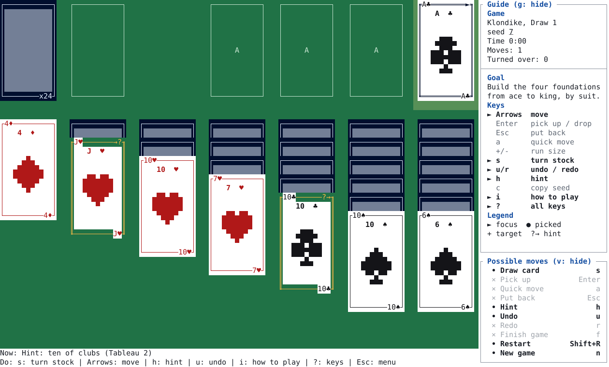
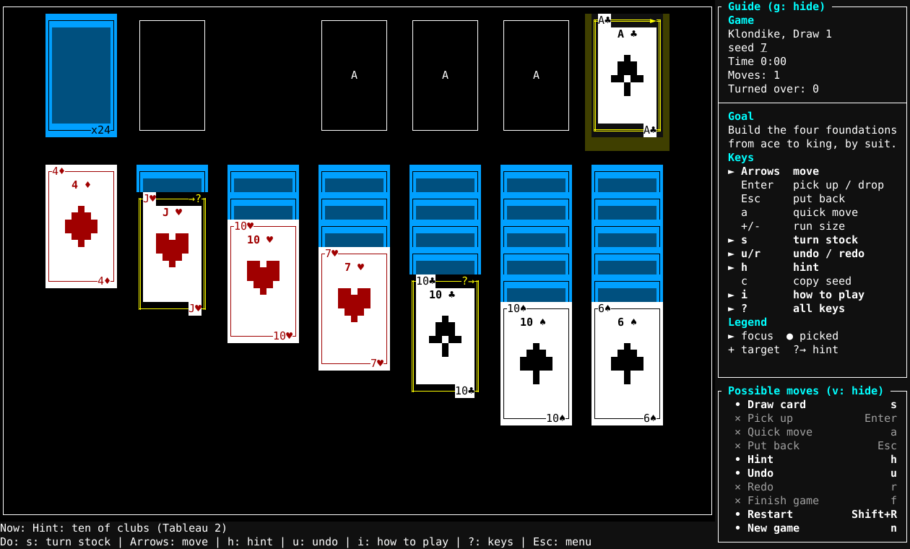
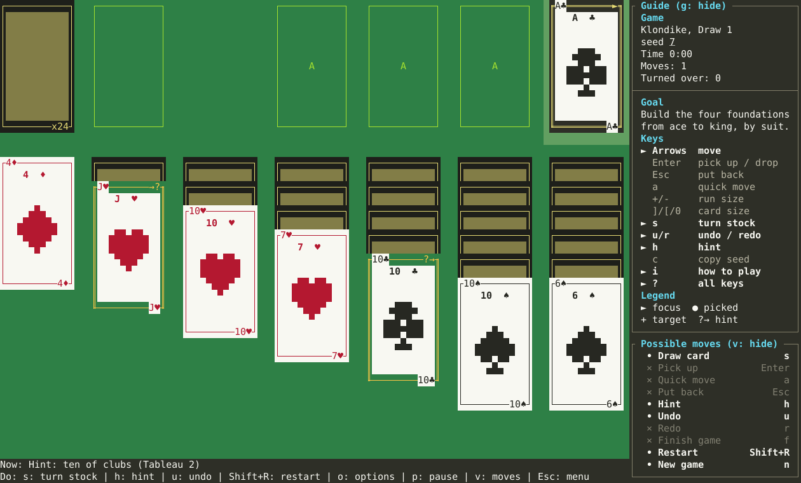
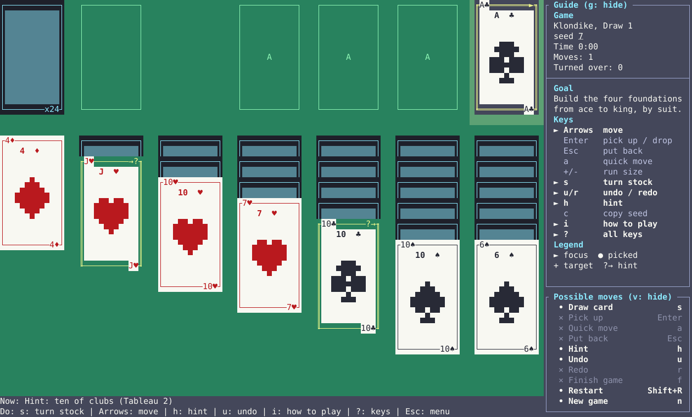

[English](../features.md) · [Polski](../pl/features.md) · [Deutsch](../de/features.md) · [Español](../es/features.md) · [Français](../fr/features.md) · [Italiano](../it/features.md) · [Nederlands](../nl/features.md) · **Português (Brasil)** · [Українська](../uk/features.md)

# Recursos

> **Observação:** hoje a interface do jogo está disponível em inglês e em polonês; alemão, francês, italiano,
> português do Brasil, ucraniano, holandês e espanhol estão em andamento. As capturas de tela mostram a versão em
> inglês. Por isso os nomes dos menus também aparecem aqui em inglês, entre parênteses.

## Quatro jogos

- **Klondike**: virando 1 ou 3 cartas.
- **Spider**: com 1, 2 ou 4 naipes.
- **FreeCell**.
- **Pirâmide**: relaxada ou clássica.

Um programa, um menu, as mesmas teclas para tudo.

## Teclado e mouse

Toda ação funciona com o teclado e com o mouse. Clique em uma carta para pegá-la e clique em um destino para soltá-la.
Um clique duplo envia uma carta para uma fundação, dá para arrastar uma carta até o destino, e o botão direito a
devolve ao lugar. A lista completa de teclas está na janela de ajuda (`?`).

## Tamanho das cartas

`]` aumenta as cartas e `[` as diminui; `0` volta ao tamanho automático, que se ajusta à janela. Ctrl+roda do mouse e a
configuração Tamanho das cartas (Card size) fazem o mesmo. Um tamanho que não cabe na janela diminui sozinho. No console
clássico do Windows, Ctrl+Mais, Ctrl+Menos e Ctrl+0 mudam o tamanho da fonte do console.

## Ajuda durante o jogo

- **Painel do guia** (`g`): o objetivo do jogo, as teclas e o que a carta selecionada pode fazer. Ele fica ao lado da
  mesa em terminais com pelo menos 130 colunas e abre em uma janela nos mais estreitos.
- **Painel de jogadas possíveis** (`v`): todas as jogadas que você pode fazer agora, cada uma com sua tecla.
- **Dicas** (`h`): o jogo marca uma jogada na mesa e diz qual é.
- **Finalização automática**: quando a vitória é certa, o próprio jogo faz as jogadas restantes. Dá para desligar
  isso nas Configurações (Settings).
- **Desfazer e refazer** (`u`, `r`), com a opção de jogar sem desfazer.

## Sementes, partidas vencíveis, estatísticas

Cada partida tem uma **semente** (seed). Copie-a (`c`) para jogar de novo ou compartilhar uma partida, ou comece um
jogo a partir de qualquer semente com “Novo jogo a partir de semente” (New game from seed). Uma opção faz o novo jogo
procurar uma distribuição que comprovadamente pode ser vencida. A tela de **estatísticas** mostra os resultados de cada
jogo e o histórico de todas as partidas, da mais recente para a mais antiga, e permite jogar uma semente de novo.

## Temas para conforto e acessibilidade

Cinco temas, escolhidos nas Configurações. Cada um aparece aqui na mesma posição.

**Dark** (escuro) e **Light** (claro) para o dia a dia.

**High contrast** (alto contraste) foi feito para pessoas com baixa visão: texto branco sobre preto puro com detalhes
em amarelo vivo e ciano, uma moldura em volta da área de jogo e contraste de texto de pelo menos 7:1 (os outros temas
mantêm pelo menos 4,5:1; testes verificam os dois valores).

**Monokai** e **Dracula** também estão disponíveis.

**A cor nunca é a única portadora de informação.** Os naipes aparecem como símbolos (♠ ♥ ♦ ♣) ao lado do valor, o
item selecionado é marcado com um símbolo, cartas pegas e destinos têm marcas próprias, e uma linha abaixo da mesa diz
em palavras onde está o cursor e o que ele pode fazer. O jogo continua jogável para pessoas daltônicas. Modos
específicos para daltonismo estão planejados, mas ainda não estão no jogo.

## Idiomas

Hoje a interface do jogo está disponível em **inglês** e em **polonês**; alemão, francês, italiano, português do
Brasil, ucraniano, holandês e espanhol estão em andamento. Escolha o idioma no seletor com bandeiras, no canto
superior esquerdo do menu principal, ou nas Configurações; a mudança vale na hora.

Este site está disponível em nove idiomas: os links no topo de cada página alternam entre eles.

## O que ainda não é

O oXySol é uma versão de pré-lançamento. Espere algumas arestas e conte para nós no
[rastreador de problemas](https://github.com/beoArcha/oXyFlow.Solitare/issues).
