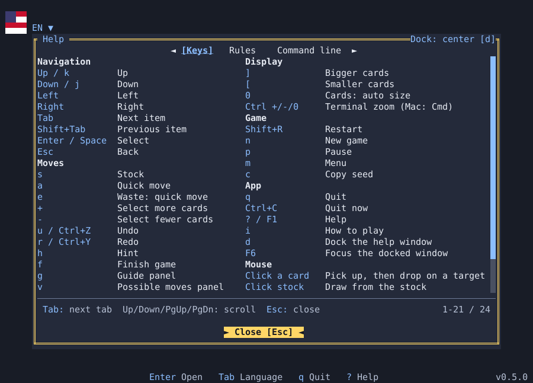

[English](../gallery.md) · [Polski](../pl/gallery.md) · [Deutsch](../de/gallery.md) · [Español](../es/gallery.md) · [Français](../fr/gallery.md) · [Italiano](../it/gallery.md) · [Nederlands](../nl/gallery.md) · **Português (Brasil)** · [Українська](../uk/gallery.md)

# Capturas de tela e animações

> **Observação:** hoje a interface do jogo está disponível em inglês e em polonês; alemão, francês, italiano,
> português do Brasil, ucraniano, holandês e espanhol estão em andamento. As capturas de tela mostram a versão em
> inglês.

Todas as imagens desta página são geradas a partir do jogo de verdade por `cargo xtask screenshots`, então mostram
o que o programa desenha.

## Jogos

### Klondike

### Spider

### FreeCell

### Pirâmide

## Telas

### Menu principal

### Configurações

### Ajuda

### Dicas e o painel do guia

## Animações

### Uma jogada

### Finalização automática

### Uma vitória

Se o seu sistema pede movimento reduzido, as animações mostram o último quadro em vez de se mover.

## Temas

Os cinco temas estão na [página de recursos](features.md#temas-para-conforto-e-acessibilidade).
