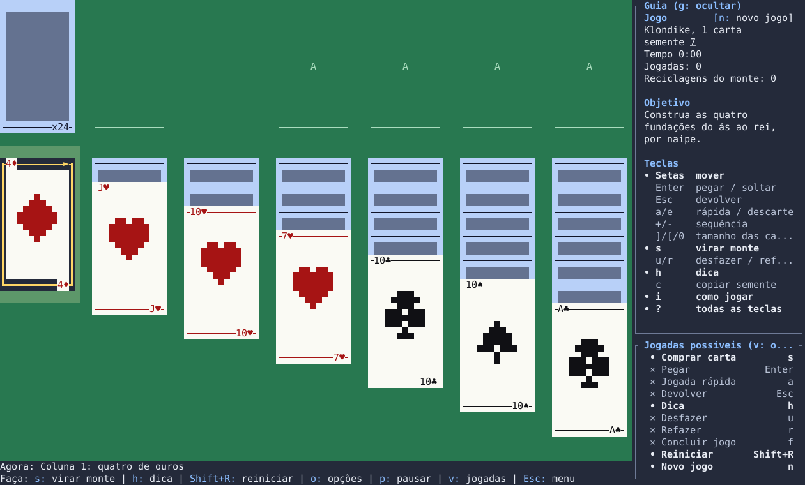

[English](../en/index.md) · [Polski](../pl/index.md) · [Deutsch](../de/index.md) · [Español](../es/index.md) · [Français](../fr/index.md) · [Italiano](../it/index.md) · [Nederlands](../nl/index.md) · **Português (Brasil)** · [Українська](../uk/index.md)

# oXySol

Quatorze jogos de paciência para o terminal: **Klondike, Spider, FreeCell, Pirâmide, a família Yukon e Golf** em um único programa, `oxysol`.
Funciona em qualquer terminal moderno e pode ser jogado com teclado ou mouse.

**Situação:** versão de pré-lançamento, em desenvolvimento.

## Baixe

**Versão mais recente:** [{{VERSION}}]({{RELEASE_URL}}). É a versão mais nova, incluindo as de pré-lançamento.
Todas as versões estão na [página de lançamentos](https://github.com/beoArcha/oXyFlow.Solitaire/releases).

- [Baixe uma versão pronta ou compile a partir do código-fonte](install.md) no Windows, Linux ou macOS.
- [Recursos](features.md): partidas selecionadas por dificuldade, dicas, baixa visão e visão de cores, estilos de carta, estatísticas e idiomas.
- [Capturas de tela e animações](gallery.md) de todos os jogos e telas.

Código-fonte e relatos de problemas: [beoArcha/oXyFlow.Solitaire](https://github.com/beoArcha/oXyFlow.Solitaire).
As regras dos jogos estão na
[wiki](https://github.com/beoArcha/oXyFlow.Solitaire/tree/main/docs/wiki/rules) (em inglês).
