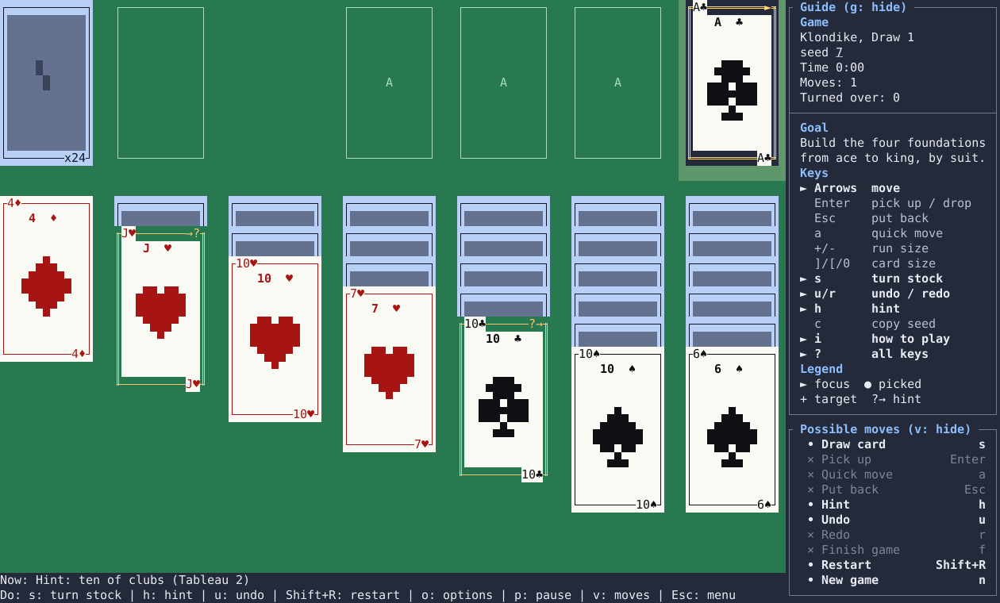
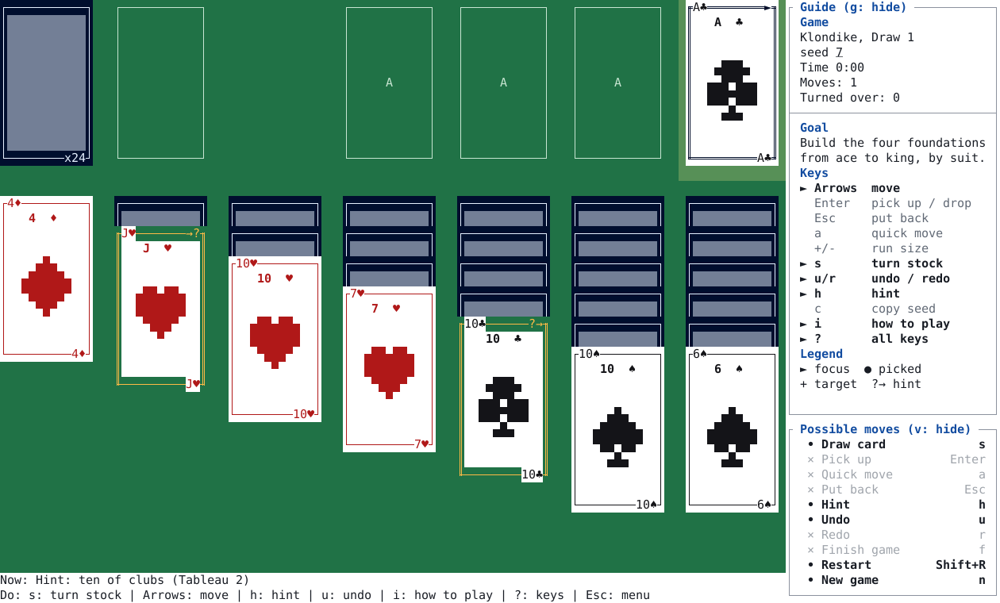
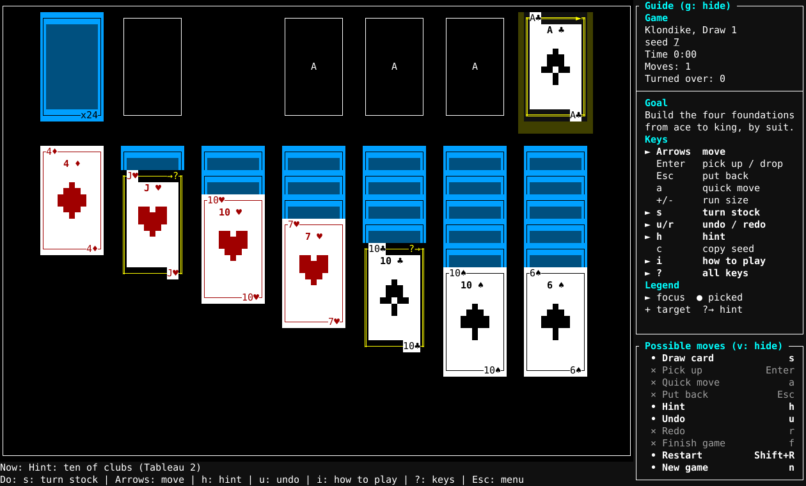
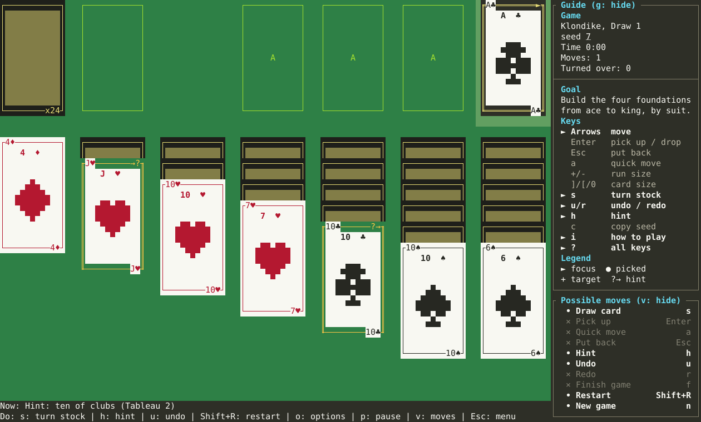
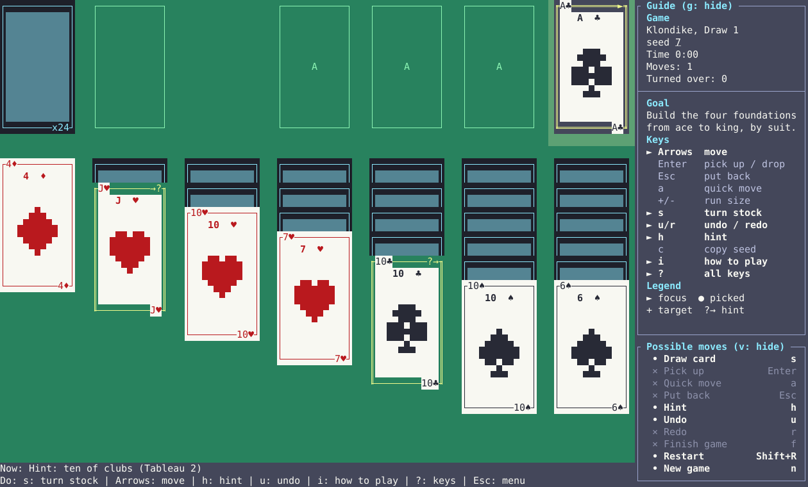

[English](../features.md) · [Polski](../pl/features.md) · [Deutsch](../de/features.md) · [Español](../es/features.md) · [Français](../fr/features.md) · [Italiano](../it/features.md) · [Nederlands](../nl/features.md) · [Português (Brasil)](../pt-br/features.md) · **Українська**

# Можливості

> **Зверніть увагу:** наразі інтерфейс гри доступний англійською та польською; німецька, французька, італійська,
> бразильська португальська, українська, нідерландська та іспанська версії в роботі. Знімки екрана показують
> англійську версію. Тому назви пунктів меню тут також наведено англійською в дужках.

## Чотири гри

- **Клондайк** (Klondike, «Косинка»): по 1 або по 3 карти з колоди.
- **Павук** (Spider): 1, 2 або 4 масті.
- **FreeCell** («Вільна комірка»).
- **Піраміда** (Pyramid): спрощена або класична.

Одна програма, одне меню, одні й ті самі клавіші.

## Клавіатура та миша

Кожну дію можна виконати і клавіатурою, і мишею. Клацніть карту, щоб узяти її, і клацніть ціль, щоб покласти.
Подвійне клацання відправляє карту в базову стопку, карту можна перетягнути на ціль, а клацання правою кнопкою кладе
її назад. Повний список клавіш є у вікні довідки (`?`).

## Розмір карт

`]` збільшує карти, `[` зменшує; `0` повертає автоматичний розмір, що підлаштовується під вікно. Те саме роблять
Ctrl+коліщатко миші та налаштування «Розмір карт» (Card size). Розмір, який не вміщується у вікно, зменшується сам.
У класичній консолі Windows Ctrl+Плюс, Ctrl+Мінус і Ctrl+0 змінюють розмір шрифту консолі.

## Допомога під час гри

- **Панель посібника** (`g`): мета гри, клавіші та те, що може зробити вибрана карта. Вона стоїть поруч із полем у
  терміналах завширшки щонайменше 130 стовпців, а у вужчих відкривається у вікні.
- **Панель можливих ходів** (`v`): усі ходи, які можна зробити зараз, кожен зі своєю клавішею.
- **Підказки** (`h`): гра позначає хід на полі й називає його.
- **Автозавершення**: коли перемога вже гарантована, решту ходів гра робить сама. Це можна вимкнути в Налаштуваннях
  (Settings).
- **Скасування та повтор** (`u`, `r`), а також можливість грати без скасування ходів.

## Зерна, розклади з гарантованою перемогою, статистика

Кожен розклад має **зерно** (seed). Скопіюйте його (`c`), щоб зіграти розклад ще раз або поділитися ним, чи почніть
гру з будь-якого зерна через «Нова гра із зерна» (New game from seed). Окреме налаштування змушує нову гру шукати
розклад, для якого доведено, що його можна виграти. Екран **статистики** показує результати кожної гри та історію всіх
розкладів, від найновішого, і дає змогу зіграти зерно знову.

## Теми для зручності та доступності

П’ять тем, які вибирають у Налаштуваннях. Кожну з них тут показано на тій самій позиції.

**Dark** (темна) і **Light** (світла) для щоденної гри.

**High contrast** (висока контрастність) створена для людей зі слабким зором: білий текст на чисто чорному тлі з
яскраво-жовтими та бірюзовими акцентами, рамка навколо ігрового поля й контрастність тексту щонайменше 7:1 (інші теми
тримають щонайменше 4,5:1; обидва значення перевіряють тести).

Також доступні **Monokai** і **Dracula**.

**Колір ніколи не єдиний носій інформації.** Масті намальовано знаками (♠ ♥ ♦ ♣) поруч із вартістю карти, вибраний
елемент позначено символом, узяті карти й цілі мають власні позначки, а рядок під полем словами каже, де стоїть курсор
і що він може зробити. Гра залишається зручною для людей із дальтонізмом. Окремі режими для порушень кольоросприйняття
заплановано, але в грі їх поки що немає.

## Мови

Наразі інтерфейс гри доступний **англійською** та **польською**; німецька, французька, італійська, бразильська
португальська, українська, нідерландська та іспанська версії в роботі. Мову можна вибрати перемикачем із прапорцями в
лівому верхньому куті головного меню або в Налаштуваннях; зміна діє відразу.

Цей сайт доступний дев’ятьма мовами: посилання вгорі кожної сторінки перемикають між ними.

## Чого ще немає

oXySol — попередня версія. Можливі шорсткості; повідомляйте про них у
[трекері проблем](https://github.com/beoArcha/oXyFlow.Solitare/issues).
