[English](../gallery.md) · [Polski](../pl/gallery.md) · [Deutsch](../de/gallery.md) · [Español](../es/gallery.md) · [Français](../fr/gallery.md) · [Italiano](../it/gallery.md) · [Nederlands](../nl/gallery.md) · [Português (Brasil)](../pt-br/gallery.md) · **Українська**

# Знімки екрана та анімації

Кожне зображення на цій сторінці створено зі справжньої гри командою `cargo xtask-art screenshots`, тож воно показує те,
що малює програма.

## Ігри

### Клондайк

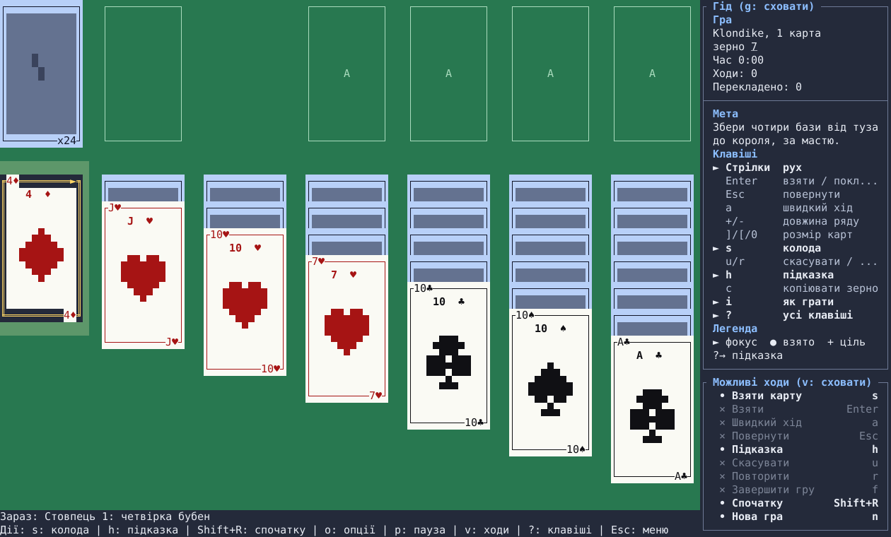

### Павук

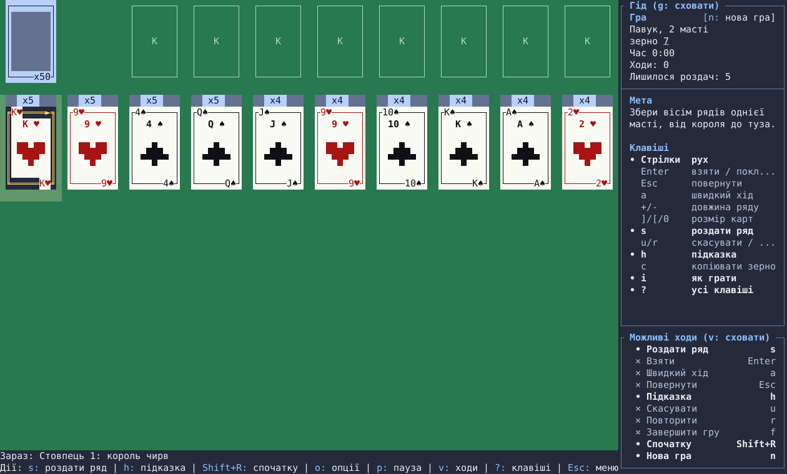

### FreeCell

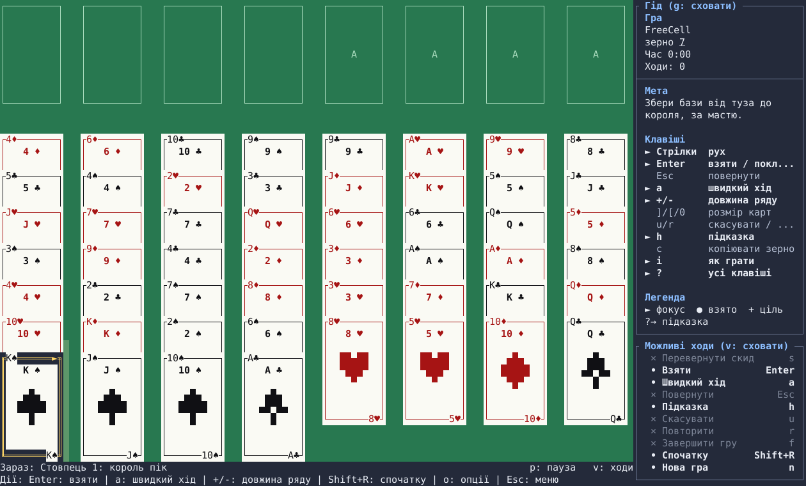

### Піраміда

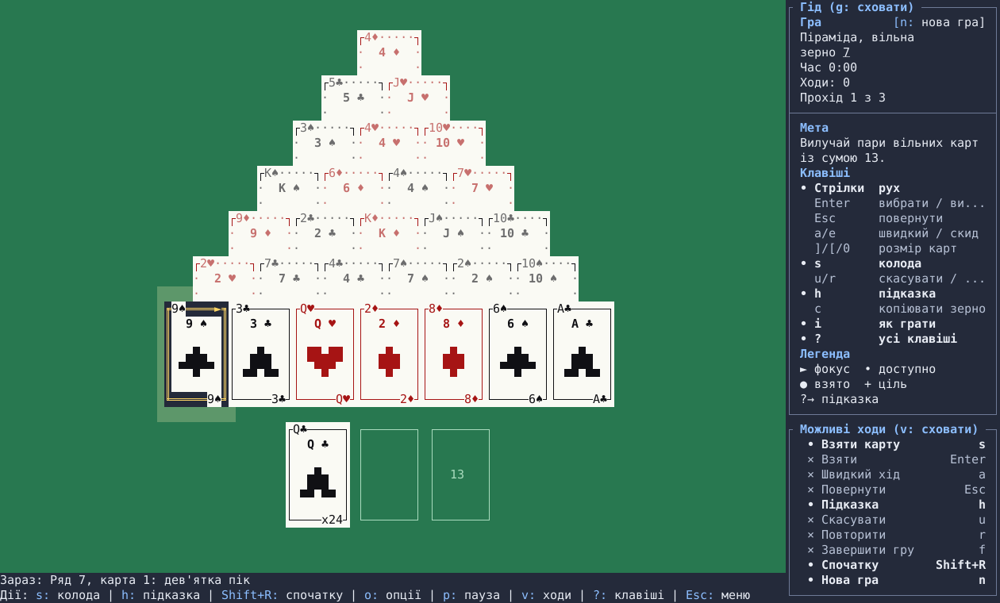

## Екрани

### Головне меню

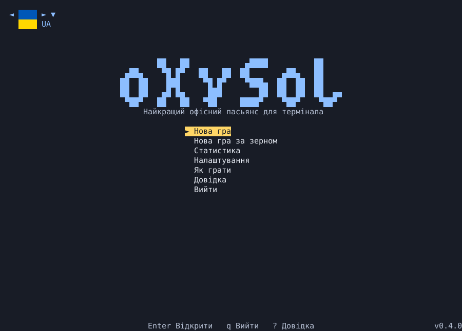

### Налаштування

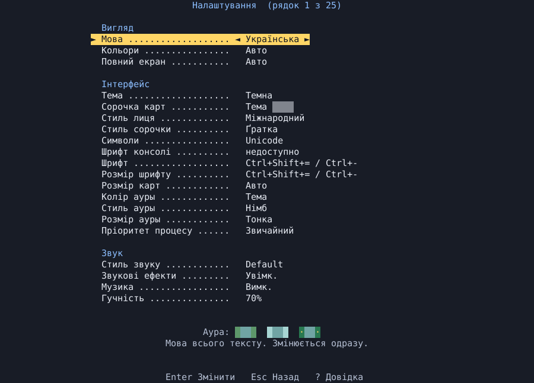

### Довідка

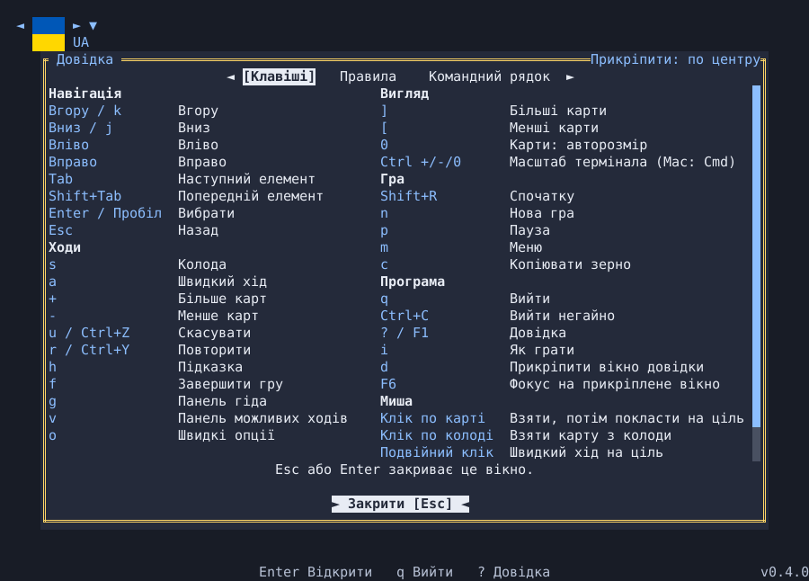

### Підказки та панель посібника

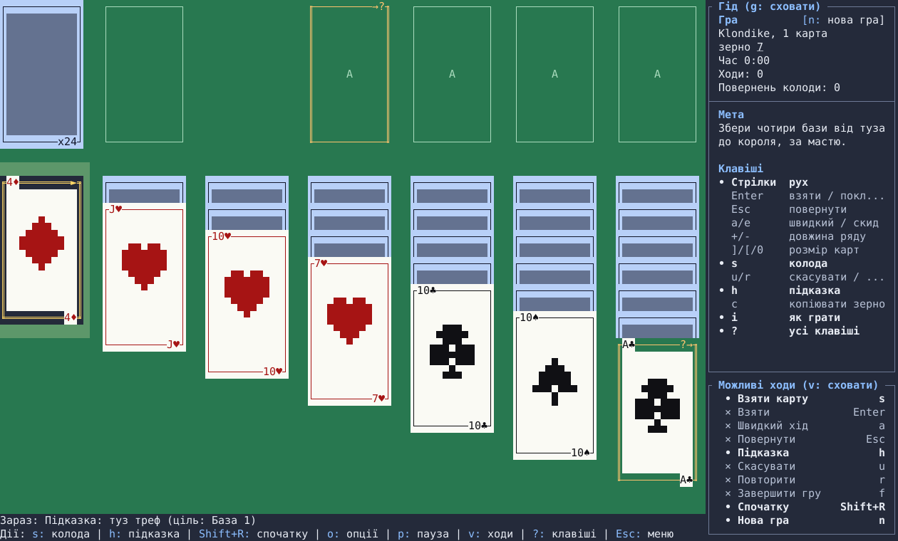

## Анімації

### Хід


### Автозавершення


### Перемога

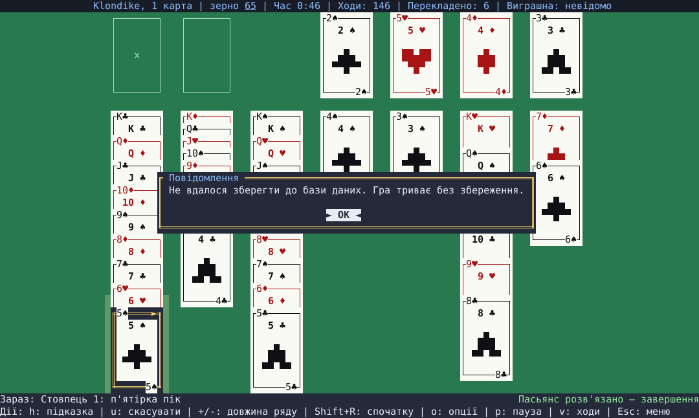

Якщо ваша система просить зменшити рух, анімації показують останній кадр замість руху.

## Теми

П’ять тем показано на [сторінці можливостей](features.md#Теми-для-зручності-та-доступності).
