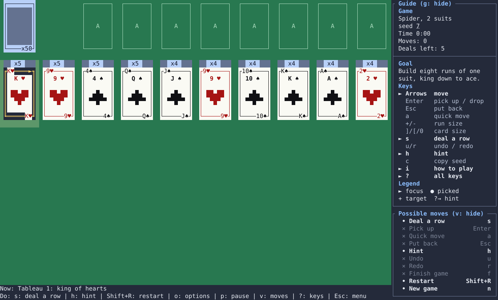
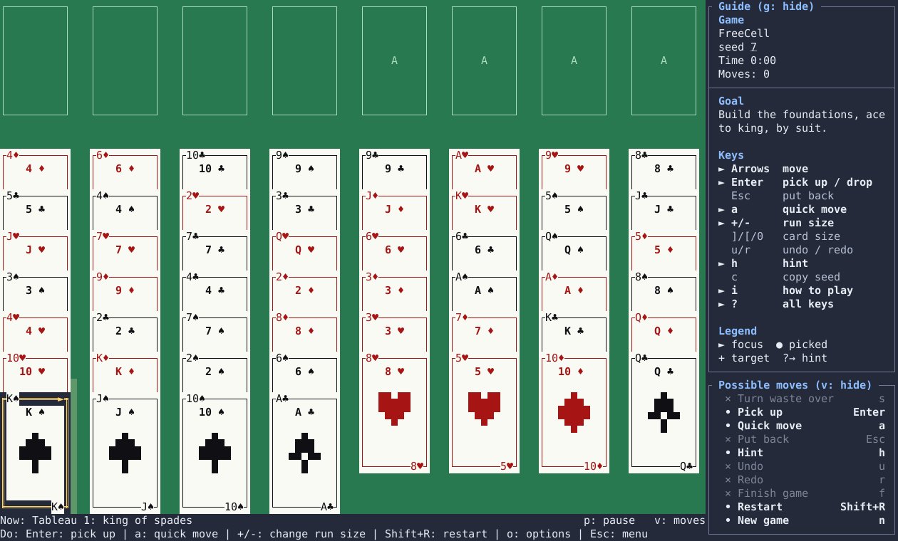
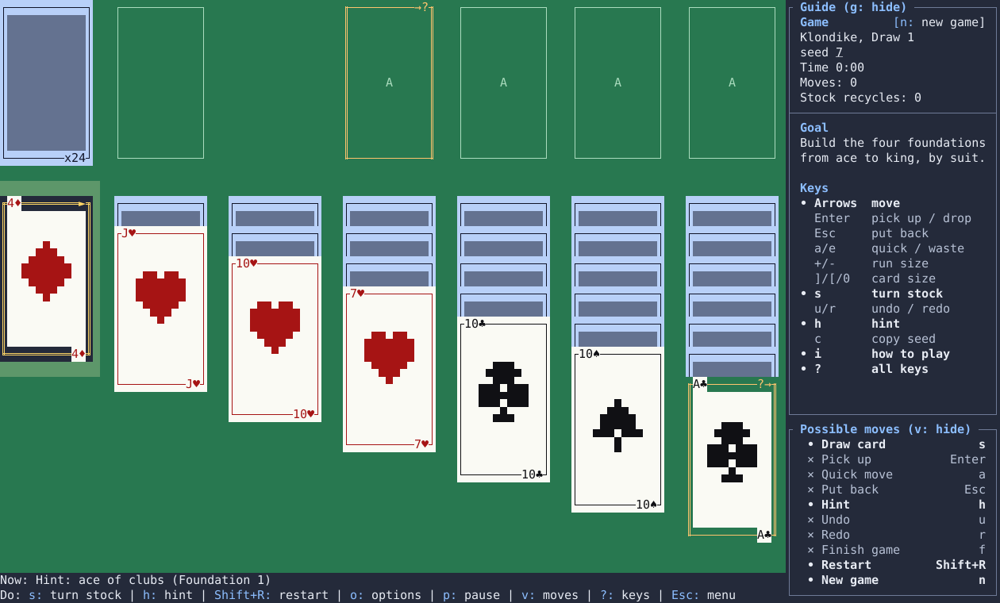

[English](../gallery.md) · [Polski](../pl/gallery.md) · [Deutsch](../de/gallery.md) · [Español](../es/gallery.md) · [Français](../fr/gallery.md) · [Italiano](../it/gallery.md) · [Nederlands](../nl/gallery.md) · [Português (Brasil)](../pt-br/gallery.md) · **Українська**

# Знімки екрана та анімації

> **Зверніть увагу:** наразі інтерфейс гри доступний англійською та польською; німецька, французька, італійська,
> бразильська португальська, українська, нідерландська та іспанська версії в роботі. Знімки екрана показують
> англійську версію.

Кожне зображення на цій сторінці створено зі справжньої гри командою `cargo xtask screenshots`, тож воно показує те,
що малює програма.

## Ігри

### Клондайк

### Павук

### FreeCell

### Піраміда

## Екрани

### Головне меню

### Налаштування

### Довідка

### Підказки та панель посібника

## Анімації

### Хід

### Автозавершення

### Перемога

Якщо ваша система просить зменшити рух, анімації показують останній кадр замість руху.

## Теми

П’ять тем показано на [сторінці можливостей](features.md#Теми-для-зручності-та-доступності).
