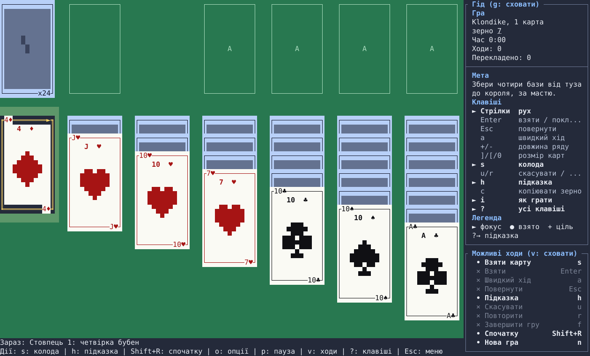

[English](../en/index.md) · [Polski](../pl/index.md) · [Deutsch](../de/index.md) · [Español](../es/index.md) · [Français](../fr/index.md) · [Italiano](../it/index.md) · [Nederlands](../nl/index.md) · [Português (Brasil)](../pt-br/index.md) · **Українська**

# oXySol

Чотирнадцять пасьянсів у терміналі: **Klondike, Павук, FreeCell, Піраміда, родина Юкона і Гольф** в одній програмі, `oxysol`.
Працює в будь-якому сучасному терміналі, грати можна клавіатурою або мишею.

**Стан:** попередня версія, у розробці.

## Завантажити

**Найновіша збірка:** [{{VERSION}}]({{RELEASE_URL}}). Це найсвіжіша збірка, включно з попередніми версіями.
Усі збірки є на [сторінці випусків](https://github.com/beoArcha/oXyFlow.Solitaire/releases).

- [Завантажте готову збірку або зберіть програму з вихідного коду](install.md) у Windows, Linux чи macOS.
- [Можливості](features.md): добрані роздачі за складністю, підказки, слабкий зір і кольоровий зір, стилі карт, статистика та мови.
- [Знімки екрана та анімації](gallery.md) усіх ігор і екранів.

Вихідний код і повідомлення про помилки: [beoArcha/oXyFlow.Solitaire](https://github.com/beoArcha/oXyFlow.Solitaire).
Правила всіх ігор є у
[вікі](https://github.com/beoArcha/oXyFlow.Solitaire/tree/main/docs/wiki/rules) (англійською).
